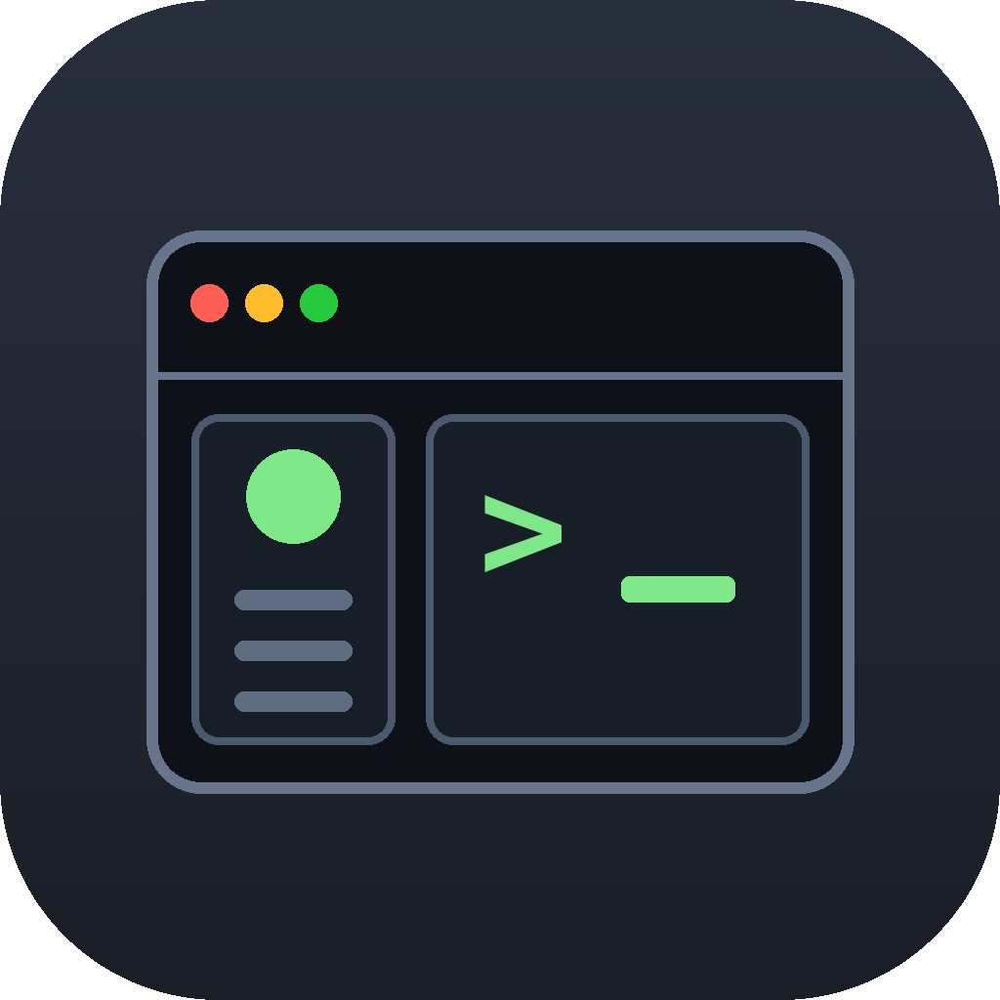

# Cindy Official Plugins

<p align="center">
  <a href="README.md">English</a> · <strong>简体中文</strong>
</p>

<p align="center">
  <a href="LICENSE"></a>
  <a href="https://github.com/makecindy/cindy-official-plugins/actions/workflows/pr-verify.yml"></a>
  <a href="https://github.com/makecindy/cindy-official-plugins/actions/workflows/publish-cindy-plugins-global.yml"></a>
  <a href="CONTRIBUTING.zh-CN.md"></a>
</p>

<p align="center">
  🌐 <a href="https://cindy.cn">中国大陆</a> | <a href="https://cindy.app">国际版</a>
  &nbsp;·&nbsp;
  ⬇️ <a href="https://cindy.cn/#download">下载</a> | <a href="https://cindy.app/#download">Download</a>
</p>

这里是 [Cindy](https://github.com/makecindy/cindy) 插件市场中**全部官方插件
（Ghost）的源码仓库**。

- **正在用 Cindy？** 不需要本仓库——在 Cindy 客户端打开「插件」页，下方已
  全量开放的插件都可以一键安装（标注「定向灰度」的仍在分批放量，暂未对所有
  人开放）。
- **想给 Cindy 写插件？** 本仓库接受外部贡献：国内推包逻辑已移除，PR 合入 `main`
  后会自动将变更包提交到海外 Plugin Platform，审核通过后才对用户可见。从
  [提交你的插件](#提交你的插件)开始。

已安装的市场插件按安装时记录的来源更新。审核通过、安装、能力授权和账号配置是
不同事实；是否自动更新、是否需要确认，以目标 Host 的版本和安装来源为准。请把能力扩张
和运行时行为变更视为线上变更：包内 `ghost.json` 只声明实际必需的最小能力，
遵守 Host 授权及凭证边界；市场摘要不是另一套安装权限门禁。

## 插件列表

|  | 插件 | 目录 | 说明 |
| --- | --- | --- | --- |
|  | Antigravity | [`cindy-antigravity-acp`](./cindy-antigravity-acp) | 通过本机 agy 执行 Cindy 任务，需自备 Google 账号。 |
|  | DeepSeek Harness | [`dsh-acp`](./dsh-acp) | 通过本机 dsh 执行 Cindy 任务，需自备 DeepSeek API Key。 |
|  | Herdr 控制台 | [`cindy-herdr`](./cindy-herdr) | 本机 Herdr 与 tmux 的终端控制台：查看 agent 状态、读取画面、发送输入，并把 blocked/done 事件接成 Cindy 通知与自动化；本机没装 Herdr 也能直接操作 tmux。面向本机终端——管理远程 SSH 机器和工作区用 herdr-bridge；自选安装 |
|  | Art | [`cindy-art`](./cindy-art) | 图片 / 短视频生成，支持基于已生成图片的改图与风格化 |
|  | OpenDesign | [`opendesign-trial`](./opendesign-trial) | 复用 Cindy 会话模型的 HTML 设计稿、固定会话预览、元素批注和手动编辑 |
|  | GitHub | [`cindy-github`](./cindy-github) | GitHub issue / PR / code review / Actions / release 全流程操作 |
|  | GitLab | [`cindy-gitlab`](./cindy-gitlab) | GitLab（gitlab.com 及自建实例）issue / MR / 仓库操作 |
|  | Gitea | [`gitea`](./gitea) | 自建 Gitea 的仓库、文件、issue、PR、Actions 运行与日志、release；写操作需确认；自选安装，需自备实例与 token |
|  | Mermaid | [`cindy-mermaid`](./cindy-mermaid) | Mermaid 图表源码规范化与常见语法修复 |
|  | Cindy Ping | [`cindy-ping`](./cindy-ping) | 可配置桌面表情轮盘，向项目、会话或伙伴投递；仅 macOS 14+；手动安装 |
|  | Notion | [`cindy-notion`](./cindy-notion) | Notion 页面、数据库与知识库读写 |
|  | Web Search | [`cindy-web-search`](./cindy-web-search) | 公网搜索（默认 Cindy AI，可选用户自备 Brave / Tavily / DeepSeek Key），以及使用 Tavily Key 读取用户明确确认的任意公开 HTTP(S) 网页正文 |
|  | 世界银行公开数据 | [`world-bank-open-data`](./world-bank-open-data) | 无需 API Key，查询全球国家、经济、社会与发展指标；定向灰度 |
|  | Gmail | [`google-gmail`](./google-gmail) | 搜索、阅读、整理 Gmail 邮件，生成草稿或发送邮件；授权由宿主托管 |
|  | Google Drive | [`google-drive`](./google-drive) | 搜索、读取、下载、上传、移动和删除云端文件 |
|  | Google Calendar | [`google-calendar`](./google-calendar) | 查询日程与空闲时间，创建或修改会议 |
|  | Google Sheets | [`google-sheets`](./google-sheets) | 列出工作表、读取范围并写入单元格 |
|  | 163 邮箱 | [`163-mail`](./163-mail) | 通过 IMAP/SMTP 搜索、阅读、整理、撰写和发送 163 邮箱邮件 |
|  | iCloud Mail | [`icloud-mail`](./icloud-mail) | Cindy 安全保存 App 专用密码，按需通过 IMAP/SMTP 管理邮件 |
|  | Outlook Mail | [`outlook-mail`](./outlook-mail) | 微软邮箱通过 Host 托管 OAuth 接入 Microsoft Graph；搜索、阅读、草稿、发送和整理；提案阶段，不自动分发 |
|  | QQ 邮箱 | [`qq-mail`](./qq-mail) | Cindy 安全保存授权码，按需通过 IMAP/SMTP 搜索、阅读、整理和发送 |
|  | Yahoo Mail | [`yahoo-mail`](./yahoo-mail) | Cindy 安全保存应用密码，按需通过 IMAP/SMTP 管理和发送邮件 |
|  | TapTap Maker | [`taptap-maker`](./taptap-maker) | 账号连接、项目同步、构建与官方动态工具 |
|  | 设备模拟器 | [`cindy-simulator`](./cindy-simulator) | Cindy 官方设备模拟器（基于开源 Baguette），独立设备、侧边栏实时画面与操作；替代已下线的内置模拟器，市场安装 |
|  | iOS 模拟器 | [`ios-simulator`](./ios-simulator) | Cindy 主机托管的内嵌工作流；主机授权回退时将原始任务和精确设备交给指定外部工作流；定向灰度 |
|  | X Manager | [`x-manager`](./x-manager) | 在 X（Twitter）上搜舆情、发帖——xAI x_search，Grok 订阅 / API key 双通道降级，发帖走 X 官方 API v2；目前定向灰度中 |
|  | ntfy | [`ntfy`](./ntfy) | 通过你自己的 ntfy 服务器向手机或电脑发送推送通知；访问令牌由 Cindy 保管，只发送给对应服务器；自选安装 |
|  | 决策闸门 | [`decision-gate`](./decision-gate) | 按你写的规则开新任务时选模型，并在自动化和例行任务运行前判断要不要跑 |
|  | AgentCompass | [`agentcompass`](./agentcompass) | 把独立工作交给最合适的模型：通过 Cindy 的 quick-text 通道由模型为任务做画像（需要 Cindy 账号），内置 AgentCompass 引擎在这台 Cindy 能运行的模型中选出 harness、模型与档位（仅按能力匹配，不做额度经济，也没有 fast 模式），在父项目目录以 `bypassPermissions`（Claude）/ `full-access`（Codex、Pi）启动普通 Cindy 任务并取回确切结果；自选安装 |

想要的插件不在这里？[提议一个](#提交你的插件)——或者自己写一个提交上来。

## 提交你的插件

从想法到上架的完整路径：

1. **想法**——先对照上表确认不重叠。同一服务商的产品家族（Gmail / Drive /
   Calendar）、同一协议的不同服务商（163 / iCloud / QQ 邮箱）属合理共存，但重复的
   通用能力（如又一个通用网页搜索）不予接受。
2. **对照标准**——准入与受众见
   [`.greptile/rules.md`](.greptile/rules.md#4-新插件准入受众与查重)。符合标准无需
   事先批准，[提案 issue](https://github.com/makecindy/cindy-official-plugins/issues/new?template=new_plugin_proposal.yml)
   纯属可选。`all` 只给多数用户受益且无需自备密钥/账号的插件；有用但小众或需自备
   密钥/账号的按自选接受（`{ "emails": [] }`）。`author` 必须是真实作者。
3. **开发**——在任意 coding Agent 或开发环境中按照
   [工具无关的快速路径](#工具无关的快速路径)操作，不要求 Cindy 专用制作工具。
4. **提交 PR**——标题 `feat(<目录名>): …`；填写初始 `ghost.json.version`
   （存量插件日常修复不再强制手工 bump patch，打包时会自动按 `main` 历史单调递增）；
   补 `provisioning.json` 条目；四语言 locale（`zh-CN` / `en` / `ja` / `ko`）齐全；
   每个 commit 带签名（`git commit -s`，[DCO](./DCO)）。细节见
   [`CONTRIBUTING.zh-CN.md`](./CONTRIBUTING.zh-CN.md)。
5. **审查**——CI 在本仓校验 manifest、交付限制、本地化、provisioning、改动插件单测
   与试打包；自动审查（Greptile + Codex）负责守住安全红线与确认的 P0/P1 缺陷。
   已有插件的常规迭代（L1）在 CI 全绿且自动审查通过后即可直接合并，不把人工实机测试
   作为合并门禁。
6. **提交并上架**——合入 `main` 后，变更包会提交到海外 Plugin Platform 生成待审版本，
   审核通过后才会下发给兼容客户端；拒绝不会影响此前已批准的版本。国内推包逻辑保持移除。

## 审查标准

已发布插件的 ID 变更需要先单独审查
[迁移登记](./docs/plugin-id-migrations.zh-CN.md)，并在改名包发布前完成 Server 与客户端
配套上线。

审查按风险分级执行（完整契约见 [`.greptile/rules.md`](./.greptile/rules.md) 与
[`AGENTS.md`](./AGENTS.md)）：
- **L1 常规迭代（快车道）**：已有插件的 bugfix、性能优化、小功能增强、多语言/图标、
  测试与可追溯依赖维护（尤其由 [`.github/plugin-owners.json`](./.github/plugin-owners.json)
  登记的维护者或插件 Owner 提交且未扩大边界），在 CI 全绿 + Greptile APPROVED +
  Codex 无 P0/P1 时直接合并。
- **L2 边界变更**：新插件入仓、`provisioning.json` 扩大到 `all`、新增/扩大权限、
  凭证、自主域名或子进程，或变更第三方 OAuth scope / 依赖未就绪的宿主授权，需核对边界
  （涉及未获批 OAuth 授权时待平台批准后合并）。
- **L3 仓库基座**：`.github/workflows/**`、`.greptile/**`、`AGENTS.md`、
  `.github/plugin-owners.json`、放宽 `.tests/` 门禁，以及重命名/删除已发布插件，需
  维护者 Approve。

四条安全与设计原则：

1. **默认纯沙箱，授权跟随执行者**：普通插件运行在隔离沙箱中。当前 Agent 工具调用内的
   普通 HTTPS 与 workdir 操作经在途 `callId` 复用既有 Agent 授权，CLI 走已有 Node
   工作进程。仅脱离当前调用的自主 Host 能力（Panel/订阅/scheduler/常驻进程）与随包
   Node Runtime（顶层 `node` 字段、固定入口、最小子进程边界）在 `ghost.json` 声明。
2. **密钥归属明确**：API token 通过宿主 `/secrets` 只写通道保存；Node 插件通过
   `node.secretBindings` 由宿主临时注入，不经过 `main.js`、Agent 参数、日志或 KV。
   已批准的第三方运行时（如 TapTap Maker）可自管凭证，不得复制到 Cindy KV/Secret。
3. **工具描述即契约**：`ghost.json` 中 tool `description` 须与能力、限制、返回值及
   不可逆副作用一致；不可逆外部副作用的失败路径须区分「确定未执行 / 确定已执行 /
   不确定」，不确定态不建议盲目重试。
4. **错误信息说人话**：面向用户的报错要可行动（如 401 提示去哪里填 token），避免裸堆栈。

### 提交 PR 前快速自查

- [ ] 无硬编码密钥；凭证只走 `/secrets` 或 `node.secretBindings`
- [ ] 自主域名、`node` 入口与子进程边界最小化
- [ ] 不可逆外部副作用失败路径区分「未执行 / 已执行 / 不确定」
- [ ] 四语言 locale 通过 `node --test .tests/localization.test.mjs`
- [ ] `ghost.json.version` 未降级（日常 patch 无需手工 bump）；涉及时同步 `provisioning.json` 与 `THIRD-PARTY-LICENSES.txt`
- [ ] 若改动第三方 OAuth scope 或依赖未就绪宿主授权，已在 PR 说明写清状态
- [ ] 每个 commit 带 DCO 签名（`git commit -s`）

完整审查与防熔断契约见 [`.greptile/rules.md`](./.greptile/rules.md)。

## 仓库结构

每个子目录就是一个完整的插件（"意识包"）源码：

```
cindy-github/
├── ghost.json      # 身份卡:插件 id、描述、工具声明、网络与密钥声明
├── main.js         # 入口:沙箱内运行的插件逻辑
├── settings.html   # (可选) 设置页,如粘贴 API token
├── settings.js
└── assets/         # (可选) 图标等静态资源
cindy-art/
├── ghost.json
├── main.js
└── settings.html   # 插件自有的图片/视频模型设置
```

根目录的 `provisioning.json` 按插件声明哪些受众会把它作为内置插件装上。每个插件目录
都有对应条目，因此新增插件时也要同步加一行。

`.tests/` 目录存放插件行为测试；`*.test.mjs` 用 Node 内置 test runner 运行
（`node --test .tests/<文件>.test.mjs`），同时支撑 PR 校验 Workflow 与发布门禁。
验证流程见 [`CONTRIBUTING.zh-CN.md`](./CONTRIBUTING.zh-CN.md)。

官方插件已接入宿主驱动的 `zh-CN / en / ja / ko` locale 资源；语言选择与英文兜底契约见
[`docs/localization.zh-CN.md`](./docs/localization.zh-CN.md)。共享资源覆盖清单层；
自绘设置页正独立迁移到同一套宿主语言契约，运行时报错文案目前仍以中文单语为主。

## 自动提交与审核

已撤回的 Antigravity 个人投稿 ID（`agy-acp`）不参与 Global 提交。

Chrome 扩展使用独立的[商店自动发布流程](./docs/chrome-webstore-publishing.zh-CN.md)：
将更高的扩展版本合入 `main` 后自动提交 Google 审核，通过后自动发布。

**海外推包已启用，国内推包逻辑保持移除。**
[海外 Workflow](./.github/workflows/publish-cindy-plugins-global.yml)
在 `main` push 时提交变更插件，从 `main` 手动触发时提交全部当前插件。
PR 验证和测试包产物与生产推包保持隔离。

恢复 Workflow 不会自动补发维护期间合入的插件。确认海外服务已就绪后，应从 `main`
手动触发一次全量推包，以覆盖这些插件。推包使用 GitHub Actions OIDC
（audience `cindy-plugin`）访问受保护的 Plugin Platform 端点，不允许绕过审核直连
Plugin Server；Platform 创建待审核 release。

审核通过后，兼容客户端会收到该 release；低于 `minCindyVersion` 的客户端会继续收到
已有的最新兼容旧 release（如果存在）。Desktop 信任该 Server 投影，不再追加版本确认。

修改插件内容时不得降低 `ghost.json.version`。日常修复或优化无需手工 bump patch——
`.github/scripts/package-plugin.sh` 会在打包时按 `main` 提交历史自动计算严格递增的
`major.minor.patch` 版本写入 `.cindy` 包；仅需显式提升 minor/major 时再手工修改。

## 本地开发

本仓库的源码、校验与发布契约由以下说明、[`CONTRIBUTING.zh-CN.md`](./CONTRIBUTING.zh-CN.md)、
`.tests/contracts/` 中固定版本的 Cindy Manifest 校验器，以及仓库打包门禁共同组成
正本。无论使用哪一种 Agent 或 harness，写出的文件都遵循同一契约。Cindy Forge 工具
只是可选捷径，不属于插件格式，也不是开发前置条件。

Host API 的参数、能力声明与运行时限制，以目标 Cindy 版本随包的编写参考为准。
选择接口前先读[版本与能力导航](docs/plugin-authoring.zh-CN.md#目标宿主参考与能力导航)；
仓库校验器通过不等于运行时支持。

维护已有插件、v2/v3 字段映射、HTTPS、文件和 Node/CLI 的具体调用见
[插件编写与迁移参考](./docs/plugin-authoring.zh-CN.md)。Agent 可依据这些事实和
现有代码自行完成必要适配，作者不需要另外手工执行迁移清单。
未知能力声明不应阻断插件开发与发布；接受声明不等于运行时授权。即使声明了
`minCindyVersion`，用户仍可能在不适配的客户端直接安装，插件须处理缺失 API，
提供安全降级或明确升级提示，详见参考文档中的能力兼容章节。

新插件使用 `schemaVersion: 3`，并通过 `tools`、`network`、`node`、`notify: true`
等顶层字段直接声明能力；v3 不得再有 `slots`。每个 v3 插件包都必须独立填写
`minCindyVersion`：它应是同时支持这个具体插件所依赖的全部 Host 能力和 Manifest 字段的
第一个已发布的 Cindy 版本（正式稳定版或 Beta 版）。Manifest v3 本身不设置仓库级 Cindy 版本下限。现有 v2 清单
保持原样，直到该插件的实际打包内容发生变化；改动它的 PR
必须同时迁移到 v3。本仓不会只为 schema 变化批量迁移、批量发布现有插件。

直接字段表达插件贡献项和**自主** Host 能力，不是具体命令、域名或路径的预登记清单。
插件工具是否执行由当前 `ghost_call` 的既有 Agent 授权决定；普通 HTTPS 与 workdir
文件操作把 Host 下发的 `callId` 传给 `cindy.fetch` 或 `cindy.fs`。随包代码与 CLI
继续走已有 Node 工作进程，始终需要顶层 `node` 声明。
Host 托管凭证以及脱离该在途调用的使用仍须对应的显式声明。

### 工具无关的快速路径

把下面这段发给任意能够编辑文件、运行命令的 coding Agent 或 harness：

```text
按当前仓库的发布要求和目标 Host 的编写参考，帮我制作一个用于[具体用途]的 Cindy 插件。先读
AGENTS.md 和 docs/plugin-authoring.zh-CN.md，根据任务自行判断所需声明与运行时接口，
按目标 Cindy 版本核对所需 Host API，只确认现有事实无法确定的功能取舍或验证缺口。新建 Manifest v3 插件目录，
不要复制现有 v2 ghost.json。使用仓库校验器检查 Manifest，把目录内容打成 .cindy ZIP
包并返回产物路径。除非我明确要求，否则不要安装插件。
```

先创建最小目录：

```text
my-plugin/
├── ghost.json
├── main.js
└── assets/
    └── icon.png
```

**不要复制本仓现有插件的 `ghost.json`**：仓库会刻意保留尚未发生内容改动的旧 v2
清单。现有源码只能用于参考实现方式。

`ghost.json` 从下面这份最小可运行 Manifest v3 开始：

下面的 `1.2.3` 只是示例；请替换成实际支持当前插件的第一个已发布的 Cindy 版本（正式稳定版或 Beta 版）。

```json
{
  "schemaVersion": 3,
  "minCindyVersion": "1.2.3",
  "id": "my-plugin",
  "name": "My Plugin",
  "description": "给用户看的单句说明。",
  "whenToUse": "当用户需要这个插件提供的能力时使用。",
  "version": "1.0.0",
  "kind": "chip",
  "entry": "main.js",
  "icon": "assets/icon.png",
  "tools": [
    {
      "name": "hello",
      "description": "返回一句问候，用来确认插件已经正常工作。",
      "parameters": { "type": "object", "properties": {} }
    }
  ]
}
```

使用用户提供的图片，或在用户同意后生成图标，不制作或保留纯色色块占位图。
在 `assets/icon.png` 放入真实 PNG；如果暂时没有图标，就同时删除 Manifest 的 `icon`
字段和未使用的 `assets/` 项。禁止打包 Manifest 已声明、包内却不存在的文件。

在 `main.js` 中按 Host 消息契约实现已经声明的工具：

```js
cindy.onHostMessage(async function (message) {
  if (message.type !== 'tool-call' || message.tool !== 'hello') return;

  await cindy.send({
    type: 'tool-result',
    callId: message.callId,
    ok: true,
    result: { message: '插件已经正常工作。' }
  });
});
```

`callId` 只属于当前这一次在途工具调用；插件必须使用相同 `callId` 返回且只返回一个
`tool-result`。普通 HTTPS 与 workdir 文件操作同样把 Host 下发的 `callId` 传给
`cindy.fetch` / `cindy.fs`，沿用 Cindy 现有运行时授权，不需要在 Manifest 中预登记
具体命令、域名或路径。只有插件贡献项或脱离该调用的自主 Host 使用才声明对应顶层能力。
随包 Node 工作进程与托管凭证在调用内也须有各自声明。新建图片/视频生成功能应遵循
[媒体流程](docs/plugin-authoring.zh-CN.md#媒体生成与任务协作)。

在仓库根目录校验 Manifest：

```bash
node scripts/validate-plugin-manifest.mjs ./my-plugin
```

`.cindy` 是普通 ZIP：压缩包根目录必须直接包含 `ghost.json`、`main.js` 和声明的资源，
不能在外层再套一层 `my-plugin/`。本地开发可用下方 Forge 入口或经审查的显式文件清单
打包。提交源码后，PR CI 会提供可下载的验证包；本地复现仓库构建是可选路径：

小二进制（每个插件所有平台合计不超过 10 MiB）可以直接入仓，沿用许可证、来源审查和总包大小规则。
大依赖按需使用[打包时依赖声明机制](docs/binary-dependencies.zh-CN.md)，不提交到 Git。
Python 3.11+ 仅是依赖收集器的构建环境要求，本地复现该步骤才需安装；
不要求作者为了开发插件配置 Python。旧插件保持原工具链。
所有平台进入同一个包，不增加客户端侧依赖下载。

```bash
.github/scripts/package-plugin.sh my-plugin /tmp/my-plugin-1.0.0.cindy
unzip -Z1 /tmp/my-plugin-1.0.0.cindy
```

该脚本使用 `git archive` 归档插件目录、补入固定的仓库法律文件、收集已声明的二进制
依赖并校验产物，刻意不包含
插件目录中未提交和未跟踪的文件。
不要递归压缩插件工作目录，否则本地 `.env`、`.npmrc`、私钥或其他凭证可能进入包中。
若 harness 要打包尚未提交的工作区，必须使用经过审查的显式文件清单。安装或分享前，
检查归档列表只含预期文件、没有外层插件目录，也没有凭证。

用户可以从 Cindy 的本地插件入口导入这个包。如果当前 harness 恰好提供 Cindy Forge
工具，`ghost_forge_scaffold` 可以生成同样的 v3 基线，`ghost_forge_pack` 可以校验并
打包，`ghost_forge_install` 可以在用户明确要求后安装。它们只是可选加速器；源码与
`.cindy` 格式完全相同。Forge 不解析依赖声明，本地需先准备好声明对应的文件。
旧版脚手架可能带占位图，应替换或省略 `icon`，不要提交占位图。打包不等于发布：
官方仓插件走上文的 PR 流程；客户端社区投稿和 `intent: 'publish'` 组织发布是其它目标。
迁移步骤、完整声明示例与 PR 验证包下载见[依赖接入指南](docs/binary-dependencies.zh-CN.md)。

提交到官方仓库前，还必须补充 `provisioning.json` 条目，并在 Manifest 中声明恰好
`zh-CN`、`en`、`ja`、`ko` 四份 locale 文件，完整覆盖插件文案和全部工具描述；随后
按 [`CONTRIBUTING.zh-CN.md`](./CONTRIBUTING.zh-CN.md) 自查。可以先开 PR 从 CI 取得
测试包；自动化测试与 CI 试打包是合并门禁，人工实机测试推荐用于全新插件首发或重大
宿主能力接入，不再作为常规更新的合并硬门禁。

`taptap-maker/vendor/taptap-maker/` 固定随插件分发官方
`@taptap/maker@0.0.42`。升级时应整体替换 npm 包发布内容并同步更新插件版本，
在官方包包含等价修复前，保留以下经审查的 Cindy 兼容补丁：

- `normalizeRemoteProxyExecutionState` 接受 `executed`，保留确定已执行状态
  （最初补丁：`ff54f59`）；新版状态汇总函数也保留该状态，冲突时返回 `unknown`。
- BLACKLISTED 的 `tools/call` 拦截返回 `structuredContent`，包含
  `success: false`、原提示和 `execution_state: "not_executed"`，确保 Cindy
  错误清洗后仍保留执行态。
- BLACKLISTED 的 `tools/list` 保留受限工具列表，并通过 `_meta.maker_access`
  携带原始错误码和提示。Cindy 在发送调用前返回账号受限原因和 `not_executed`，
  不再将其替换为通用的工具不存在提示。
- `user-skills pull` 在任何写入前拒绝项目及客户端 Skill 根路径中的已有符号链接。
- `tools/list`、`resources/read`、`tools/call` 按请求检查账号访问状态，
  不使用启动时的 `accessStatePromise` 缓存；更换 PAT 后无需等待旧 Runtime
  进程过期。每次上述请求增加一次鉴权检查，但不改变上游访问限制策略。
- MAC 失效恢复仅对明确 `not_executed` 的请求重试一次；已执行、未知或未提供状态时不重放。
- Cindy 控制台启动身份包含分发类型和入口路径，不复用同版本独立安装或另一插件的 Runtime。
- Cindy 分发隐藏控制台模型设置入口，不支持自定义 API 配置；识图仅用 Server API，
  服务不可用时直接报错，不回退到其他识图方式。

- 云端 Git 提交超时且无法核实时保留 unknown，禁用盲目重试提示；兼容新旧云端阻塞文本，准确区分云端已提交与本地尚未完成的步骤。
- 画布结果未知的请求保留重发保护，015 自动流程等待超限后暂停；准备及恢复等待阶段也可停止后续，不取消已经提交的远端任务。

除以上补丁和保留的 `LICENSE` 外，vendor 文件必须与官方 npm 包一致。
每次升级都需核对补丁清单和回归测试，不要增加无关的 bundle 手工修改。

历史故障、已被替换的修复及升级验收要求见
[Maker 维护避坑清单](./docs/taptap-maker-maintenance.zh-CN.md)。

插件 2.1.25 将所有动态 Maker 工具、工具发现及长耗时账号操作的请求窗口从 60 秒
调至 120 秒，沿用已有的进度续期及 15 分钟总上限，不新增定时心跳。没有进度的
请求仍可能在 120 秒超时；这不等于无限等待，也不保证大图生成一定能在窗口内完成。

插件 2.1.17 新增 `maker_validate`，通过当前可信工作区和随包 Runtime 做本地 Lua
验证/截图；Cindy Manual 提供流程，不依赖项目 Skill 安装，不自动安装 Runtime、
提交或构建。保留原报告与 Skill 维护告警，区分采集完成和游戏 PASS。

插件 2.1.19 另检查验证证据是否已被 Git 忽略且未跟踪，拒绝不兼容的模式参数，
清理返回值中的 Runtime 结构化路径；大报告返回有大小限制的摘要和完整证据路径。

## 社区

提 PR 前请读 [`CONTRIBUTING.zh-CN.md`](./CONTRIBUTING.zh-CN.md)：其中包含 PR 标题规范、版本
号策略（日常 patch 打包自动递增，无需手工 bump）、本地化检查、内嵌 Node Worker 的重新
构建方式，以及每个 commit 都需要的 [DCO](./DCO) 签名（`git commit -s`）。

参与社区请遵守 [`CODE_OF_CONDUCT.zh-CN.md`](./CODE_OF_CONDUCT.zh-CN.md)。使用问题以及提 issue
需要附上的信息见 [`SUPPORT.zh-CN.md`](./SUPPORT.zh-CN.md)。

安全漏洞请勿通过公开 issue 披露，报告渠道见 [SECURITY.zh-CN.md](./SECURITY.zh-CN.md)。

## License

本仓库代码以 [Apache License 2.0](./LICENSE) 开源。

Copyright 2026 心动网络股份有限公司 (X.D. Network Inc.)，见 [`NOTICE`](./NOTICE)。

打包产物中包含的第三方开源组件，其许可证归属见对应插件目录：

- `qq-mail/THIRD-PARTY-LICENSES.txt` — `node/worker.cjs` 内嵌依赖的完整许可证文本
- `163-mail/THIRD-PARTY-LICENSES.txt` — 同上，163 邮箱插件的内嵌依赖
- `icloud-mail/THIRD-PARTY-LICENSES.txt` — 同上，iCloud Mail 插件的内嵌依赖
- `yahoo-mail/THIRD-PARTY-LICENSES.txt` — 同上，Yahoo Mail 插件的内嵌依赖
- `taptap-maker/vendor/taptap-maker/LICENSE` — vendored `@taptap/maker`（MIT）

Apache-2.0 不授予商标权。本仓库插件是对所连接服务的非官方集成，第三方名称与标志归其
各自所有者所有 —— 见 [`TRADEMARKS.zh-CN.md`](./TRADEMARKS.zh-CN.md)。
