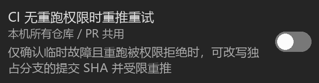

<a href="github-ci-retry-2026-11-13.zh-CN.md">简体中文</a> · <strong>English</strong>

# GitHub CI recovery evidence — 2026-11-13

Environment: Cindy 0.1.136 Beta, Windows 10.0.26100, Node v22.22.3.
Only the isolated `local` GitHub development instance was installed/updated.
The marketplace instance and its preferences were left unchanged.

## Additional real-device check — 1.5.19 / 97d540e

At 2026-11-13 18:09 UTC (2026-11-14 02:09 +08:00), Cindy Forge updated the
existing `_ns__local__cindy-github` instance to 1.5.19, returning
`action: updated`, `enabled: true`, `namespace: local`. This was an explicitly
authorized update, not a marketplace replacement. The tested package source is
97d540e; subsequent changes to this record do not change its packaged content.

- The live settings before and after update were identical:
  `auto_rename:false, auto_follow:true, ci_retry_repush:true`. This was the
  pre-existing value, not an enablement performed by the Agent. Account setup
  remained ready; the marketplace instance was retained.
- The actual iPhone operator opened local test [PR #1](https://github.com/yan-xdt/cindy-official-plugins/pull/1)'s
  settings and checked the retry switch, shared-scope label and SHA description.
  Both Light and Dark were reported complete with no horizontal overflow;
  the preference was left unchanged. This is an on-device human observation,
  not a generated preview, browser-width emulation or Agent screenshot. The
  phone client version was not read; no full-screen/private image was captured
  or uploaded. It does not cover fault-injected unknown-state UI.
- Through the actual installed local plugin, normal rerun of
  [run 43421933262](https://github.com/yan-xdt/cindy-official-plugins/actions/runs/43421933262)
  was accepted. Read-back showed **attempt 3, completed/success**, job
  `controlled-check` 132072958905, with all steps successful. The original PR
  remained closed/unmerged and head remained
  `1296be40f2082aa1e8bc01cb7f5d078beba533a1`; no branch rewrite was attempted.

This is genuine Cindy/mobile display and GitHub normal-rerun evidence, **not**
permission-denied recovery acceptance. Repository metadata confirmed that the
current isolated-repository account has `admin`, `maintain` and `push` access;
it does not supply a real rerun denial. The fixture is an intentional test,
not a diagnosed infrastructure failure. No credentials, permissions, live
preference or production branches were changed to manufacture eligibility.
The real denial → guarded rewrite → original PR new SHA/CI path and disabling
during that recovery remain unverified; their review thread stays open.

## Actual desktop observation: 1.5.14 / 209ef92

The PR card enabled the preference; the live tool returned `true`. The settings
page displayed it checked, then disabled it; the live tool returned `false`.
Clicking Disable on a stale card that still displayed On kept the value false;
the card redrew Off, and refreshing `pr_card` also returned false.
Light/Dark were observed in Cindy. The original light theme and the disabled
development preference were restored. A later foreground activation was refused
by Windows; no input was sent. No further desktop input was attempted after lock.

These are cropped actual screenshots from **1.5.14**, including its older,
longer wording and former per-PR limit. They are not current-version screenshots.
Only the control and its explanation remain; account, task list and chat are
excluded. Image metadata is not retained.

| Actual settings page | Actual PR card |
| --- | --- |
|  |  |
|  |  |

In 1.5.17 the account-settings preference control, KV reads and dedicated
readiness/write messaging were removed. These old settings-page observations
are historical, not a current entry point or an outstanding cold-start test.
The card's persistence and explicit target action paths are unchanged; their
evidence remains applicable. Changed recovery rules need their own evidence.

## Current wording: generated 1.5.16 preview

These images are generated copy/layout previews, **not live Cindy or phone
screenshots**. The explanation stays one sentence; an adjacent scope label says
all repositories/PRs on this computer share the preference. The scope is also
included in the card's accessible name. The four-language card layout is
unchanged in 1.5.17; the plugin account-settings page no longer has this control.

| Generated narrow light | Generated narrow dark |
| --- | --- |
|  |  |

## Verified GitHub normal rerun

Isolated [test PR #1](https://github.com/yan-xdt/cindy-official-plugins/pull/1)
added only a controlled workflow. The first attempt deliberately failed.
The plugin's normal rerun produced
[run 43421933262, attempt 2: success](https://github.com/yan-xdt/cindy-official-plugins/actions/runs/43421933262),
without changing head `1296be40`. The test PR was closed, never merged; its
branch and run are retained. This was a deliberate fixture failure, not a
diagnosis of an infrastructure fault. The owner account has rerun rights, so no
real permission denial or CI-only rewrite occurred.

## Review invariants and signature checks

The scope-disclosure invariant is that every CI-retry choice names its shared
scope before selection, on every PR card. Preference writes still have
one owner: the existing main-page PR queue. The signature invariant is that an
originally signed head never authorizes an unsigned replacement push. The Agent
reads the existing Git configuration; it does not change signing identities,
keys or verification policy to make recovery eligible.

| Observed state/event | Required action |
| --- | --- |
| Signed original, signature invalid/unknown or automatic signing disabled | Stop before budget consumption or amend |
| Signed original, signing readiness unknown/key unavailable/interaction required | Stop; never fall back to unsigned |
| Signed original, existing noninteractive signing succeeds | Verify new signature before push |
| Replacement signature missing/invalid/unknown | Leave it unpushed; report outcome |
| Unsigned original | Apply every existing recovery condition |
| Preference disabled or unreadable before amend/push | No CI-only rewrite/push |

The isolated real Git fixture uses a generated, test-only SSH signing key. It
checks one-off `-S` with automatic signing off, successful verification after a
configured signed amend, unchanged tree, and failure without head movement when
the signing key is unavailable. It does not establish GitHub Verified status or
prove an Agent followed these instructions on a live recovery.

In 1.5.17, quota receipts move to durable user data; observation/trace cache
stays disposable. The gate is the sole receipt writer and exclusively adopts
matching older cache evidence, without overwriting durable receipts. The CLI
fixture verifies that removing or changing the cache cannot reopen the same
failure's budget, and that an older cache receipt cannot replace durable evidence.
Migration cannot recover evidence that had already been deleted before upgrade.

## Preference visibility invariant — 1.5.18

Unknown preference state must never appear as a confirmed Off state. The
existing main-page queue remains the sole preference writer; there is no new
cache, retry or coordinator. Card rendering and Agent tool returns project the
same known/unreadable state. Every preference action uses one final read-back,
including settings other than CI retry; Refresh is read-only.

| Read/write event | Panel/result |
| --- | --- |
| Valid read, CI flag missing or false | Known Off, explicit On action |
| Valid read, CI flag true | Known On, explicit Off action |
| Read failure or malformed root storage | Unknown message and read-only Refresh; no toggle/model choices |
| PUT response unconfirmed, read-back succeeds | Show current values with an unconfirmed-save note; no repeated PUT |
| PUT response unconfirmed, read-back fails | Unknown panel; no claim that authorization is Off or the mutation did not execute |
| Successful PUT, subsequent read fails | Unknown panel rather than optimistic confirmation |
| Refresh recovers | Show the new known state without a write or Agent/Git action |

Three production-entry regression tests failed against 195cfc4 before the fix.
The four required repository suites plus the plugin suite passed together:
306 passed, 19 skipped, 0 failed in 132.1 seconds, on the Windows/Node environment
above. The final focused three-test run also passed, including successful PUT
followed by failed read-back. No new package was installed for this observation.
They cover storage read failure/recovery, malformed JSON root values, enable,
disable and another preference save whose mutation persisted before a thrown
or rejected response, and unavailable read-back. These are simulated-host
regressions, not real Cindy fault injection. The actual unknown-state UI on
desktop/mobile remains unverified; normal known-state copy/layout is unchanged.

## Fixed total invariant — 1.5.19

At most two successful CI-only reservations per immutable PR ID on this computer,
and at most one per stable diagnosis. The gate owns two exclusive durable slots;
it writes each once, never expires, refunds or clears it. This replaces new
per-diagnosis receipt allocation; it adds no lock, scheduler or Git retry.
All new and migrated reservations share the same slot allocator and validator.

| Event / prior history | Expected outcome |
| --- | --- |
| First / second distinct fault | Consume one remaining slot before Git; return its head/diagnosis |
| Third distinct fault | Reject, stop and report regardless of diagnosis |
| Same fault, changed SHA or URL | Reject without consuming another slot |
| Concurrent same / distinct faults | One success per fault; no more than two total successes |
| Earlier cache/durable per-failure receipts | Count all current-PR diagnoses toward two; never overwrite originals |
| More than two older attempts, corrupt/partial/unknown evidence | Fail closed; no reset or new attempt |
| Crash, failed push, cache cleanup or restart | Consumed slots persist; status permits read-back only |

Three new/expanded CLI regressions first failed against 754f1fe. The focused
suite then passed 13 tests, including old receipt migration and concurrent real
Node processes. This is isolated local budget/Git evidence, not the missing
real GitHub permission-denied recovery acceptance. At that CLI-check stage no
1.5.19 live install was performed; the later installation is recorded above.
The four required repository suites plus the plugin suite passed together:
310 passed, 19 skipped, 0 failed in 106.5 seconds (same Windows/Node environment).
The final focused CLI suite passed 13 tests in 5.1 seconds after the status/help
wording update; the Git fixtures remain local, not GitHub recovery evidence.

## Main synchronization — source 1.5.20 (2026-11-14)

Merged main `0410e4862d18b47083aafcb8f381c793a1373b60` into the existing
feature branch. Kept upstream baseline-wait backoff and base-movement handling
alongside the bounded recovery budget. Resolved the manifest/version-test
conflict with source version 1.5.20 and no hard-coded release number in the
authentication contract test. No new retry mechanism or permission was added.

The live local instance remains 1.5.19. Version 1.5.20 was not installed or
tested on the phone. Its main.js and preference UI are unchanged from 1.5.19;
the existing normal-display evidence applies to those unchanged paths. Local
tests of the integrated wait/recovery scripts are separate from live evidence.
The real permission-denied recovery prerequisite below remains unmet.

The four required repository suites plus the GitHub plugin suite passed after
integration: 313 passed, 19 skipped, zero failures in 110.0 seconds on the same
Windows/Node environment. The checks include the inherited baseline-wait
backoff/base-movement cases and the existing recovery-budget/Git fixtures.

## Main copy-link integration — source 1.5.21 (2026-11-14)

Merged main `2bc837d71b785b1ceb5ce178520dd2b1db9aa9cf` into the existing
branch. Retained both the upstream hidden Host-handled PR copy-link button and
all four languages of this PR's unknown-preference/refresh messages. The
header composition change is inherited from main; preference storage, live
reads and bounded recovery behavior are unchanged. Source version is 1.5.21.

The installed local plugin remains 1.5.19. Unlike the earlier 1.5.20 sync,
this integration changes main.js card rendering, so the earlier phone check
does not establish the new header/copy-link behavior. No new installation or
live clipboard/phone verification was performed. Local card regressions are
not claimed as device evidence; the genuine recovery prerequisite remains.

The four required repository suites and plugin suite passed together after
this integration: 314 passed, 19 skipped, zero failures in 107.4 seconds
(Windows/Node environment above), including the inherited copy-link card test
and existing preference/read-back and bounded-recovery regressions.

## Legacy evidence invariant — source 1.5.22 (2026-11-14)

Unknown earlier consumption must remain unknown after cache deletion and
restart. Migration keeps the existing raw receipt filenames and exclusive-copy
operation, but copies before decoding/validation. A missing diagnosis, broken
JSON or invalid diagnosis is preserved durably and still refuses status/new
reservations; no new marker, lock, scheduler or storage mechanism is introduced.
Valid existing durable evidence is never overwritten. A valid other-PR receipt
does not consume this PR's slots; an unreadable/unattributable receipt remains
fail-closed rather than being discarded. The same bounded opaque-ID check is
used by CLI parsing and legacy receipt validation; legacy GitHub base64 IDs
are accepted without inventing or translating a replacement identity.

| Event | Expected result |
| --- | --- |
| Unknown legacy receipt first encountered | Exclusive raw copy, then reject |
| Cache deleted/replaced, process restarted | Durable unknown evidence still rejects |
| Existing durable receipt | Never overwrite from stale cache |
| Verified legacy node ID | Adopt/query/reserve using the exact ID |
| Different PR or diagnosis | Existing per-PR total and per-diagnosis limits apply |

Both new CLI regressions failed against acef06c: all three unknown-evidence
variants failed durability checks, and the legacy ID failed before querying.
These are isolated process/filesystem tests, not real GitHub recovery evidence.
The new version is not installed; local remains 1.5.19 and the inherited 1.5.21
header/copy-link runtime gap above remains. The real recovery prerequisite is
not resolved by this patch.

The focused CLI suite passed 18 tests in 6.2 seconds. The four required
repository suites plus plugin suite passed together: 319 passed, 19 skipped,
zero failures in 133.9 seconds, same Windows/Node environment. No live plugin
or user data directory was modified by these isolated fixtures.

## Merge-work protection and unknown-panel height — source 1.5.23

The Agent workflow now excludes any retained approval, queue entry, enabled
auto-merge or unknown/incomplete reads of those states. One eligibility rule
is reused before reservation/amend and immediately before push; no new query
worker, permission, lock or Git executor is added. After reservation, a new
blocker stops without refund; after amend, it leaves the local commit unpushed.
Post-push concurrent/unknown side effects must be reported, never auto-repaired.
No live approvals, queue entries or auto-merge settings were changed/tested.
This is a Skill boundary, not a mechanically enforced GitHub atomic lock.

The card height now receives the same settings state as its renderer: a compact
unknown panel declares less height than full settings, closed settings remove
that allowance and a successful read restores it. The production-tool regression
first failed against 072a156 and covers asking/open/closed/merged PR stages,
unknown -> close/reopen -> refreshed-known, with zero preference writes.

No new package was installed. The local instance remains 1.5.19; actual
unknown-state desktop/phone height, inherited copy-link rendering and the real
permission-denied recovery chain remain unverified. This simulated-Host height
regression is not a real-device observation.

Five focused card regressions passed in 0.3 seconds. The four required
repository suites plus plugin suite passed together: 320 passed, 19 skipped,
zero failures in 147.1 seconds on the Windows/Node environment above. The
review/queue rule was reviewed as Agent instructions; no live merge workflow
was exercised or claimed as verified.

## Main conflict synchronization — source 1.5.24 (2026-11-17)

Merged main `f5e6f5c` into the existing feature branch. The two conflicts were
the manifest version/release notes and main's old fixed-version test assertion.
The package is now 1.5.24; the existing contract suites enforce SemVer and
version growth instead of pinning this authentication test to main's 1.5.16.
Main's publish-click wording and draft-reporting guidance are retained. The
recovery script, limits, approval/queue guards, preference storage and four
locale resources are byte-identical to 1d189e2. No machinery or permission was
added; main's unrelated changes are inherited without edits.

The four required repository suites plus plugin suite initially returned
316 passed, 19 skipped and four publishing-test failures in 69.2 seconds on
Windows / Node v22.22.3. Those failures selected WSL bash, which could not open
the Windows temporary script paths. With Git Bash selected through this test
process's PATH, the publishing suite passed all 12 tests in 114.2 seconds;
the other suites were not repeated. No test or production code was changed
to accommodate the environment. Manifest validation passed. A real index-tree
`git archive` package was normalized and checked in memory: 31 files,
221997 compressed bytes and 614794 expanded bytes, with required legal files,
locales, safe paths, limits and matching packaged source. No package file was
retained or installed.

GitHub now shows all 16 review threads resolved. Direct GraphQL identifies
`yan-xdt` as resolver of the original acceptance thread; the effective approval
on 1d189e2 was Greptile's existing review, not a new maintainer runtime report.
Neither that state change nor this synchronization supplies the missing real
recovery evidence. The last actually tested runtime remains 1.5.19; 1.5.24 was
not installed. The inherited header/copy-link and unknown-panel runtime gaps
remain, as does the genuine denied-rerun recovery prerequisite below. No live
rerun, preference/credential/permission change or recovery quota use occurred.

## Preference ordering and reference layout — source 1.5.25 (2026-11-17)

Round 14 groups the two findings into the existing preference-ordering and
render/height-consistency families. The correction reuses the established
coordinator: `prQueue` still owns card/preference changes, and the Agent's
`pr_follow_settings` read now joins that same queue. `sendPrCard` owns the
normal/reference rendering choice and supplies it to height calculation too.
No new queue, lock, cache, receipt, storage or retry mechanism is introduced.

**Ordering invariant:** a later authorization read cannot overtake an earlier
queued preference action or its reconciliation. **Layout invariant:** only
the actually rendered settings panel contributes settings height.

| Event/state | Expected result |
| --- | --- |
| Other preference save pending; disable queued; read arrives | Read waits behind both actions, then returns disabled |
| Cold-start click awaits locale context; host locale changes | Later tool still waits behind that click |
| Disable PUT pending | No old enabled grant returned while it is pending |
| Disable accepted, or response lost with readable state | Read returns the reconciled current value; no replay |
| Write response lost and readback unavailable | Reader fails without a settings grant; later recovery is read-only |
| Local known/unknown settings open | Full/compact panel height, respectively |
| Another task owns follow-up; known/unknown local settings open | Reference card has no settings allowance; local open state is preserved |
| Other owner releases follow-up | Restore the local full/compact settings panel |

The symmetric audit covers on/off, other preference writes and all Agent-facing
settings paths: card tools and click handoffs already share the queue; the
standalone read was the bypass. Unreadable results still fail closed. Reference
refreshes and clicks reuse the same rendering/height decision; they never write
preferences or change ownership. This orders messages in the existing sandbox,
not GitHub/Git actions in another process: a later click cannot revoke a grant
already returned, so the immediate pre-push live read remains required.

All three PR entry points reserve their queue position before locale setup.
Locale initialization also runs inside that position: a host locale update
cannot let a later reader/tool pass a cold-start click still awaiting context.
A fourth regression reproduced that gap in the initial one-line queue fix;
it now shares the same coordinator rather than adding another guard or state.

All three new regressions failed on 279d951, covering the queued/active disable
and both known/unknown reference states. After the fix, the focused new and
adjacent production-tool regressions, including delayed locale setup, passed
13 tests in 0.23 seconds. These use
a simulated Host with controlled promises; they are not real Cindy/GitHub
recovery or phone measurements. Source 1.5.25 is not installed. The changed
live-read ordering and reference-card layout need corresponding real runtime
coverage in addition to the existing recovery/header/unknown-panel gaps.

The four required repository suites plus plugin suite passed 328 tests,
19 skipped, zero failures in 106.2 seconds on Windows / Node v22.22.3 with
Git Bash selected for this test process. After the final locale-coordinator
consolidation, the plugin suite was rerun: 264 passed, 19 skipped, zero failures
in 63.9 seconds. Manifest validation and the exact index-tree archive/content
check passed (31 files, 222073 compressed bytes, 614968 expanded bytes);
the normalized package was inspected in memory without retaining a file.

## Historical receipt discovery — source 1.5.26 (2026-11-17)

Round 15 belongs to the existing unknown-evidence durability family. Historical
writer inspection found the omitted namespace: initial 1.5.14 (`8dcb0c1`)
wrote `<stateFilePath>.ci-retry` with only `sourceHead` and `reservedAt`.
The existing discovery function now covers both `*.json.ci-retry` (plain and
encoded repository names) and immutable-ID/per-diagnosis hash names. The same
exclusive raw-copy path preserves them before any rejection; no new marker,
allocator, storage system, lock or retry is added. This is a complete namespace
audit of the earlier URL, per-ID, per-diagnosis and current fixed-slot formats.

**Invariant:** unknown past consumption cannot become fresh quota because its
filename format, URL, cache directory or process changed. Discovery has one
owner, `legacyCiRetryFiles`; allocation remains the existing two-slot owner.

| Evidence/event | Result |
| --- | --- |
| Plain/encoded URL receipt, including broken bytes | Exclusive raw durable copy, then stop |
| Stale cache copy replaces the original | Durable bytes are not overwritten |
| Cache deleted/replaced; process restarts; URL changes | Durable unknown evidence still stops status/reserve |
| URL-only evidence seen with another claimed node ID | Cannot prove it unrelated; no inferred identity or new slot |
| Valid other-PR immutable-ID receipt | Existing separate-PR accounting remains unchanged |

URL-only receipts lack both immutable identity and diagnosis, so they
conservatively block budget operations until their previous outcome is
reconciled, even for another URL. No URL-to-ID conversion or guessed diagnosis
is introduced. The three added URL scenarios failed first on f109fcb while the
three older unknown-evidence variants passed. The focused CLI suite then
passed 21 tests in 7.8 seconds. Extended tests also verify raw-byte preservation,
cache deletion/replacement, process restart and no new slot allocation.

These are isolated CLI/filesystem fixtures with temporary data roots; real
user quotas, credentials, permissions and preferences were untouched. Source
1.5.26 is not installed. `main.js`, settings and locales are unchanged from
1.5.25, so all documented real recovery/UI verification gaps still apply.

The four required repository suites plus plugin suite passed 332 tests,
19 skipped, zero failures in 120.9 seconds on Windows / Node v22.22.3 with
Git Bash selected for this test process. Manifest and index-tree package checks
passed: 31 files, 222310 compressed bytes and 615575 expanded bytes, inspected
in memory with no retained package file.

## Main synchronization — source 1.5.27 (2026-11-18)

Merged `main` at `931dbf6` in `28606c9`. The two conflicts were the manifest
version/release notes and an obsolete fixed-version assertion in the host-login
test. Version 1.5.27 preserves both this PR's bounded, default-off CI recovery
and the upstream optional ordinary PR trigger guidance, including its fallback
for older Hosts. No schedule or real preference was changed.

Compared with `e1e86d9`, the only changed files inside `cindy-github` are
`ghost.json` and `skills/pr/SKILL.md`. Runtime code, recovery scripts, settings
and four-language resources are byte-identical. Existing evidence for unchanged
paths remains applicable with its original version and limitations; this source
was not installed and the recovery/UI prerequisites below remain unmet. The
inherited optional trigger guidance was not exercised through a real scheduler.

Manifest validation and the committed-tree package/content check passed:
31 files, 222488 compressed bytes and 616009 expanded bytes. The normalized
archive was checked in memory against every tracked plugin and legal-file byte;
no artifact was retained.

The required repository and plugin coverage totals 332 passed and 19 Windows
platform skips, with no remaining failures. The first combined run had five
failures: one catalog comparison read the pre-merge HEAD, and four publishing
checks used the wrong Bash. After the merge commit the catalog contract passed.
Publishing then passed 11/12 with Git Bash and the already-verified jq 1.8.2
wrapper; the remaining packaging test passed alone after adding Git's existing
`usr/bin` (unzip) to the test process PATH. No test or production code was changed
to accommodate the environment, and the already-passing plugin suite was not
repeated. Environment: Windows 10.0.26100 / Node v22.22.3. No installation,
credential/permission/preference change, real recovery quota operation, CI-only
rewrite, merge or publishing was performed.

## Publish-progress synchronization — source 1.5.28 (2026-11-18)

This synchronization incorporates `main` at `9e2cf0e` (#350). It preserves the
upstream immediate working-card update before a slow publish/draft handoff,
the four translated progress messages, and the upstream one-second spacing
between updates. The save-path conflict retains this PR's preference read-back
before the upstream recorded-state/early-return logic. The obsolete release-number
assertion stays removed; manifest version 1.5.28 is above main's 1.5.18.

The existing preference queue, reference-card height guard, authorization reads,
recovery scripts and durable per-PR quota rules remain in place. No additional
executor, queue, storage, retry or timer was introduced beyond the code inherited
from main. The source is not installed. Publishing progress and the inherited
header/unknown-state/read-ordering paths have not received new real Cindy/phone
verification; earlier known-state observations retain their original versions
and limits. The maintainer's [new reply](https://github.com/makecindy/cindy-official-plugins/pull/332#issuecomment-6979001728)
still requires genuine denied-rerun recovery evidence and a subsequent review;
fork workflow approval remains their responsibility.

Manifest validation and an exact staged-tree package/content check passed:
tree `f5de1cf86f88c7536281b4f4a1c148e01ce8a0e7`, 31 files, 222837 compressed
bytes and 616797 expanded bytes. Every archived plugin/legal file was compared
with its tracked bytes. The normalized archive was inspected in memory only.

The four required repository suites plus the plugin suite passed on the first
run: 333 passed, 19 Windows platform skips, zero failures in 176.2 seconds.
This includes the upstream slow-handoff progress test and the existing
preference read-back/order/reference-card regressions. Environment: Windows
10.0.26100 / Node v22.22.3, with existing Git Bash, jq and unzip selected only
for the test process. No real preference, credential, permission, recovery quota,
installation, CI-only rewrite, PR merge or publication was changed/performed.

## Literal recovery arguments — source 1.5.29 (2026-11-18)

Round 18 addresses the shell-interpretation family identified in
[this review](https://github.com/makecindy/cindy-official-plugins/pull/332#discussion_r4614443000).
**Invariant:** observed refs, remotes, URLs, IDs, SHAs and paths remain complete
argument data through every recovery step. The existing task execution tool owns
argument delivery; no Git executor, queue, storage or retry was added.

| Path | Boundary and verification |
| --- | --- |
| Ref validation / remote query | Full ref and remote stay separate argv; Git format validation is not shell escaping |
| Reserve / status / crash recovery | Gate path, URL, node ID and diagnosis path remain independent arguments |
| Signature verification | New SHA stays one argument to the existing Git executable |
| Push | Whole lease option, remote after `--`, and whole refspec are separate arguments |
| Shell-only task tool | Literal-quote for the actual shell/version; stop if exact round-trip cannot be established |

Unsafe interpolated command templates were replaced with shared argument-list
examples. The main Skill boundary and both public guides use the same contract;
POSIX/PowerShell literal quoting is described, including embedded quotes, and
JSON encoding/double-quoted substituted source is explicitly insufficient.

The new regression failed against the 2431ead guide before the fix. Afterwards,
eight branch-name variants across six argument lists survived real Node argv
round-trips byte-for-byte, including quotes, `$()`, backticks, semicolons,
ampersands and Unicode. The existing real local Git transport test now consumes
the documented query/push lists with a metacharacter branch and a spaced/quoted
remote path; exact lease succeeds and an intervening commit is rejected. The
two focused tests passed in 5.7 seconds. These are isolated process/Git fixtures,
not a live Cindy shell or genuine GitHub permission-denied recovery acceptance.

All four required repository suites plus plugin tests passed: 334 passed,
19 Windows platform skips, zero failures in 121.1 seconds (Windows 10.0.26100 /
Node v22.22.3, existing Git Bash/jq/unzip selected for the test process).
Manifest and staged-tree package/content checks passed: tree
`35171b7d847a962b0ee6fead4f88c5453b33e788`, 31 files, 224023 compressed bytes,
619697 expanded bytes; archive inspected in memory only. Packaged changes are
workflow guidance and version/release notes; executable plugin/recovery code is
unchanged from 2431ead. No installation, real preference/credential/permission
or quota change, CI-only rewrite, merge or publication was performed. Existing
real recovery/UI prerequisites remain unmet.

## Preserve the follower observation directory — source 1.5.30 (2026-11-18)

Round 19 addresses the [custom state-dir finding](https://github.com/makecindy/cindy-official-plugins/pull/332#discussion_r4614941349).
Both documented budget argument lists now explicitly carry the current follower's
effective `--state-dir`, including status after a crash. An explicit directory
wins over an inherited environment/default cache; an unknown directory stops
budget operations. The existing executor owns argument delivery, the follower
configuration owns directory selection, and existing migration owns legacy
receipt adoption. No new storage, queue, retry or execution code was added.

Two fresh isolated CLI fixtures use the earliest URL-named receipt format in a
custom directory and a different inherited default. Reserve and status each
stop on unknown old evidence, retain its exact bytes in the source and durable
copy, and allocate no slot. The literal-argv regression also covers the custom
directory's spaces, quotes and shell metacharacters. Both focused guide tests
passed in 3.1 seconds. These fixtures are not real Cindy/GitHub recovery evidence.

The four required repository suites plus plugin tests passed: 335 passed,
19 Windows platform skips, zero failures in 153.7 seconds, with the same
Windows/Node/test-process Git Bash environment as 1.5.29. Manifest and staged-tree
package/content checks passed: tree `9fa81963a9f02f5983ee1cc6b2695aca70818fa9`,
31 files, 224267 compressed bytes and 620334 expanded bytes, inspected in memory
only. Executable plugin/recovery code is unchanged from e47ec22. Source 1.5.30
was not installed; real recovery/UI prerequisites remain unmet. No real
preference, credential, permission, quota, merge or publication changed.

## Preserve old evidence before the current diagnosis — source 1.5.31 (2026-11-18)

Round 20 addresses [diagnosis failure before migration](https://github.com/makecindy/cindy-official-plugins/pull/332#discussion_r4615271337).
The status/reserve entry point now calls the existing legacy adoption before
reading the current diagnosis file. Its exclusive raw copy therefore survives
a missing file, invalid JSON or invalid fields. Migration retains already-used
attempts; invalid current diagnoses cannot create a new reservation. No new
storage, lock, queue, retry or allocator was introduced.

All 12 cases failed first on 7a53d71 because the durable raw copy was absent.
After the order change, the focused matrix passed (13 tests including its
parent, 3.4 seconds): status/reserve, three diagnosis errors, and known versus
unknown URL-named old evidence. New processes after isolated cache deletion
still report one previously consumed attempt or reject the unknown outcome,
and cannot reserve the same failure anew. Original and durable receipt bytes
are preserved. These are isolated CLI fixtures, not live recovery acceptance.

All four required repository suites plus plugin tests passed: 348 passed,
19 Windows platform skips, zero failures in 140.9 seconds, using the same
Windows/Node/test-process Git Bash environment as 1.5.30.
Manifest and staged-tree package/content checks passed: tree
`38c5f55364e9c8356c26d4aecc6fa250601f3f95`, 31 files, 224409 compressed bytes,
620747 expanded bytes; archive inspected only in memory. Main/settings/locales
are unchanged from 1.5.30; the packaged gate changes only the adoption/read
order above. Source 1.5.31 was not installed, and real recovery/UI prerequisites
remain unmet. No real preference, credentials, permissions, quota, CI-only
rewrite, merge or publication changed.

## Synchronize main #351 — source 1.5.32 (2026-11-19)

Merged main `01b42db13d6ee9ca6f236722bfa171afd71e46b8` (#351) into this same
feature branch to clear the reported conflict. Only manifest/version-assertion
conflicts needed resolution. The upstream title-adjacent copy control, smaller
glyph and shared reference-card button CSS are retained, as are this PR's
preference ordering, reference height, unknown panel and bounded recovery.
Source/package version is 1.5.32, above main's 1.5.19.

The recovery scripts, settings page and all four locale files are byte-identical
to 3213807. Main's diff is the imported header/copy layout; no new preference,
storage, network, permission, queue, lock, retry or dependency was introduced.
Main's 1.5.19 at 01b42db and the historically installed/tested local 1.5.19 at
97d540e have different contents: equal version numbers do not make them the
same runtime. Source 1.5.32 was not installed. The inherited title-adjacent copy
layout/hover, current phone/unknown-panel/read-ordering paths and genuine
denied-rerun recovery remain unverified in live Cindy; earlier evidence is not
claimed for these changed paths.

The four required repository suites plus plugin tests passed: 348 passed,
19 Windows platform skips, zero failures in 113.7 seconds, with existing Git
Bash/jq/unzip selected only for the test process. The upstream title/copy
placement regression and existing recovery/preference/reference regressions
all remain in the run. Manifest and staged-tree package/content checks passed:
tree `9608cfa5155b25ce3bc49600f899e0a569a65e4a`, 31 files, 224395 compressed
bytes and 620598 expanded bytes. Archive inspected in memory; no new package
file retained. No installation, real preference/credential/permission/quota
change, CI-only rewrite, PR merge or publication was performed.

## Bind the verified push source — source 1.5.33 (2026-11-19)

Round 22 addresses [the late HEAD lookup](https://github.com/makecindy/cindy-official-plugins/pull/332#discussion_r4624198913).
**Invariant:** the pushed object is exactly the commit checked for tree, parents,
author, message and required signature. The existing Agent workflow owns the
verified full `newSha`; the existing executor receives that value in the
refspec, without resolving HEAD or a local branch again. Signed and unsigned
paths share this source and the original exact remote-SHA lease. No executor,
lock, queue, storage or retry was added.

| Event | Result |
| --- | --- |
| Local movement observed before launch | Stop; preserve the concurrent local work |
| HEAD advances after final checks/argument binding | Send only the verified `newSha`; leave local HEAD intact |
| Remote advances | Original exact lease rejects; no refreshed lease or replay |
| Verified source object unavailable | Git fails; no fallback to HEAD or another commit |
| Required signature missing/invalid/unknown | Existing guard stops before push |
| Crash or ambiguous network result | Existing remote/original-PR read-back; no push replay or fresh quota |

Both regressions first failed against the 8c910e1 guide: its argv still used
HEAD, and the real isolated bare-Git fixture pushed a later, different tree.
After the fix, both focused tests passed in 6.2 seconds. The fixture freezes
the documented argv, commits later local work, and verifies the remote receives
only the checked SHA/tree while local HEAD stays advanced. It also verifies a
missing source cannot fall back to HEAD and an intervening remote commit rejects
the stale lease. This is local Git transport evidence, not real Cindy/GitHub
permission-denied recovery acceptance.

The four required repository suites plus plugin tests passed: 348 pass, 19
Windows platform skips, 0 failures in 118.4 seconds. Manifest validation passed.
In-memory packaging/content checks used staged tree
`752593a45b9beea7f3579fbfc09977ff19f10fbc`: 31 files, 224665 compressed bytes,
621313 expanded bytes; every file matches its Git blob and no package file was
retained. Source 1.5.33 exceeds main's 1.5.19; main.js, settings, locales and
recovery scripts are unchanged from 8c910e1. Source 1.5.33 was not installed;
the last actual local runtime remains 97d540e / 1.5.19. Genuine denied-rerun
recovery and current UI/read-ordering prerequisites remain unmet. No real
preference, credential, permission or quota change, CI-only rewrite, PR merge
or publication was performed.

## Remaining prerequisites

- Normal phone display passed the 1.5.19 human check above; fault-injected
  unknown-state UI remains unverified. The deleted settings-page preference
  handshake does not require cold-start acceptance.
- The disabled-preference scheduled observation was recorded at 2026-11-13
  13:21:38 UTC in [this reply](https://github.com/makecindy/cindy-official-plugins/pull/332#issuecomment-6854235302).
  It is historical, not current rewrite authorization or a full recovery test.
- A real eligible permission-denied rerun through signed/unsigned recovery,
  exact leased push, original PR head read-back and actual CI triggering.
- The [maintainer's explicit scope decision](https://github.com/makecindy/cindy-official-plugins/pull/332#issuecomment-6860544540)
  confirmed one attempt per failure and two total per PR. Its thread has been
  resolved. This does not approve the unverified recovery path or authorize merge.

Local fixtures/generated previews do not replace these prerequisites. Fork CI
approval remains a maintainer action. No merge, publishing, permission changes
or changes to makecindy/cindy#10355 were performed.
