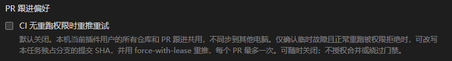

<a href="github-ci-retry-2026-11-13.zh-CN.md">简体中文</a> · <strong>English</strong>

# GitHub CI recovery evidence — 2026-11-13

Current publication policy: **1.5.62, not installed**; all active hooks and unsupported directory durability stop recovery. Local 1.5.45 trial evidence below is version-limited; see the final section.

Environment: Cindy 0.1.136 Beta, Windows 10.0.26100, Node v22.22.3.
Only the isolated `local` GitHub development instance was installed/updated.
The marketplace instance and its preferences were left unchanged.

## Additional real-device check — 1.5.19 / 97d540e

At 2026-11-13 18:09 UTC (2026-11-14 02:09 +08:00), Cindy Forge updated the
existing `_ns__local__cindy-github` instance to 1.5.19, returning
`action: updated`, `enabled: true`, `namespace: local`. This was an explicitly
authorized update, not a marketplace replacement. The tested package source is
97d540e; subsequent changes to this record do not change its packaged content.

- The live settings before and after update were identical:
  `auto_rename:false, auto_follow:true, ci_retry_repush:true`. This was the
  pre-existing value, not an enablement performed by the Agent. Account setup
  remained ready; the marketplace instance was retained.
- The actual iPhone operator opened local test [PR #1](https://github.com/yan-xdt/cindy-official-plugins/pull/1)'s
  settings and checked the retry switch, shared-scope label and SHA description.
  Both Light and Dark were reported complete with no horizontal overflow;
  the preference was left unchanged. This is an on-device human observation,
  not a generated preview, browser-width emulation or Agent screenshot. The
  phone client version was not read; no full-screen/private image was captured
  or uploaded. It does not cover fault-injected unknown-state UI.
- Through the actual installed local plugin, normal rerun of
  [run 43421933262](https://github.com/yan-xdt/cindy-official-plugins/actions/runs/43421933262)
  was accepted. Read-back showed **attempt 3, completed/success**, job
  `controlled-check` 132072958905, with all steps successful. The original PR
  remained closed/unmerged and head remained
  `1296be40f2082aa1e8bc01cb7f5d078beba533a1`; no branch rewrite was attempted.

This is genuine Cindy/mobile display and GitHub normal-rerun evidence, **not**
permission-denied recovery acceptance. Repository metadata confirmed that the
current isolated-repository account has `admin`, `maintain` and `push` access;
it does not supply a real rerun denial. The fixture is an intentional test,
not a diagnosed infrastructure failure. No credentials, permissions, live
preference or production branches were changed to manufacture eligibility.
The real denial → guarded rewrite → original PR new SHA/CI path and disabling
during that recovery remain unverified; their review thread stays open.

## Actual desktop observation: 1.5.14 / 209ef92

The PR card enabled the preference; the live tool returned `true`. The settings
page displayed it checked, then disabled it; the live tool returned `false`.
Clicking Disable on a stale card that still displayed On kept the value false;
the card redrew Off, and refreshing `pr_card` also returned false.
Light/Dark were observed in Cindy. The original light theme and the disabled
development preference were restored. A later foreground activation was refused
by Windows; no input was sent. No further desktop input was attempted after lock.

These are cropped actual screenshots from **1.5.14**, including its older,
longer wording and former per-PR limit. They are not current-version screenshots.
Only the control and its explanation remain; account, task list and chat are
excluded. Image metadata is not retained.

| Actual settings page | Actual PR card |
| --- | --- |
|  |  |
|  |  |

In 1.5.17 the account-settings preference control, KV reads and dedicated
readiness/write messaging were removed. These old settings-page observations
are historical, not a current entry point or an outstanding cold-start test.
The card's persistence and explicit target action paths are unchanged; their
evidence remains applicable. Changed recovery rules need their own evidence.

## Current wording: generated 1.5.16 preview

These images are generated copy/layout previews, **not live Cindy or phone
screenshots**. The explanation stays one sentence; an adjacent scope label says
all repositories/PRs on this computer share the preference. The scope is also
included in the card's accessible name. The four-language card layout is
unchanged in 1.5.17; the plugin account-settings page no longer has this control.

| Generated narrow light | Generated narrow dark |
| --- | --- |
|  |  |

## Verified GitHub normal rerun

Isolated [test PR #1](https://github.com/yan-xdt/cindy-official-plugins/pull/1)
added only a controlled workflow. The first attempt deliberately failed.
The plugin's normal rerun produced
[run 43421933262, attempt 2: success](https://github.com/yan-xdt/cindy-official-plugins/actions/runs/43421933262),
without changing head `1296be40`. The test PR was closed, never merged; its
branch and run are retained. This was a deliberate fixture failure, not a
diagnosis of an infrastructure fault. The owner account has rerun rights, so no
real permission denial or CI-only rewrite occurred.

## Review invariants and signature checks

The scope-disclosure invariant is that every CI-retry choice names its shared
scope before selection, on every PR card. Preference writes still have
one owner: the existing main-page PR queue. The signature invariant is that an
originally signed head never authorizes an unsigned replacement push. The Agent
reads the existing Git configuration; it does not change signing identities,
keys or verification policy to make recovery eligible.

| Observed state/event | Required action |
| --- | --- |
| Signed original, signature invalid/unknown or automatic signing disabled | Stop before budget consumption or amend |
| Signed original, signing readiness unknown/key unavailable/interaction required | Stop; never fall back to unsigned |
| Signed original, existing noninteractive signing succeeds | Verify new signature before push |
| Replacement signature missing/invalid/unknown | Leave it unpushed; report outcome |
| Unsigned original | Apply every existing recovery condition |
| Preference disabled or unreadable before amend/push | No CI-only rewrite/push |

The isolated real Git fixture uses a generated, test-only SSH signing key. It
checks one-off `-S` with automatic signing off, successful verification after a
configured signed amend, unchanged tree, and failure without head movement when
the signing key is unavailable. It does not establish GitHub Verified status or
prove an Agent followed these instructions on a live recovery.

In 1.5.17, quota receipts move to durable user data; observation/trace cache
stays disposable. The gate is the sole receipt writer and exclusively adopts
matching older cache evidence, without overwriting durable receipts. The CLI
fixture verifies that removing or changing the cache cannot reopen the same
failure's budget, and that an older cache receipt cannot replace durable evidence.
Migration cannot recover evidence that had already been deleted before upgrade.

## Preference visibility invariant — 1.5.18

Unknown preference state must never appear as a confirmed Off state. The
existing main-page queue remains the sole preference writer; there is no new
cache, retry or coordinator. Card rendering and Agent tool returns project the
same known/unreadable state. Every preference action uses one final read-back,
including settings other than CI retry; Refresh is read-only.

| Read/write event | Panel/result |
| --- | --- |
| Valid read, CI flag missing or false | Known Off, explicit On action |
| Valid read, CI flag true | Known On, explicit Off action |
| Read failure or malformed root storage | Unknown message and read-only Refresh; no toggle/model choices |
| PUT response unconfirmed, read-back succeeds | Show current values with an unconfirmed-save note; no repeated PUT |
| PUT response unconfirmed, read-back fails | Unknown panel; no claim that authorization is Off or the mutation did not execute |
| Successful PUT, subsequent read fails | Unknown panel rather than optimistic confirmation |
| Refresh recovers | Show the new known state without a write or Agent/Git action |

Three production-entry regression tests failed against 195cfc4 before the fix.
The four required repository suites plus the plugin suite passed together:
306 passed, 19 skipped, 0 failed in 132.1 seconds, on the Windows/Node environment
above. The final focused three-test run also passed, including successful PUT
followed by failed read-back. No new package was installed for this observation.
They cover storage read failure/recovery, malformed JSON root values, enable,
disable and another preference save whose mutation persisted before a thrown
or rejected response, and unavailable read-back. These are simulated-host
regressions, not real Cindy fault injection. The actual unknown-state UI on
desktop/mobile remains unverified; normal known-state copy/layout is unchanged.

## Fixed total invariant — 1.5.19

At most two successful CI-only reservations per immutable PR ID on this computer,
and at most one per stable diagnosis. The gate owns two exclusive durable slots;
it writes each once, never expires, refunds or clears it. This replaces new
per-diagnosis receipt allocation; it adds no lock, scheduler or Git retry.
All new and migrated reservations share the same slot allocator and validator.

| Event / prior history | Expected outcome |
| --- | --- |
| First / second distinct fault | Consume one remaining slot before Git; return its head/diagnosis |
| Third distinct fault | Reject, stop and report regardless of diagnosis |
| Same fault, changed SHA or URL | Reject without consuming another slot |
| Concurrent same / distinct faults | One success per fault; no more than two total successes |
| Earlier cache/durable per-failure receipts | Count all current-PR diagnoses toward two; never overwrite originals |
| More than two older attempts, corrupt/partial/unknown evidence | Fail closed; no reset or new attempt |
| Crash, failed push, cache cleanup or restart | Consumed slots persist; status permits read-back only |

Three new/expanded CLI regressions first failed against 754f1fe. The focused
suite then passed 13 tests, including old receipt migration and concurrent real
Node processes. This is isolated local budget/Git evidence, not the missing
real GitHub permission-denied recovery acceptance. At that CLI-check stage no
1.5.19 live install was performed; the later installation is recorded above.
The four required repository suites plus the plugin suite passed together:
310 passed, 19 skipped, 0 failed in 106.5 seconds (same Windows/Node environment).
The final focused CLI suite passed 13 tests in 5.1 seconds after the status/help
wording update; the Git fixtures remain local, not GitHub recovery evidence.

## Main synchronization — source 1.5.20 (2026-11-14)

Merged main `0410e4862d18b47083aafcb8f381c793a1373b60` into the existing
feature branch. Kept upstream baseline-wait backoff and base-movement handling
alongside the bounded recovery budget. Resolved the manifest/version-test
conflict with source version 1.5.20 and no hard-coded release number in the
authentication contract test. No new retry mechanism or permission was added.

The live local instance remains 1.5.19. Version 1.5.20 was not installed or
tested on the phone. Its main.js and preference UI are unchanged from 1.5.19;
the existing normal-display evidence applies to those unchanged paths. Local
tests of the integrated wait/recovery scripts are separate from live evidence.
The real permission-denied recovery prerequisite below remains unmet.

The four required repository suites plus the GitHub plugin suite passed after
integration: 313 passed, 19 skipped, zero failures in 110.0 seconds on the same
Windows/Node environment. The checks include the inherited baseline-wait
backoff/base-movement cases and the existing recovery-budget/Git fixtures.

## Main copy-link integration — source 1.5.21 (2026-11-14)

Merged main `2bc837d71b785b1ceb5ce178520dd2b1db9aa9cf` into the existing
branch. Retained both the upstream hidden Host-handled PR copy-link button and
all four languages of this PR's unknown-preference/refresh messages. The
header composition change is inherited from main; preference storage, live
reads and bounded recovery behavior are unchanged. Source version is 1.5.21.

The installed local plugin remains 1.5.19. Unlike the earlier 1.5.20 sync,
this integration changes main.js card rendering, so the earlier phone check
does not establish the new header/copy-link behavior. No new installation or
live clipboard/phone verification was performed. Local card regressions are
not claimed as device evidence; the genuine recovery prerequisite remains.

The four required repository suites and plugin suite passed together after
this integration: 314 passed, 19 skipped, zero failures in 107.4 seconds
(Windows/Node environment above), including the inherited copy-link card test
and existing preference/read-back and bounded-recovery regressions.

## Legacy evidence invariant — source 1.5.22 (2026-11-14)

Unknown earlier consumption must remain unknown after cache deletion and
restart. Migration keeps the existing raw receipt filenames and exclusive-copy
operation, but copies before decoding/validation. A missing diagnosis, broken
JSON or invalid diagnosis is preserved durably and still refuses status/new
reservations; no new marker, lock, scheduler or storage mechanism is introduced.
Valid existing durable evidence is never overwritten. A valid other-PR receipt
does not consume this PR's slots; an unreadable/unattributable receipt remains
fail-closed rather than being discarded. The same bounded opaque-ID check is
used by CLI parsing and legacy receipt validation; legacy GitHub base64 IDs
are accepted without inventing or translating a replacement identity.

| Event | Expected result |
| --- | --- |
| Unknown legacy receipt first encountered | Exclusive raw copy, then reject |
| Cache deleted/replaced, process restarted | Durable unknown evidence still rejects |
| Existing durable receipt | Never overwrite from stale cache |
| Verified legacy node ID | Adopt/query/reserve using the exact ID |
| Different PR or diagnosis | Existing per-PR total and per-diagnosis limits apply |

Both new CLI regressions failed against acef06c: all three unknown-evidence
variants failed durability checks, and the legacy ID failed before querying.
These are isolated process/filesystem tests, not real GitHub recovery evidence.
The new version is not installed; local remains 1.5.19 and the inherited 1.5.21
header/copy-link runtime gap above remains. The real recovery prerequisite is
not resolved by this patch.

The focused CLI suite passed 18 tests in 6.2 seconds. The four required
repository suites plus plugin suite passed together: 319 passed, 19 skipped,
zero failures in 133.9 seconds, same Windows/Node environment. No live plugin
or user data directory was modified by these isolated fixtures.

## Merge-work protection and unknown-panel height — source 1.5.23

The Agent workflow now excludes any retained approval, queue entry, enabled
auto-merge or unknown/incomplete reads of those states. One eligibility rule
is reused before reservation/amend and immediately before push; no new query
worker, permission, lock or Git executor is added. After reservation, a new
blocker stops without refund; after amend, it leaves the local commit unpushed.
Post-push concurrent/unknown side effects must be reported, never auto-repaired.
No live approvals, queue entries or auto-merge settings were changed/tested.
This is a Skill boundary, not a mechanically enforced GitHub atomic lock.

The card height now receives the same settings state as its renderer: a compact
unknown panel declares less height than full settings, closed settings remove
that allowance and a successful read restores it. The production-tool regression
first failed against 072a156 and covers asking/open/closed/merged PR stages,
unknown -> close/reopen -> refreshed-known, with zero preference writes.

No new package was installed. The local instance remains 1.5.19; actual
unknown-state desktop/phone height, inherited copy-link rendering and the real
permission-denied recovery chain remain unverified. This simulated-Host height
regression is not a real-device observation.

Five focused card regressions passed in 0.3 seconds. The four required
repository suites plus plugin suite passed together: 320 passed, 19 skipped,
zero failures in 147.1 seconds on the Windows/Node environment above. The
review/queue rule was reviewed as Agent instructions; no live merge workflow
was exercised or claimed as verified.

## Main conflict synchronization — source 1.5.24 (2026-11-17)

Merged main `f5e6f5c` into the existing feature branch. The two conflicts were
the manifest version/release notes and main's old fixed-version test assertion.
The package is now 1.5.24; the existing contract suites enforce SemVer and
version growth instead of pinning this authentication test to main's 1.5.16.
Main's publish-click wording and draft-reporting guidance are retained. The
recovery script, limits, approval/queue guards, preference storage and four
locale resources are byte-identical to 1d189e2. No machinery or permission was
added; main's unrelated changes are inherited without edits.

The four required repository suites plus plugin suite initially returned
316 passed, 19 skipped and four publishing-test failures in 69.2 seconds on
Windows / Node v22.22.3. Those failures selected WSL bash, which could not open
the Windows temporary script paths. With Git Bash selected through this test
process's PATH, the publishing suite passed all 12 tests in 114.2 seconds;
the other suites were not repeated. No test or production code was changed
to accommodate the environment. Manifest validation passed. A real index-tree
`git archive` package was normalized and checked in memory: 31 files,
221997 compressed bytes and 614794 expanded bytes, with required legal files,
locales, safe paths, limits and matching packaged source. No package file was
retained or installed.

GitHub now shows all 16 review threads resolved. Direct GraphQL identifies
`yan-xdt` as resolver of the original acceptance thread; the effective approval
on 1d189e2 was Greptile's existing review, not a new maintainer runtime report.
Neither that state change nor this synchronization supplies the missing real
recovery evidence. The last actually tested runtime remains 1.5.19; 1.5.24 was
not installed. The inherited header/copy-link and unknown-panel runtime gaps
remain, as does the genuine denied-rerun recovery prerequisite below. No live
rerun, preference/credential/permission change or recovery quota use occurred.

## Preference ordering and reference layout — source 1.5.25 (2026-11-17)

Round 14 groups the two findings into the existing preference-ordering and
render/height-consistency families. The correction reuses the established
coordinator: `prQueue` still owns card/preference changes, and the Agent's
`pr_follow_settings` read now joins that same queue. `sendPrCard` owns the
normal/reference rendering choice and supplies it to height calculation too.
No new queue, lock, cache, receipt, storage or retry mechanism is introduced.

**Ordering invariant:** a later authorization read cannot overtake an earlier
queued preference action or its reconciliation. **Layout invariant:** only
the actually rendered settings panel contributes settings height.

| Event/state | Expected result |
| --- | --- |
| Other preference save pending; disable queued; read arrives | Read waits behind both actions, then returns disabled |
| Cold-start click awaits locale context; host locale changes | Later tool still waits behind that click |
| Disable PUT pending | No old enabled grant returned while it is pending |
| Disable accepted, or response lost with readable state | Read returns the reconciled current value; no replay |
| Write response lost and readback unavailable | Reader fails without a settings grant; later recovery is read-only |
| Local known/unknown settings open | Full/compact panel height, respectively |
| Another task owns follow-up; known/unknown local settings open | Reference card has no settings allowance; local open state is preserved |
| Other owner releases follow-up | Restore the local full/compact settings panel |

The symmetric audit covers on/off, other preference writes and all Agent-facing
settings paths: card tools and click handoffs already share the queue; the
standalone read was the bypass. Unreadable results still fail closed. Reference
refreshes and clicks reuse the same rendering/height decision; they never write
preferences or change ownership. This orders messages in the existing sandbox,
not GitHub/Git actions in another process: a later click cannot revoke a grant
already returned, so the immediate pre-push live read remains required.

All three PR entry points reserve their queue position before locale setup.
Locale initialization also runs inside that position: a host locale update
cannot let a later reader/tool pass a cold-start click still awaiting context.
A fourth regression reproduced that gap in the initial one-line queue fix;
it now shares the same coordinator rather than adding another guard or state.

All three new regressions failed on 279d951, covering the queued/active disable
and both known/unknown reference states. After the fix, the focused new and
adjacent production-tool regressions, including delayed locale setup, passed
13 tests in 0.23 seconds. These use
a simulated Host with controlled promises; they are not real Cindy/GitHub
recovery or phone measurements. Source 1.5.25 is not installed. The changed
live-read ordering and reference-card layout need corresponding real runtime
coverage in addition to the existing recovery/header/unknown-panel gaps.

The four required repository suites plus plugin suite passed 328 tests,
19 skipped, zero failures in 106.2 seconds on Windows / Node v22.22.3 with
Git Bash selected for this test process. After the final locale-coordinator
consolidation, the plugin suite was rerun: 264 passed, 19 skipped, zero failures
in 63.9 seconds. Manifest validation and the exact index-tree archive/content
check passed (31 files, 222073 compressed bytes, 614968 expanded bytes);
the normalized package was inspected in memory without retaining a file.

## Historical receipt discovery — source 1.5.26 (2026-11-17)

Round 15 belongs to the existing unknown-evidence durability family. Historical
writer inspection found the omitted namespace: initial 1.5.14 (`8dcb0c1`)
wrote `<stateFilePath>.ci-retry` with only `sourceHead` and `reservedAt`.
The existing discovery function now covers both `*.json.ci-retry` (plain and
encoded repository names) and immutable-ID/per-diagnosis hash names. The same
exclusive raw-copy path preserves them before any rejection; no new marker,
allocator, storage system, lock or retry is added. This is a complete namespace
audit of the earlier URL, per-ID, per-diagnosis and current fixed-slot formats.

**Invariant:** unknown past consumption cannot become fresh quota because its
filename format, URL, cache directory or process changed. Discovery has one
owner, `legacyCiRetryFiles`; allocation remains the existing two-slot owner.

| Evidence/event | Result |
| --- | --- |
| Plain/encoded URL receipt, including broken bytes | Exclusive raw durable copy, then stop |
| Stale cache copy replaces the original | Durable bytes are not overwritten |
| Cache deleted/replaced; process restarts; URL changes | Durable unknown evidence still stops status/reserve |
| URL-only evidence seen with another claimed node ID | Cannot prove it unrelated; no inferred identity or new slot |
| Valid other-PR immutable-ID receipt | Existing separate-PR accounting remains unchanged |

URL-only receipts lack both immutable identity and diagnosis, so they
conservatively block budget operations until their previous outcome is
reconciled, even for another URL. No URL-to-ID conversion or guessed diagnosis
is introduced. The three added URL scenarios failed first on f109fcb while the
three older unknown-evidence variants passed. The focused CLI suite then
passed 21 tests in 7.8 seconds. Extended tests also verify raw-byte preservation,
cache deletion/replacement, process restart and no new slot allocation.

These are isolated CLI/filesystem fixtures with temporary data roots; real
user quotas, credentials, permissions and preferences were untouched. Source
1.5.26 is not installed. `main.js`, settings and locales are unchanged from
1.5.25, so all documented real recovery/UI verification gaps still apply.

The four required repository suites plus plugin suite passed 332 tests,
19 skipped, zero failures in 120.9 seconds on Windows / Node v22.22.3 with
Git Bash selected for this test process. Manifest and index-tree package checks
passed: 31 files, 222310 compressed bytes and 615575 expanded bytes, inspected
in memory with no retained package file.

## Main synchronization — source 1.5.27 (2026-11-18)

Merged `main` at `931dbf6` in `28606c9`. The two conflicts were the manifest
version/release notes and an obsolete fixed-version assertion in the host-login
test. Version 1.5.27 preserves both this PR's bounded, default-off CI recovery
and the upstream optional ordinary PR trigger guidance, including its fallback
for older Hosts. No schedule or real preference was changed.

Compared with `e1e86d9`, the only changed files inside `cindy-github` are
`ghost.json` and `skills/pr/SKILL.md`. Runtime code, recovery scripts, settings
and four-language resources are byte-identical. Existing evidence for unchanged
paths remains applicable with its original version and limitations; this source
was not installed and the recovery/UI prerequisites below remain unmet. The
inherited optional trigger guidance was not exercised through a real scheduler.

Manifest validation and the committed-tree package/content check passed:
31 files, 222488 compressed bytes and 616009 expanded bytes. The normalized
archive was checked in memory against every tracked plugin and legal-file byte;
no artifact was retained.

The required repository and plugin coverage totals 332 passed and 19 Windows
platform skips, with no remaining failures. The first combined run had five
failures: one catalog comparison read the pre-merge HEAD, and four publishing
checks used the wrong Bash. After the merge commit the catalog contract passed.
Publishing then passed 11/12 with Git Bash and the already-verified jq 1.8.2
wrapper; the remaining packaging test passed alone after adding Git's existing
`usr/bin` (unzip) to the test process PATH. No test or production code was changed
to accommodate the environment, and the already-passing plugin suite was not
repeated. Environment: Windows 10.0.26100 / Node v22.22.3. No installation,
credential/permission/preference change, real recovery quota operation, CI-only
rewrite, merge or publishing was performed.

## Publish-progress synchronization — source 1.5.28 (2026-11-18)

This synchronization incorporates `main` at `9e2cf0e` (#350). It preserves the
upstream immediate working-card update before a slow publish/draft handoff,
the four translated progress messages, and the upstream one-second spacing
between updates. The save-path conflict retains this PR's preference read-back
before the upstream recorded-state/early-return logic. The obsolete release-number
assertion stays removed; manifest version 1.5.28 is above main's 1.5.18.

The existing preference queue, reference-card height guard, authorization reads,
recovery scripts and durable per-PR quota rules remain in place. No additional
executor, queue, storage, retry or timer was introduced beyond the code inherited
from main. The source is not installed. Publishing progress and the inherited
header/unknown-state/read-ordering paths have not received new real Cindy/phone
verification; earlier known-state observations retain their original versions
and limits. The maintainer's [new reply](https://github.com/makecindy/cindy-official-plugins/pull/332#issuecomment-6979001728)
still requires genuine denied-rerun recovery evidence and a subsequent review;
fork workflow approval remains their responsibility.

Manifest validation and an exact staged-tree package/content check passed:
tree `f5de1cf86f88c7536281b4f4a1c148e01ce8a0e7`, 31 files, 222837 compressed
bytes and 616797 expanded bytes. Every archived plugin/legal file was compared
with its tracked bytes. The normalized archive was inspected in memory only.

The four required repository suites plus the plugin suite passed on the first
run: 333 passed, 19 Windows platform skips, zero failures in 176.2 seconds.
This includes the upstream slow-handoff progress test and the existing
preference read-back/order/reference-card regressions. Environment: Windows
10.0.26100 / Node v22.22.3, with existing Git Bash, jq and unzip selected only
for the test process. No real preference, credential, permission, recovery quota,
installation, CI-only rewrite, PR merge or publication was changed/performed.

## Literal recovery arguments — source 1.5.29 (2026-11-18)

Round 18 addresses the shell-interpretation family identified in
[this review](https://github.com/makecindy/cindy-official-plugins/pull/332#discussion_r4614443000).
**Invariant:** observed refs, remotes, URLs, IDs, SHAs and paths remain complete
argument data through every recovery step. The existing task execution tool owns
argument delivery; no Git executor, queue, storage or retry was added.

| Path | Boundary and verification |
| --- | --- |
| Ref validation / remote query | Full ref and remote stay separate argv; Git format validation is not shell escaping |
| Reserve / status / crash recovery | Gate path, URL, node ID and diagnosis path remain independent arguments |
| Signature verification | New SHA stays one argument to the existing Git executable |
| Push | Whole lease option, remote after `--`, and whole refspec are separate arguments |
| Shell-only task tool | Literal-quote for the actual shell/version; stop if exact round-trip cannot be established |

Unsafe interpolated command templates were replaced with shared argument-list
examples. The main Skill boundary and both public guides use the same contract;
POSIX/PowerShell literal quoting is described, including embedded quotes, and
JSON encoding/double-quoted substituted source is explicitly insufficient.

The new regression failed against the 2431ead guide before the fix. Afterwards,
eight branch-name variants across six argument lists survived real Node argv
round-trips byte-for-byte, including quotes, `$()`, backticks, semicolons,
ampersands and Unicode. The existing real local Git transport test now consumes
the documented query/push lists with a metacharacter branch and a spaced/quoted
remote path; exact lease succeeds and an intervening commit is rejected. The
two focused tests passed in 5.7 seconds. These are isolated process/Git fixtures,
not a live Cindy shell or genuine GitHub permission-denied recovery acceptance.

All four required repository suites plus plugin tests passed: 334 passed,
19 Windows platform skips, zero failures in 121.1 seconds (Windows 10.0.26100 /
Node v22.22.3, existing Git Bash/jq/unzip selected for the test process).
Manifest and staged-tree package/content checks passed: tree
`35171b7d847a962b0ee6fead4f88c5453b33e788`, 31 files, 224023 compressed bytes,
619697 expanded bytes; archive inspected in memory only. Packaged changes are
workflow guidance and version/release notes; executable plugin/recovery code is
unchanged from 2431ead. No installation, real preference/credential/permission
or quota change, CI-only rewrite, merge or publication was performed. Existing
real recovery/UI prerequisites remain unmet.

## Preserve the follower observation directory — source 1.5.30 (2026-11-18)

Round 19 addresses the [custom state-dir finding](https://github.com/makecindy/cindy-official-plugins/pull/332#discussion_r4614941349).
Both documented budget argument lists now explicitly carry the current follower's
effective `--state-dir`, including status after a crash. An explicit directory
wins over an inherited environment/default cache; an unknown directory stops
budget operations. The existing executor owns argument delivery, the follower
configuration owns directory selection, and existing migration owns legacy
receipt adoption. No new storage, queue, retry or execution code was added.

Two fresh isolated CLI fixtures use the earliest URL-named receipt format in a
custom directory and a different inherited default. Reserve and status each
stop on unknown old evidence, retain its exact bytes in the source and durable
copy, and allocate no slot. The literal-argv regression also covers the custom
directory's spaces, quotes and shell metacharacters. Both focused guide tests
passed in 3.1 seconds. These fixtures are not real Cindy/GitHub recovery evidence.

The four required repository suites plus plugin tests passed: 335 passed,
19 Windows platform skips, zero failures in 153.7 seconds, with the same
Windows/Node/test-process Git Bash environment as 1.5.29. Manifest and staged-tree
package/content checks passed: tree `9fa81963a9f02f5983ee1cc6b2695aca70818fa9`,
31 files, 224267 compressed bytes and 620334 expanded bytes, inspected in memory
only. Executable plugin/recovery code is unchanged from e47ec22. Source 1.5.30
was not installed; real recovery/UI prerequisites remain unmet. No real
preference, credential, permission, quota, merge or publication changed.

## Preserve old evidence before the current diagnosis — source 1.5.31 (2026-11-18)

Round 20 addresses [diagnosis failure before migration](https://github.com/makecindy/cindy-official-plugins/pull/332#discussion_r4615271337).
The status/reserve entry point now calls the existing legacy adoption before
reading the current diagnosis file. Its exclusive raw copy therefore survives
a missing file, invalid JSON or invalid fields. Migration retains already-used
attempts; invalid current diagnoses cannot create a new reservation. No new
storage, lock, queue, retry or allocator was introduced.

All 12 cases failed first on 7a53d71 because the durable raw copy was absent.
After the order change, the focused matrix passed (13 tests including its
parent, 3.4 seconds): status/reserve, three diagnosis errors, and known versus
unknown URL-named old evidence. New processes after isolated cache deletion
still report one previously consumed attempt or reject the unknown outcome,
and cannot reserve the same failure anew. Original and durable receipt bytes
are preserved. These are isolated CLI fixtures, not live recovery acceptance.

All four required repository suites plus plugin tests passed: 348 passed,
19 Windows platform skips, zero failures in 140.9 seconds, using the same
Windows/Node/test-process Git Bash environment as 1.5.30.
Manifest and staged-tree package/content checks passed: tree
`38c5f55364e9c8356c26d4aecc6fa250601f3f95`, 31 files, 224409 compressed bytes,
620747 expanded bytes; archive inspected only in memory. Main/settings/locales
are unchanged from 1.5.30; the packaged gate changes only the adoption/read
order above. Source 1.5.31 was not installed, and real recovery/UI prerequisites
remain unmet. No real preference, credentials, permissions, quota, CI-only
rewrite, merge or publication changed.

## Synchronize main #351 — source 1.5.32 (2026-11-19)

Merged main `01b42db13d6ee9ca6f236722bfa171afd71e46b8` (#351) into this same
feature branch to clear the reported conflict. Only manifest/version-assertion
conflicts needed resolution. The upstream title-adjacent copy control, smaller
glyph and shared reference-card button CSS are retained, as are this PR's
preference ordering, reference height, unknown panel and bounded recovery.
Source/package version is 1.5.32, above main's 1.5.19.

The recovery scripts, settings page and all four locale files are byte-identical
to 3213807. Main's diff is the imported header/copy layout; no new preference,
storage, network, permission, queue, lock, retry or dependency was introduced.
Main's 1.5.19 at 01b42db and the historically installed/tested local 1.5.19 at
97d540e have different contents: equal version numbers do not make them the
same runtime. Source 1.5.32 was not installed. The inherited title-adjacent copy
layout/hover, current phone/unknown-panel/read-ordering paths and genuine
denied-rerun recovery remain unverified in live Cindy; earlier evidence is not
claimed for these changed paths.

The four required repository suites plus plugin tests passed: 348 passed,
19 Windows platform skips, zero failures in 113.7 seconds, with existing Git
Bash/jq/unzip selected only for the test process. The upstream title/copy
placement regression and existing recovery/preference/reference regressions
all remain in the run. Manifest and staged-tree package/content checks passed:
tree `9608cfa5155b25ce3bc49600f899e0a569a65e4a`, 31 files, 224395 compressed
bytes and 620598 expanded bytes. Archive inspected in memory; no new package
file retained. No installation, real preference/credential/permission/quota
change, CI-only rewrite, PR merge or publication was performed.

## Bind the verified push source — source 1.5.33 (2026-11-19)

Round 22 addresses [the late HEAD lookup](https://github.com/makecindy/cindy-official-plugins/pull/332#discussion_r4624198913).
**Invariant:** the pushed object is exactly the commit checked for tree, parents,
author, message and required signature. The existing Agent workflow owns the
verified full `newSha`; the existing executor receives that value in the
refspec, without resolving HEAD or a local branch again. Signed and unsigned
paths share this source and the original exact remote-SHA lease. No executor,
lock, queue, storage or retry was added.

| Event | Result |
| --- | --- |
| Local movement observed before launch | Stop; preserve the concurrent local work |
| HEAD advances after final checks/argument binding | Send only the verified `newSha`; leave local HEAD intact |
| Remote advances | Original exact lease rejects; no refreshed lease or replay |
| Verified source object unavailable | Git fails; no fallback to HEAD or another commit |
| Required signature missing/invalid/unknown | Existing guard stops before push |
| Crash or ambiguous network result | Existing remote/original-PR read-back; no push replay or fresh quota |

Both regressions first failed against the 8c910e1 guide: its argv still used
HEAD, and the real isolated bare-Git fixture pushed a later, different tree.
After the fix, both focused tests passed in 6.2 seconds. The fixture freezes
the documented argv, commits later local work, and verifies the remote receives
only the checked SHA/tree while local HEAD stays advanced. It also verifies a
missing source cannot fall back to HEAD and an intervening remote commit rejects
the stale lease. This is local Git transport evidence, not real Cindy/GitHub
permission-denied recovery acceptance.

The four required repository suites plus plugin tests passed: 348 pass, 19
Windows platform skips, 0 failures in 118.4 seconds. Manifest validation passed.
In-memory packaging/content checks used staged tree
`752593a45b9beea7f3579fbfc09977ff19f10fbc`: 31 files, 224665 compressed bytes,
621313 expanded bytes; every file matches its Git blob and no package file was
retained. Source 1.5.33 exceeds main's 1.5.19; main.js, settings, locales and
recovery scripts are unchanged from 8c910e1. Source 1.5.33 was not installed;
the last actual local runtime remains 97d540e / 1.5.19. Genuine denied-rerun
recovery and current UI/read-ordering prerequisites remain unmet. No real
preference, credential, permission or quota change, CI-only rewrite, PR merge
or publication was performed.

## Preserve receipts before budget argument rejection — source 1.5.34 (2026-11-19)

Round 23 addresses [the omitted diagnosis option](https://github.com/makecindy/cindy-official-plugins/pull/332#discussion_r4624322101)
as another path of the earlier evidence-preservation family. **Invariant:** once
a budget request and its effective directory are parsed, rejecting its CI
options must not leave older receipts solely in disposable cache. The existing
`runGate` entry point owns the ordering: one completed parse → existing exclusive
raw copy → shared argument validation → existing adoption/diagnosis/allocation.
`gateMain` consumes the same parsed object, removing its second parse. The copy
loop and fixed-slot allocator remain the only writers; no new marker, storage,
lock, queue or retry was added.

| Parsed request / event | Result |
| --- | --- |
| Status or reserve omits/empties the diagnosis option | Preserve raw old files, then reject; no new slot/trace/state |
| CI value absent before a later `--state-dir` | Do not consume the next option; use the completed directory selection |
| Identity or reserve SHA missing/invalid; budget modes conflict | Same preserve-before-validation path; no URL identity fallback |
| Known older attempt, then cache cleanup/restart | Adopt exactly that previous consumption; same diagnosis cannot reserve again |
| Unknown URL-only evidence, then cleanup/restart | Durable raw evidence remains fail-closed; no invented identity/diagnosis |
| Current diagnosis file missing/damaged/invalid | Existing preservation and adoption precede diagnosis-file reading |
| Help or unparseable CLI grammar/target | Existing early rejection/help; automatic migration is not promised |

The 32-case CLI matrix first failed on cc54f36, covering status/reserve, seven
argument failures plus two reserve-SHA failures, and known/unknown old receipts.
After the fix the CI recovery suite passed 69 tests in 20.2 seconds. Each matrix
case verifies byte-exact copies and originals, no new slot or observation trace,
cache deletion and a fresh process: known consumption survives and unknown
history still blocks. Existing malformed-file, custom-directory, exact-SHA push,
signing, concurrency and total-cap tests also passed. These are isolated local
CLI/Git fixtures, not real Cindy/GitHub denied-rerun acceptance.

The four required repository suites plus plugin tests passed: 381 pass, 19
Windows platform skips, 0 failures in 117.6 seconds. Manifest validation passed.
In-memory package/content checks used staged tree
`333253a78f48a6f971b483c48be303342aad7a0e`: 31 files, 225175 compressed bytes,
622830 expanded bytes, all files match their Git blobs; no new package retained.
Source 1.5.34 exceeds main's 1.5.19 at 01b42db.

Source 1.5.34 was not installed; main.js, settings and locales are unchanged from
cc54f36. The last actual local runtime remains 97d540e / 1.5.19. Genuine recovery
and current UI/read-ordering evidence remain prerequisites. No real preference,
credential, permission or quota change, CI-only rewrite, PR merge or publication
was performed.

## Synchronize main #352 — source 1.5.34 (2026-11-19)

Round 24 merges main `1b26689b7b069e778c7621327607ec51d124a20d` (#352) into
this same feature branch. Resolved manifest, version-assertion and four-language
tool-description conflicts by retaining upstream native-follow semantics and
this PR's default-off CI-retry contract. Source/package stays 1.5.34, above
main's 1.5.20, as the maintainer explicitly allowed in
[comment 7001964297](https://github.com/makecindy/cindy-official-plugins/pull/332#issuecomment-7001964297).
History is merged, not rebased or rewritten.

The imported main changes let PR cards manage follow-up through Host scheduling
and `node/follow.cjs`, which only locates this installation's approved Skill.
Node, `agent.hostTools: ["scheduler"]`, network declarations and minimum Cindy
version match main exactly. [Upstream #352](https://github.com/makecindy/cindy-official-plugins/pull/352)
explicitly disclosed the local Node/automation grant and update consent; GitHub
identifies zqchris as its merger. Its author reported a development-build,
isolated real-scheduler create/read/delete check, while installed-plugin/online-PR
verification remained missing. That is upstream-reported evidence, not a new
runtime observation by this task. No installed support or permission consent is
inferred from main or its tests. No extra grant beyond main is introduced here.

The recovery scripts are byte-identical to cd3cf48: full-SHA push binding,
preserve-before-argument-validation, fixed two-slot budget and approval/queue
guards remain. The existing preference queue, reference-card height and unknown
panel are retained. Inherited card/native scheduling has no new live acceptance
here. The existing source-checkout follower and schedule were not replaced or
duplicated, and this source hook is not an installed agent-skills entry.

The final four required suites plus plugin tests passed: 388 pass, 19 Windows
platform skips, 0 failures in 125.0 seconds. An initial pre-commit run could not
find the new Node entry in HEAD's tracked package list. After the merge commit,
the contract exposed the combined English description exceeding 1024 characters;
it was reduced to 911 without dropping native follow-up or CI-retry limits.
Contract/localization recheck passed 50 tests before the final full run above.
No test or production-code workaround was introduced.

Manifest validation and in-memory package/content checks passed: staged tree
`11d8aeed17e68ddff127eb64ef1c7390328efa8b`, 32 files, 229314 compressed bytes,
635934 expanded bytes; all files match their Git blobs and no package artifact
was retained. This package differs from cd3cf48 despite sharing version 1.5.34;
identify the source by commit, not version alone.

No plugin was installed, no real preference/credential/permission/quota was
changed, and no CI-only rewrite, PR merge or publication was performed. The last
actual tested local runtime remains 97d540e / 1.5.19. Genuine denied-rerun recovery,
current UI/read-ordering and inherited native-follow runtime gaps remain; green
CI or resolved threads do not waive them.

## Synchronize main #355 — source 1.5.34 (2026-11-19)

Round 25 merges main `84b1ba819f13b06b87fcfc84883b7538551bde54` (#355) into
the same feature branch. Only manifest/release-note and version-assertion
conflicts required resolution. Source/package remains 1.5.34, above main's
1.5.21; the merged release notes retain both changes.

The upstream snapshot failure path reports DNS, authentication, rate limit,
timeout or unknown causes before CLI login suggestions, retains full stderr,
and emits the optional diagnosis/failure count/actual next-probe timestamp.
This snapshot diagnosis is separate from the verified CI-retry failure key.
Existing thresholds, backoff ownership and exit-code workflow are retained.
The CI parser, raw preservation/slot functions, budget operation and `runGate`
coordinator were compared byte-for-byte with a17f39c and are unchanged. Main.js,
settings, Node helper, locales and the CI-retry guide are also unchanged; Node,
Host tools, network and minimum-version declarations still match main.

The four required repository suites plus plugin tests passed: 389 pass, 19
Windows platform skips, 0 failures in 118.5 seconds. This includes upstream's
isolated gate-process cases for DNS with login suggestions, HTTP 401/429,
timeout and unknown failure; these are local fixtures, not live Cindy fault
injection. Manifest and in-memory package/content checks passed: staged tree
`4d2253a44fb06005110cdba01e4c2d7eaf695972`, 32 files, 229942 compressed bytes,
637351 expanded bytes, all contents match Git blobs; no package file retained.

No plugin or client was installed, no real preference/credential/permission/quota
changed, and no recovery rewrite, PR merge or publication occurred. The original
source-checkout follower remains active. The last actually tested local runtime
is still 97d540e / 1.5.19. Current source 1.5.34 differs from a17f39c despite the
same version; use its commit identity. Real 403 recovery, UI/read ordering,
inherited native follow-up and client diagnosis presentation remain unverified.
Maintainer comment 7005560347 still requires genuine recovery evidence and then
a review of the current head; green CI and resolved threads do not supply it.

## Main #354 synchronization — 2026-11-20 (source 1.5.34, not installed)

Merged main `095aa54e07831d6e3573c495a53892471c5df410` from
[PR #354](https://github.com/makecindy/cindy-official-plugins/pull/354), whose
GitHub receipt identifies zqchris as the merger. Main is 1.5.33; this branch
retains 1.5.34, strictly greater than main, under the existing version decision.
The original feature checkout and source hook remain in use.

The merge retains upstream's explicit local `status_watch` and resident launch,
its bounded polling, account/object checks, failure classification, notification
receipt handling and Node bootstrap correction. The watch implementation block
and Node entry match main byte for byte. The new launch declaration, Node,
agent host tools, network and minimum Cindy version match main; this PR adds
no grant beyond that baseline and does not start a real watch or new follower.
Four locales keep both the inherited watch contract and this PR's default-off
CI-repush contract. Shared KV reads retain this PR's strict non-object rejection
for both watch and preference callers, so malformed storage cannot be replaced
by an empty object or presented as confirmed-off authorization. Existing PR
queue/read ordering is preserved. Recovery scripts, guide, slots and settings
page are unchanged from 4ff249b; no new recovery storage, locks or retries.

The focused merge checks passed 28 tests with one platform skip (0.60 seconds).
The required four repository suites plus plugin passed **415 tests, 19 Windows
platform skips, 0 failures in 119.9 seconds**. Manifest validation and the official
Git-archive packaging method, normalized and inspected entirely in memory,
passed: staged tree `f84394ca02adc0df550171521f39ee6a4470b5cc`, 32 files,
238445 compressed bytes, 662453 expanded bytes; every file matches its Git blob.
No package file was created or retained.

Upstream #354 reports Linux/Cindy 0.1.141 local 1.5.22 plugin-instance recovery
and normal Actions-change notification, with further revisions/fixture results
and remaining limitations in its body. This is upstream-reported evidence for
that candidate, not a fresh test of this merged source or a real CI-recovery
acceptance result. Its whole-app restart, minimum-version, live PR/Issue notice,
real PAT fallback and host-refused notification scenarios remain as documented
there. The new shared-KV combination has only local regression evidence here.

No live plugin/client installation, preference/credential/permission/quota change,
CI-only rewrite, PR merge or publication was performed. Last actually tested
local runtime remains 97d540e / 1.5.19. Genuine denied-rerun recovery, current
UI/read ordering, inherited native follow-up and client diagnosis presentation
remain unverified. Comment 7005560347 still requires actual recovery evidence
and a review of the then-current head; green old-head CI is not acceptance and
must not be inherited by this new head.

## Review round 27 — 2026-11-20 (source 1.5.35, not installed)

Two confirmed families were consolidated without new persistence, locks, queues,
Git execution or retry machinery. Default-off permission, fixed two-slot budget,
approval/queue protection and the existing source follower remain unchanged.

| Event / invariant | Result |
| --- | --- |
| Another task owns follow-up; retry consent is On | Reference card directly offers Off with the existing shared-scope label |
| Reference receives On or a follow-management action | Existing ownership gate still refuses it |
| A stale Off is clicked | Same existing queued writer sets false, never toggles; owner record is untouched |
| KV read fails / write result is uncertain | Unknown plus read-only refresh, or actual read-back; no blind write retry or handoff |
| Reference state changes / ownership ends | One render result supplies its HTML and declared height; local full-panel open state is retained |
| Original key A, automatic signer B; both trusted | Resolve original format/full fingerprint/principal and effective signer before quota; mismatch/unknown stops |
| Signer changes before amend / replacement verifies with B | Stop before amend, or leave the new object unpushed; full verified identity must match A |
| Crash loses original signature identity | Existing task record is insufficient; report unknown, never infer equality or repush |

Off is handled for ordinary and reference cards by the same early action path,
inside the existing PR queue and after card/session checks. Other reference
controls remain read-only. The same existing final settings read-back is used.
No global permission was changed in this task. Four-language labels are reused;
no new localization contract is introduced. The signing guide binds metadata
reads to exact original/new objects; matching author/email or two successful
verifications is not proof of matching provenance. This is an Agent workflow,
not mechanical key/configuration or remote-race enforcement.

New checks failed on 695eb64 before the fix (missing reference revocation/unknown
content and missing original/replacement signature identity reads). Final focused
checks passed **11 tests in 5.22 seconds**. The disposable SSH fixture creates
and cleans two test keys under its own temporary directory: original A and
replacement B both verify, but their full fingerprints differ; same-key A
matches. No real credential, Git configuration, permission or quota was changed.
This is local Git evidence, not eligible 403 recovery. OpenPGP/X.509 identity
resolution and all live signed/unsigned recovery acceptance remain unverified.

Required four suites plus plugin: **418 passed, 19 Windows platform skips, zero
failures in 118.9 seconds**. Manifest and in-memory official archive/content checks
passed: staged tree `98e89ec67e1e88f8b976a2427f4070be113bab4f`, 32 files,
239292 compressed bytes, 665398 expanded bytes, all files match Git blobs;
no package artifact retained. Source 1.5.35 exceeds main 1.5.33. No plugin was
installed; last tested local runtime remains 97d540e / 1.5.19. Reference-card
revocation/unknown display/height, current UI/read order, inherited integrations
and genuine denied-rerun recovery still require real runtime evidence and then
maintainer review. No merge/queue/auto-merge/publication or blocked cleanup retry.

## Receipt durability convergence — round 28, 2026-11-20 (source 1.5.36)

[Maintainer decision 7032587133](https://github.com/makecindy/cindy-official-plugins/pull/332#issuecomment-7032587133)
requires file and directory-entry sync for new slots, old raw copies and
migration, with recovery refused on unsupported/unknown storage. It does not
waive the two-attempt cap, missing real 403 acceptance, or authorize installation.

One receipt I/O owner now handles exclusive creation/copy and confirmed reads.
Before success it fsyncs the file and the whole parent chain through the root,
including recursively created ancestors. Status checks the existing ancestor
without creating an unused data directory. New reservations, migration and
raw preservation share this boundary; existing winners are never overwritten.
Only ENOENT at file open means absent; a later missing directory or any sync
failure stops. A partially written/uncertain file is retained, never rolled back,
refunded, deleted or retried in another directory. Observation/trace state and
all quota names, formats, limits and identity/diagnosis rules are unchanged.
No native helper, fallback store, lock, retry or new grant was introduced.

The native Windows 10.0.26100 / Node 22.22.3 test first failed on a2c5161 because
status returned available quota despite directory fsync EPERM. After the fix,
real isolated CLI status, reserve and raw-migration requests all refuse success;
no receipt directory is created, and the old raw source survives. This is
actual Node/Windows refusal evidence, not Cindy/GitHub recovery acceptance.
A separate supported-filesystem model tests ordering, immutable winners,
ancestor creation and 62 file/directory sync fault points; simulated sync does
not count as native supported-platform or power-loss evidence.

Focused receipt/quota tests: 69 passed, 17 skipped, zero failed (5.25 seconds).
Required four suites plus plugin: **417 passed, 36 skipped, zero failed in
126.5 seconds**. Of the skips, 17 are existing native positive quota/process
cases requiring directory sync; supported CI hosts still run their original
assertions. The other 19 Windows skips are unchanged. No test-only bypass is
available to the CLI. Native positive filesystem/CI evidence remains pending.

Manifest and in-memory official archive/content checks passed: staged tree
`f50c578f7421ba9d7fa193eaf1795fd01b94206b`, 33 files, 241415 compressed bytes,
671027 expanded bytes, every file matches Git; no package artifact retained.
Source 1.5.36 exceeds live main 1.5.33 and is NOT installed. Main UI, settings
and Node follow entry remain unchanged from a2c5161; four-language tool hints
now disclose refusal on unsupported/unknown durability. Known pre-upgrade lost
receipts cannot be reconstructed and require reconciliation, not fresh quota.
The last actually tested local plugin remains 97d540e / 1.5.19. No live quota,
preferences, credentials, permissions, plugin installation, recovery rewrite,
PR merge/queue operation or blocked cleanup retry occurred. Genuine denied-rerun
recovery, the existing UI/integration gaps and subsequent maintainer review
remain prerequisites; OS sync acknowledgement is not a physical power-loss test.

## Tag-following boundary — round 29, 2026-11-20 (source 1.5.37)

Confirmed P1 discussion_r4639592715: an exact branch refspec/lease does not
suppress `push.followTags=true`. Both a successful update and a rejected stale
lease reproduced an unintended annotated-tag publication with the old guide.
The shared signed/unsigned `pushArgs` now places `--no-follow-tags` before `--`;
only the verified branch ref is authorized. No Git executor, retry, configuration
change or additional permission was introduced. A nonzero historical push exit
is not proof of no tag side effect; inspect suspected refs read-only and report
actual/unknown outcomes without deleting/moving tags or replaying a push.

Native isolated bare-Git regressions fail on 7df53d6 and pass after the fix.
With local followTags still true, success changes only the exact branch; stale
lease leaves the complete remote ref inventory unchanged. Both local annotated
tags remain, and no tag reaches the remote in either case. This is local Git
transport evidence, not a real Cindy/GitHub 403 recovery or release test; every
temporary repository/tag is fixture-owned and cleaned by the test.

Focused argv/Git checks: 4 passed in 7.23 seconds. Required four suites plus
plugin: **420 passed, 36 skipped, zero failed in 119.0 seconds**. The same 17
unsupported native-durability positives and 19 Windows skips remain explicit.
Manifest and in-memory official archive/content checks passed: staged tree
`dd8542c9e68ca5b0a38e64238a068082c424f5d3`, 33 files, 241734 compressed bytes,
671840 expanded bytes, all contents match Git; no package retained. Source
1.5.37 exceeds main 1.5.33 and is NOT installed. Main/settings/Node entry and
receipt/gate code are byte-identical to 7df53d6. No real quota, user settings,
credentials, permissions, plugin installation or recovery rewrite changed;
no PR merge/queue operation or blocked cleanup retry. Real recovery and existing
runtime gaps plus later maintainer review remain prerequisites.

## Remaining prerequisites

- Normal phone display passed the 1.5.19 human check above; fault-injected
  unknown-state UI remains unverified. The deleted settings-page preference
  handshake does not require cold-start acceptance.
- The disabled-preference scheduled observation was recorded at 2026-11-13
  13:21:38 UTC in [this reply](https://github.com/makecindy/cindy-official-plugins/pull/332#issuecomment-6854235302).
  It is historical, not current rewrite authorization or a full recovery test.
- A real eligible permission-denied rerun through signed/unsigned recovery,
  exact leased push, original PR head read-back and actual CI triggering.
- The [maintainer's explicit scope decision](https://github.com/makecindy/cindy-official-plugins/pull/332#issuecomment-6860544540)
  confirmed one attempt per failure and two total per PR. Its thread has been
  resolved. This does not approve the unverified recovery path or authorize merge.

Local fixtures/generated previews do not replace these prerequisites. Fork CI
approval remains a maintainer action. No merge, publishing, permission changes
or changes to makecindy/cindy#10355 were performed.

## Main synchronization #364 — 2026-11-20 (source 1.5.38)

Merged main `5f9dfcb16ed41dc78d47561c3b2767a4b0c69b99` into this same feature branch. GitHub confirms #364 was merged by zqchris. Resolved the manifest/version test conflicts and combined the upstream target-repository fetch/FETCH_HEAD guidance with this PR's complete CI recovery conditions. The upstream read-only cleanup planner and its guarded primary fast-forward plan are retained byte-for-byte. No primary checkout synchronization or cleanup command was executed here.

Required four suites plus plugin: **421 passed, 36 skipped, 0 failed (122.94 s)** on Windows 10.0.26100 / Node 22.22.3, including the inherited cleanup-plan regression. The same 17 unsupported-directory-sync native positive cases and 19 existing Windows skips remain; this does not add positive durability evidence. Manifest and official-method in-memory archive/content checks passed: staged tree `6456a7122b6d6231945f27031c9db921b7f01aa8`, 33 files, 242325 compressed bytes, 673897 expanded bytes, exact Git blobs, no retained package. Source 1.5.38 exceeds live main 1.5.34 and is **not installed**.

Main UI, settings, locales, Node entry, recovery guide, heartbeat gate and receipt I/O are byte-identical to b4c8f735 / 1.5.37. #364 reports a real read-only plan against merged PR #342, not execution of the primary pull or a complete Cindy PR flow; its fallback/new-worktree wording remains unverified in that flow. This is inherited evidence, not a new runtime observation by this task. Existing recovery/UI/integration prerequisites remain. Maintainer comment [7036436492](https://github.com/makecindy/cindy-official-plugins/pull/332#issuecomment-7036436492) accepts the b4c8f735 durability/no-follow-tags fixes but still requires genuine denied-rerun recovery evidence and a fresh review of the then-current head. Last tested local runtime remains 97d540e / 1.5.19; local plugin identity is unavailable this round, so retry preference is unknown and provides no rewrite authorization. No installation, preference, credential, permission or real-quota change, recovery rewrite, PR merge/queue action, retired-resource recreation or blocked-cleanup retry occurred.

## Round 31 transfer-scope convergence — 2026-11-20 (source 1.5.39)

Addressed discussion_r4642736906 as the same configuration-driven extra-transfer family as tag following. The single shared signed/unsigned `pushArgs` now explicitly includes `--recurse-submodules=no` alongside `--no-follow-tags`, fixed verified source SHA, exact parent ref and original lease. The guide's event/configuration matrix covers accepted/rejected/unknown parent outcomes, tags, child/nested repositories and historical reconciliation. Effective mirrored remotes, nonempty push options, custom receive programs/hooks capable of extra writes or unknown behavior stop recovery before quota and are rechecked before push; no configuration changes, hook bypass, extra resolver/executor, lock, storage or retry was added. A missing child commit is never published by this recovery. Earlier parent failures cannot settle suspected child writes: identify destinations from the original checkout/configuration, inspect remote refs read-only and report actual/unknown effects; do not update submodules, move/delete refs, refund or replay.

Windows 10.0.26100 / Node 22.22.3 / Git 2.54.0.windows.1: the regression first failed on 4d71bcd. The old fixed-SHA argv entered recursive handling and failed with `src refspec ... must name a ref`; **no child-remote write was observed locally**, so this is not a claim to reproduce the reviewer's write receipt. After the fix, six transport cells (on-demand/only/check × successful/stale parent lease) passed, with inherited global policy on successful paths and a local policy on stale paths, plus submodule.recurse, followTags, matching/default extra refspec. Complete ref inventories of both disposable bare remotes were checked: no child or tag changes, only the exact successful parent ref changes, and local unpublished child work/configuration remain. The fixture deliberately changes a Gitlink to make a child transfer candidate; it tests transport arguments, not unchanged-tree/CI eligibility. Child/nested repositories are outside the recovery grant; this is not native nested-remote or genuine Cindy/GitHub 403 acceptance. Fixture-owned repositories, tags and private Git config are cleaned by the tests; retired resources were not used.

Focused argv/tag/submodule checks: **11 passed, 0 failed (40.79 s)**. Required four suites plus plugin: **428 passed, 36 skipped, 0 failed (125.61 s)**. Existing 17 unsupported directory-sync native positive cases and 19 Windows skips remain; no new positive durability evidence. Manifest and official-method in-memory archive/content checks passed: staged tree `8576b918d809a87c45b4d98898d1b1b7d0ce7bdd`, 33 files, 243141 compressed bytes, 676125 expanded bytes, exact Git blobs and no retained package. Source 1.5.39 exceeds main 1.5.34 and is not installed. Main UI/settings/locales, Node entry and all recovery/heartbeat/receipt scripts are byte-identical to 4d71bcd; only the guide and version/release notes changed in the package.

Last tested local runtime remains 97d540e / 1.5.19. This round's local plugin identity lookup returned namespace mismatch; preference is unknown, not rewrite authority. Genuine denied-rerun recovery, disabling during recovery, current UI/read-order/inherited integration gaps and then-current-head maintainer review remain prerequisites. No actual preference, quota, credentials, permissions or installation changed; no recovery rewrite, merge/queue action, retired-resource recreation or blocked cleanup retry occurred.

## Round 32 supported-checkout/raw-object scope — 2026-11-20 (source 1.5.40)

Grouped discussion_r4642978713 and discussion_r4642978736 as a recovery execution/provenance boundary. CI-only recovery now excludes every active hook, replace ref and legacy graft rather than auditing/running arbitrary extensions. Before status/object work or budget status/reservation, and again before amend/push, resolve Git's effective hook directory (including core.hooksPath/linked worktrees): only absence or inactive Git *.sample files is supported. Non-sample entries, dispatchers, symlinks, unreadable/unknown activation or executable extensions stop recovery; core.fsmonitor must be unset/false. No hook disable/rename/chmod/bypass is allowed. Resolve canonical replace refs and the graft path with read-only arrays; any replace/graft (including empty/unreadable graft files), nonstandard history environment/namespace or unknown resolution stops before quota. Never remove/convert overlays or unset user environment to qualify. Normal authorized contributions retain repository rules.

Shared object/signature/amend arguments now use --no-replace-objects and pinned full SHAs. Original and replacement cat-file commit payloads provide the one raw baseline: parse only the header block, preserve ordered complete parents, tree, author and required message/trailers. Compare the replacement to that original raw baseline; two replacement-aware reads or %P are not proof. The flag is not a legacy-graft bypass, so rejecting overlays remains mandatory. Hook/history/configuration checks are repeated at the relevant boundaries. After consumed quota or amend, newly unknown facts stop without refund/reset/push. Suspected earlier hook writes require read-only reconciliation of all destinations; no final push does not prove no external effect. No new executor, sandbox, hook interpreter, monitor, lock, persistence or retry was introduced; these are Agent checks, not atomic enforcement against concurrent adversarial configuration changes.

Windows 10.0.26100 / Node 22.22.3 / Git 2.54.0.windows.1 native isolated regressions first failed on 393c567. Four default/custom-directory post-commit/post-rewrite counterexamples wrote a separate bare remote during ordinary amend while the parent ref stayed unchanged; they deliberately demonstrate the old ineligible flow, not production recovery. Replace refs hid the original raw parent baseline; legacy grafts materialized a different parent in an amended raw commit. Raw argument tests now preserve the original parent list even with a counterfactual replacement, and the guide rejects both overlay kinds before quota. Hook-policy assertions check the Agent contract, not a mechanical refusal implementation. Private fixtures/configuration/remotes are cleaned by the tests; no live GitHub resources or recovery quota are used.

Focused hook/raw-object plus existing literal/signature initial checks: **10 passed (15.78 s)**. Required four suites plus plugin after expanding literal round-trips to all new read-only/raw arrays: **436 passed, 36 skipped, 0 failed (127.40 s)**. The 17 unsupported native directory-sync positive cases and 19 existing Windows skips remain. Manifest and official-method in-memory archive/content checks passed: staged tree `9208dfcf76552fe317738dbf47bcae6439b163e4`, 33 files, 244723 compressed bytes, 680928 expanded bytes, exact Git blobs, no retained package. Source 1.5.40 exceeds main 1.5.34 and is not installed. Only the guide and version/release notes changed in the package; main UI/settings/locales, Node entry, heartbeat/recovery/receipt scripts are byte-identical to 393c567. This task checkout was read back with only inactive sample hooks and no replace refs/graft file; this does not establish full recovery eligibility.

Last tested local runtime remains 97d540e / 1.5.19. Current local plugin identity is unavailable, so preference is unknown and grants no rewrite authority. Real denied-rerun recovery, disabling during recovery, current UI/read-order/inherited integration gaps and subsequent then-current-head maintainer review remain prerequisites. No installation, real preference/quota/credential/permission change, CI-only rewrite, merge/queue action, retired-resource recreation or blocked-cleanup retry occurred.

## Round 33 complete-history eligibility — 2026-11-20 (source 1.5.41)

Addressed discussion_r4643226416 in the existing supported-checkout/history predicate. CI-only recovery excludes all shallow histories, including a boundary at an ancestor, before any budget operation, amend and push. Shared read-only shallowStateArgs must succeed with exactly false and Git's resolved shallowPathArgs file must be absent. True, missing/failed/ambiguous reads, existing/empty/unreadable boundary files or alternate GIT_SHALLOW_FILE environment stop recovery. No automatic deepen/unshallow, extra history fetch, boundary rewrite/removal or environment unsetting is allowed to gain eligibility. Raw-parent verification remains a second defense, not permission to consume quota and try an amend first. No executor, monitor, lock, persistence, retry or Git-configuration change was added.

Windows 10.0.26100 / Node 22.22.3 / Git 2.54.0.windows.1 native file-URL clone regressions first failed on daf0998 for depth 1 and 2, with a complete-history control passing. At depth 1, the original raw payload still contains its parent but the documented --no-replace-objects amend creates a root; depth 2 is also shallow even when this head's parent survives amend. The guide now rejects both conservatively before quota. Disposable counterexamples demonstrate the old ineligible flow only; the test never calls a budget command or pushes to its bare remote, and boundary bytes stay unchanged. Policy assertions verify the Agent contract, not a mechanical refusal implementation. Fixture-owned clones/remotes/configuration are cleaned by the tests. This is native Git evidence, not Cindy/GitHub 403 recovery acceptance.

Focused shallow/literal-argument checks: **5 passed (12.77 s)**. Required four suites plus plugin: **440 passed, 36 skipped, 0 failed (133.76 s)**; the existing 17 unsupported-directory-sync positive cases and 19 Windows skips remain. Manifest and official-method in-memory archive/content checks passed: staged tree `5729b29370bfdd3805cf1de35bcf09dfe7366403`, 33 files, 245129 compressed bytes, 682313 expanded bytes, exact Git blobs and no retained package. Source 1.5.41 exceeds main 1.5.34 and is not installed. Main UI/settings/locales, Node entry and heartbeat/recovery/receipt scripts are byte-identical to daf0998; package changes are limited to the guide and version/release notes. This task checkout read back shallow=false and no shallow boundary file; that is only a local metadata check, not full recovery eligibility.

Last tested local runtime remains 97d540e / 1.5.19. This round's local identity remains unavailable; preference is unknown and grants no rewrite authority. Genuine denied-rerun recovery, disabling during recovery, current UI/read-order/inherited integration gaps and then-current-head maintainer review remain prerequisites. No live plugin installation, real setting/quota/credential/permission change, CI-only rewrite, merge/queue operation, retired-resource recreation or blocked-cleanup retry occurred.

## Main synchronization #365 — 2026-11-20 (source 1.5.42)

Merged main `2143701190032668a6653392790bec451cb9d746` into this same branch. GitHub confirms #365 was merged by zqchris. Only manifest/version-test conflicts required resolution; source version is 1.5.42, above main 1.5.35. Release notes now summarize the final recovery feature and inherited network-recovery behavior instead of accumulating per-round history. No recovery limit, diagnosis, data root, preference, permission or Git-write boundary changed.

The heartbeat gate's added/deleted lines exactly match upstream #365 relative to its base; no extra recovery edits were made. Its incoming changes concern ordinary snapshot DNS/timeout diagnosis, same-PR status-event early reads, preservation of the scheduled retry deadline and complete-read recovery. Rate limits, sign-in and unclassified backoff remain protected. The follow-up reference matches main byte-for-byte. CI budget handling still returns before ordinary watch/backoff processing. Main UI/settings/locales, Node entry, ci-retry guide and receipt I/O are byte-identical to 6950ad0. The task's original managed source hook remains at the same path; this source synchronization is not a live plugin installation.

Upstream #365 reports macOS evidence using scripts extracted from a Forge-built 1.5.35 package: isolated DNS injection, scheduled skip, then a same-PR host event reading a real GitHub PR and returning CINDY_PRECHECK_OK. It reports no live plugin installation or fault injection in a running user automation. This is inherited author-reported CLI evidence, not a fresh 1.5.42/Cindy integration or denied-rerun recovery observation by this task. The separately referenced client retry-time display is not changed or claimed released here. No network fault was injected into this live follower.

Required four suites plus plugin: **443 passed, 36 skipped, 0 failed (135.27 s)**, including inherited DNS/rate-limit/event/backoff regressions. Existing 17 unsupported native directory-sync positive cases and 19 Windows skips remain. Manifest and official-method in-memory archive/content checks passed: staged tree `09886821cc1e0a00490f9d72fe1bd75c2e19e752`, 33 files, 245049 compressed bytes, 682647 expanded bytes, exact Git blobs and no retained package. Source/package 1.5.42 is not installed; last tested local runtime remains 97d540e / 1.5.19.

Maintainer comment [7043847472](https://github.com/makecindy/cindy-official-plugins/pull/332#issuecomment-7043847472) accepts the direction of 6950ad0's submodule, hook/raw-history and shallow safeguards, keeps fork approval with the maintainers and still requires genuine 403 rerun denial to bounded rewrite to original PR new SHA/CI evidence followed by review of the then-current head. It is not runtime acceptance, new installation/setting/permission authority or merge authorization. This round's local identity remains unavailable and live retry preference unknown. Existing real recovery, disabling/current UI/read-order/inherited integration gaps remain; no installation, real quota/settings/credential/permission change, CI-only rewrite, merge/queue action, retired-resource recreation or blocked-cleanup retry occurred.

## Parsed CI request and directory boundary — 2026-11-21 (source 1.5.43)

Round 35 groups findings [4644675125](https://github.com/makecindy/cindy-official-plugins/pull/332#discussion_r4644675125) and [4644708071](https://github.com/makecindy/cindy-official-plugins/pull/332#discussion_r4644708071) into the existing legacy-evidence family. Invariant: a parsed CI request with a known observation directory preserves raw history before rejecting its semantics; an unknown directory must never become fresh default-cache quota. The completed parser owns both request classification and directory selection; `runGate` remains the sole preservation-before-validation coordinator. No new store, marker, lock, queue, allocator or retry was added.

| Event | Result |
| --- | --- |
| Any CI-only flag, including ID/diagnosis without a mode or empty values | Select existing preservation path before semantic rejection |
| Missing or conflicting mode | Reject; no implicit status, observation, trace or allocation |
| Absent/empty/whitespace explicit `--state-dir` | Reject before storage access; no environment/default-cache fallback or preservation-success claim |
| Missing value followed by another option | Keep the next option available; completed explicit directory determines preservation |
| Known/unknown cached evidence, later cache cleanup and restart | Existing durable preservation/consumption or fail-closed unknown history remains |
| Unsupported native directory synchronization | Stop before semantic validation when preservation is needed; retain source, no quota success |

The request-classification and native preservation-order regressions failed first on e259b34; the directory regression failed before its fix. All three focused regressions pass (0.14 s). Supported-native cleanup/restart coverage now also includes missing-mode requests for known and unknown receipts, but remains honestly skipped on this Windows host. Windows 10.0.26100 / Node 22.22.3 actually exercised directory rejection and unsupported-sync refusal, not successful durable migration or real Cindy/GitHub recovery.

Final required four suites plus plugin: **446 passed, 36 skipped, 0 failed (138.68 s)**. The 17 unsupported native positive cases and 19 pre-existing Windows skips remain. Manifest and official-method in-memory archive/content checks pass: staged tree `62d0c6a44191ac63e2f0c747f3fc9d2a2cd5afad`, 33 files, 245531 compressed bytes, 684242 expanded bytes, exact Git blobs and no package artifact. Version 1.5.43 exceeds freshly fetched main 1.5.35. UI/settings/locales, receipt I/O and recovery push arguments are unchanged from e259b34.

Source/package 1.5.43 is not installed. Last tested local runtime remains 97d540e / 1.5.19. This round's local identity lookup again returned namespace mismatch, so its live preference cannot be read and grants no rewrite authority. Existing real recovery/UI/integration prerequisites and maintainer decisions remain unchanged. No live installation, preference/credential/permission/quota change, CI-only rewrite, merge/queue action, retired-resource recreation or blocked-cleanup retry occurred.

## Option tokens and verbatim amend — 2026-11-21 (source 1.5.44)

Round 36 groups [4644941126](https://github.com/makecindy/cindy-official-plugins/pull/332#discussion_r4644941126) into the existing request-classification family, and [4644941135](https://github.com/makecindy/cindy-official-plugins/pull/332#discussion_r4644941135) into raw-message preservation. The parser has one shared next-token predicate for directory, ID, diagnosis and reservation SHA values: dash-prefixed tokens remain options, never pseudo-paths or quota data. Both help aliases exit without storage; unknown options fail parsing. Literal dash-prefixed relative paths require `./`. The existing completed-parse, preservation and validation order is unchanged.

The single signed/unsigned `amendArgs` now includes `--cleanup=verbatim`, preventing local/global cleanup settings from changing comments, scissors suffixes, whitespace or DCO. Post-amend raw-message and other payload comparisons remain mandatory; no Git config, hook, signer or execution mechanism changes. No new state, store, lock, queue or retry.

Both regressions failed first on 3ef8138 (all eight native message scenarios failed). Final focused checks: **11 passed (13.28 s)**. The message matrix uses isolated local/global `commit.cleanup=strip/scissors`, `core.commentChar=#/@`, and compares raw message bytes plus tree/parents/author with a new SHA. Configuration is read back unchanged, no quota operation or remote push occurs, and disposable repositories/configuration are cleaned by the fixture. This is native Windows/Git mechanics evidence, not Cindy/GitHub recovery or a signed-head runtime acceptance claim.

Required four suites plus plugin: **456 passed, 36 skipped, 0 failed (143.31 s)**. The 17 unsupported native positive cases and 19 existing Windows skips remain. Manifest and official-method in-memory archive/content checks passed: staged tree `4c003c99097fa7d970bf8b854954a3c0e21c02b9`, 33 files, 245757 compressed bytes, 684736 expanded bytes, exact Git blobs and no package artifact. Source 1.5.44 exceeds freshly fetched main 1.5.35. UI/settings/locales, receipt I/O and push arguments are unchanged.

Source/package 1.5.44 is not installed; tested local runtime remains 97d540e / 1.5.19. This round's local identity is still unavailable, so live preference is unknown and provides no rewrite authority. Genuine denied-rerun recovery, disabling/current UI/read-order/integration checks and then-current-head maintainer review remain prerequisites. No installation, real preference/credential/permission/quota change, CI-only rewrite, merge/queue action, retired-resource recreation or blocked-cleanup retry occurred.

## Inspected standard hooks and Windows receipts — 2026-11-25 (source 1.5.45)

The owner requested support for the existing #12846 task's standard Git LFS and DCO hooks and explicitly accepted the narrower Windows receipt policy before installation/recovery. Hook presence alone no longer excludes a checkout. The Agent must inspect complete hook bodies, delegated binary identity and effective configuration; the DCO source must match the pinned trusted repository source and preserve an already signed-off message. Standard LFS hooks are allowed only for the verified head repository with the required objects already provided by the original push. Unknown/custom dispatchers, changed content, extra ref/repository/object uploads and unknown effects still stop before quota/amend. Hooks are neither disabled nor replaced. Raw object, signature, lease, approval/queue, history-overlay and quota checks remain.

The single receipt I/O owner retains the same paths, exclusive slots, raw legacy preservation and failure semantics. POSIX still fsyncs files and the entire parent chain. Windows now opens receipt files with numeric libuv UV_FS_O_SYNC (0x08000000, FILE_FLAG_WRITE_THROUGH) and fsyncs the file; exclusive raw copies use that same writer. Node 22.22.3 omits fs.constants.O_SYNC on Windows, so the native flag is explicit and covered by a regression. The constant/mapping were verified against [libuv 1.51.0 win.h](https://github.com/libuv/libuv/blob/v1.51.0/include/uv/win.h) and [fs.c](https://github.com/libuv/libuv/blob/v1.51.0/src/win/fs.c), matching this Node runtime. [Microsoft CreateFileW](https://learn.microsoft.com/en-us/windows/win32/api/fileapi/nf-fileapi-createfilew#caching-behavior) documents write-through file/associated metadata behavior.

This deliberately does not confirm each newly created ancestor directory on Windows. Power loss can lose a new directory/name and its consumption evidence; it is not equivalent to the earlier full parent-chain contract. The owner accepted this limitation for the requested real test. The change to the previously approved durability/hook policy still requires maintainer review before merge, and no merge authorization is inferred. Known power loss or an uncertain previous recovery outcome still requires reconciliation, not another attempt. No new storage system, native helper, dependency, credential or permission was added.

A native disposable Git/LFS fixture now proves standard installed LFS hooks plus a DCO trailer hook preserve tree, parents, author and message through an amend and exact leased push, leave hook bytes unchanged, add no LFS object and change only the intended ref. The earlier extra-remote-write hook counterexamples remain excluded. Windows native quota tests now run against the actual backend, including cross-process exclusivity, two-total/one-per-failure limits, migration and restart. These are local mechanics, not the requested real Cindy/GitHub recovery evidence or a hardware power-loss test. Fixtures clean only their own disposable resources.

### Actual Cindy/GitHub recovery on the existing #12846 task

Cindy Forge returned updated/enabled for local cindy-github 1.5.45 on Cindy 0.1.146, Windows 10.0.26100 / Node 22.22.3. The existing marketplace instance was retained; the owner-enabled local preference read true before recovery and before amend/push. This used the original PR task and the installed local Skill entry, not a simulation, new test repository or bypassed permission.

The task reused its actual earlier rerun denial (`Must have admin rights to Repository`) for [failed run 45611685427](https://github.com/makecindy/cindy/actions/runs/45611685427), attempt 1, on original head `a20c0d6c7a8952215edd5de885538f3eb4b5bf1b`. The stable diagnosis was `.github/workflows/ci.yml` / `Windows unit tests (8/8)` / `Run client and package unit tests` / `connection pool reconnect restore test timing race with late close delivery`. The task's prior-head Windows, current Linux and local comparisons supported treating this as one timing flake unrelated to the mock-wiring change; this is an Agent diagnosis, not mechanical proof of an infrastructure cause. Maintainers must assess that diagnosis against the admission policy rather than infer eligibility from successful transport.

The task verified standard LFS and DCO hook contents/configuration, an unsigned original commit with matching sign-off, clean worktree, no history overlays, zero complete reviews, null queue/auto-merge and exact remote head. Native durable reservation returned `ci-retry-reserved`, consumed 1/2 and remaining 1, sourceHead matching the original. One amend preserved the raw tree, ordered parents, author and exact message; one fixed-lease push of verified SHA `f910ce818d134816308369ffc241ad994db91547` succeeded. The original [PR #12846](https://github.com/makecindy/cindy/pull/12846) and exact fork ref read back that new SHA. Hook bytes/configuration stayed unchanged, no LFS object upload was needed, and complete review/queue read-back remained zero/null.

GitHub registered a new pull_request [client-ci run 45621511972](https://github.com/makecindy/cindy/actions/runs/45621511972) for that exact SHA (in progress at observation); [design run 45621511728](https://github.com/makecindy/cindy/actions/runs/45621511728) completed successfully, and the task reports DCO success. This verifies real denied-rerun → bounded rewrite → original PR new SHA/new CI startup. It does not claim that the new CI finished successfully. No second rerun/rewrite, approval dismissal, merge/queue, credential/permission change, retired-lab reuse or new follow-up was performed. The original task recorded the outcome with its existing gate and kept its existing follower.

The broader repository command was executed: 533 passed, 7 failed, 20 skipped (317.56 s). After correcting the English tool-description length, the four shared suites were rerun: 61 passed, 4 failed; all four reported publishing fixtures missing jq. The unchanged guidance workflow matches freshly fetched main. The initial focused native hook/quota run passed 187 with one new test assertion exposing missing Windows O_SYNC; that was corrected to the verified numeric flag, and all 66 receipt checks then passed. Forge validation/packaging and the real recovery above passed. This is not an all-green local-test claim; remote checks and review remain required. Only the two packages generated in this work session (1.5.44 and 1.5.45) were removed after installation; older blocked cleanup targets and durable quota were untouched.

Remaining acceptance: disabling during a recovery, fault-injected unknown/card-height UI, current copy/read-order integration and signed-head live recovery were not exercised here. The Windows durability-policy change and inspected-hook exception still need maintainer review on the final source head; no merge is authorized.

## Complete hook/encoding preconditions and truthful empty status — 2026-11-25 (source 1.5.46)

Maintainer review of 5b93fa18 confirmed the real denied-rerun/new-SHA/new-CI observations and identified two further gaps. Codex also identified predictable message recoding and raised the already-disclosed Windows/hook release decisions. This round groups the code fixes into two invariants: (1) before consuming quota, every effective Git execution path and the original message encoding must be understood; (2) unused quota must never be reported as proof of a completed receipt-file flush. Git remains the hook-resolution owner, and the existing receipt reader/writer remains the only I/O owner. No hook runner, capability probe file, cache, lock, storage, refund or retry was added.

| Input/event | Required result |
| --- | --- |
| Directory hooks plus configuration registration | Read full included/scoped configuration and Git-resolved lists for every amend/push-related event; inspect before quota, amend and push |
| Unsupported enumeration, unreadable/changed/unknown effective hook | Stop without trying the hook or changing configuration |
| Any raw encoding header, invalid UTF-8 or incompatible/unknown commit/log encoding | Reject before reservation/amend; no encoding override or trial amend |
| Empty fixed slots | Quota may be available; receipt_flush_confirmed=false and explicit unverified-flush detail; no storage probe/write |
| Successful reserve or stored-slot read | receipt_flush_confirmed=true only after the existing receipt I/O flush; it does not guarantee a future write |
| File flush failure, including a later read | Error, no successful reservation/confirmation, retain evidence and stop before Git writes |

The guide now reads all hook command/event/enabled values with origin/scope and includes, and uses Git 2.54 hook list for pre-commit, prepare-commit-msg, commit-msg, post-commit, post-rewrite, reference-transaction, post-index-change, pre-auto-gc and pre-push. Unknown delegated events need inspection too. New native Git evidence registers a post-commit hook through an included global config while the traditional hook directory contains only samples: the old amend writes an isolated extra remote, and the new inspection exposes the registration. No real quota or remote GitHub object is used.

Two native Git counterexamples also establish that no-edit/cleanup=verbatim do not prevent recoding: ISO-8859-1 original with UTF-8 current config and the reverse both change raw cafe-accent message bytes. The guide now rejects all encoding headers and requires strictly valid UTF-8 plus unset/UTF-8 commit and log-output encoding before reservation and again before execution. It never changes encoding configuration to qualify.

The empty-store regression uses a separate test-only process whose real file flush raises ENOTSUP. Status truthfully reports zero consumed quota and unconfirmed receipt flush without creating a probe; reserve then fails, and a later read still cannot advertise confirmed evidence. The existing successful-reserve/status regressions check the symmetric true state. New hook, empty-store and encoding regressions failed before their respective fixes, then passed.

Required four suites plus plugin: 541 passed, 1 environment failure, 20 skipped in 268.67 s after adding the already-existing official jq 1.8.2 helper to this test process's PATH (release asset digest independently matched). The sole remaining failure was native Node lookup of unzip. Adding the already-installed Git usr/bin directory only to the test process fixed that packaging case; the combined targeted packaging/hook/status/encoding run passed all six checks. No production/test-code workaround or tool installation was made. Forge packaging passed; source 1.5.46 is not installed, while live local remains the actually tested 1.5.45. The added guard/output metadata does not change receipt writes, slots, amend or push arguments, so the 1.5.45 real transport observation is reused with that explicit version limit.

The owner explicitly accepts successful repush/new CI startup as the recovery test outcome and does not require #12846 CI's final result. This round does not poll that CI or consume another real attempt. The Windows weaker power-loss guarantee and inspected LFS/DCO exception remain proposed publishing policy: the earlier maintainer approval required directory durability, and acceptance of the one local trial does not approve release. Those two review threads stay open for a maintainer decision. The timing-flake diagnosis is still not direct runner/infrastructure evidence; do not widen eligibility or manufacture a fault to make the experiment count as proof of that diagnosis. No merge, live-plugin update, preference/credential/permission change, retired-fixture recreation or blocked-cleanup retry occurred.

## Publication policy restored — 2026-11-25 (source 1.5.47, not installed)

This section supersedes the 1.5.45/1.5.46 publication proposals above. In round 38,
we grouped feedback into Git execution eligibility and receipt durability, and
removed both trial exceptions instead of adding another runner or storage path.
[The maintainer's explicit hook decision](https://github.com/makecindy/cindy-official-plugins/pull/332#issuecomment-7163889502)
requires every effective hook, including trusted standard Git LFS/DCO, to stop
CI-only recovery before quota, amend or push. Effective directory and Git 2.54
configuration-registered hooks are still enumerated read-only. No hook body audit
can grant an exception; hooks and user configuration remain untouched.

The single receipt I/O owner again requires file and complete ancestor-directory
synchronization on every platform, as required by the
[existing durability decision](https://github.com/makecindy/cindy-official-plugins/pull/332#issuecomment-7036436492)
and reaffirmed in [this review](https://github.com/makecindy/cindy-official-plugins/pull/332#pullrequestreview-6058435334).
The Windows write-through constant, platform branch and file-only copy path were
removed. Unsupported directory confirmation stops status/reservation before
claiming unused quota; no directory, attempt or Git mutation is granted. Existing
paths, exclusive slots, raw legacy evidence and the two-total/one-per-failure cap
are retained. Empty status still distinguishes quota from receipt-file flush;
its file-flush regression models supported directory synchronization, while the
native Windows refusal case covers the actual unsupported environment.

Standard enabled DCO and locally installed Git LFS regressions first failed on
1.5.46, then passed against the strict guide. They verify native discovery,
unchanged original SHA/raw object/hook bytes, and no quota file; they never invoke
reservation, amend or push. This is native recognition plus the Agent contract,
not a mechanical recovery executor or real GitHub recovery evidence. An injected
unsupported-directory regression also failed first on the Windows trial branch,
then passed; all 62 file/directory sync-failure locations remain covered.

Installed local **1.5.45 remains unchanged**. Its actual #12846 denied-rerun,
one consumed attempt, exact leased rewrite and new CI startup remain historical
trial evidence, accepted by the owner as the requested trial outcome. They do
not demonstrate that source 1.5.47 can recover in that Windows/hook-enabled
checkout: publication policy now refuses that environment before quota/amend.
The timing race still lacks direct runner/infrastructure attribution; successful
transport is not a causal diagnosis. No further live rewrite, quota use,
installation, preference change or #12846 final-CI polling occurred. Disabling
mid-recovery, current unknown-panel/header/read-order integration and signed-head
live recovery remain unverified. A fresh review of this publication candidate
and its own required checks remain necessary; there is no merge authorization.

New same-family feedback [4695859488](https://github.com/makecindy/cindy-official-plugins/pull/332#discussion_r4695859488)
is included in this batch: inherited `push.gpgSign` must be confirmed unset/false
before quota/amend and rechecked before push. True, if-asked, invalid or unknown
values stop without config changes or a `--no-signed` bypass. The native bare
receiver reproduced the signed-push refusal using the original SHA; the new
preflight-contract regression failed first. No reservation or amend is used in
that counterexample.

Final mandatory four suites plus plugin: **466 passed, 36 skipped, 0 failed
(389.68 s)**. The 17 native positive quota cases remain skipped because this
Windows backend cannot confirm directory sync; 19 existing skips remain.
Focused refusal/status/hook/signed-push checks: **6 passed (13.53 s)**; receipt
I/O checks: **66 passed (2.57 s)** including all 62 injected sync points. An
initial full run exposed CRLF introduced by editing the guide, causing its LF
code-block extractor to fail; restoring repository LF fixed this without a
production/test bypass. The final required run above passes as a whole.
Forge 1.5.47 validation/package checks pass: **29 files, 238913 bytes**; every
non-manifest archive byte equals source and manifest semantics match. All 13
staged files match the validated working bytes. The newly generated package
was removed and its absence verified; old blocked cleanup artifacts and durable
quota remain untouched. Source 1.5.47 exceeds freshly fetched main 1.5.35.

## Tool contracts and supported heads — 2026-11-25 (source 1.5.48, not installed)

Round 39 groups the default-tool wording findings with their duplicate, and the
remaining findings into pre-reservation eligibility and equivalent-root quota
identity. The two root manifest tool descriptions now use exactly the existing
strict zh-CN policy suffix: full file/ancestor synchronization, unsupported means
stop, and any active hook (including LFS/DCO) stops before consumption/amend.
A default-versus-localized contract regression failed first, then passed. The
other locales, runtime UI, storage I/O owner and Git write arguments are unchanged.

Raw zero/one-parent heads now have an explicit eligibility check before quota:
empty roots or a single-parent head with its parent's tree are refused, without
`--allow-empty` or an amend probe. Genuine multi-parent merges retain the existing
complete-parent rules. Unsigned originals require effective commit.gpgSign unset
or false before reserve/amend and before push; a new signature after amend stops
unpushed. Signed originals retain same-signer verification. Native Git fixtures
reproduced empty-head amend refusal and automatic SSH signing of an unsigned
original; the new guide-contract regressions failed first then passed. These
counterexamples use disposable local repositories, no real recovery or quota.

Every selected durable base now uses the same `Cindy/pr-recovery` suffix, removing
the unset-versus-explicit-default XDG namespace split. Earlier non-XDG roots and
fixed slots remain in place. Before any CI request preservation/validation, the
existing `<selected-base>/cindy-pr/ci-retry` namespace is checked read-only; any
entry or inspection error except absence stops reconciliation without moving,
copying, deleting or allocating. No root registry, automatic root migration,
lock, refund or new storage is added. Arbitrary past custom roots cannot be
discovered; changing the base still requires establishing prior outcomes and
never grants fresh quota. A supported-filesystem model first reproduced fresh
quota after changing equivalent XDG settings; regressions cover both directions
with the same consumed receipt, duplicate denial, and refusal of empty/unknown
old alternate roots. This is not native Linux or hardware power-loss evidence.

Local remains actually tested **1.5.45**; 1.5.48 was not installed. No new live
amend/push, quota, preference/credential/permission change or retired fixture use.
The earlier #12846 trial run 45621511972 ultimately failed overall: the original
Windows 8/8 shard succeeded; Windows 3/8 and its aggregate failed on a different
outboundFile test. The other 24 jobs, including Host on three platforms, passed.
This result was read back from GitHub and added to the PR; it is not all-green CI
or proof of runner/infrastructure causation. Subsequent ordinary commit 692979c7
and run 45631121917 are separate work, not another CI-only attempt. Historical
consumption remains 1/2 according to the original task receipt. Current UI,
disabling mid-recovery and signed-head live acceptance gaps remain unchanged.

Final required four suites plus plugin: **474 passed, 36 skipped, 0 failed
(267.65 s)**. The 17 native successful quota cases remain skipped on this Windows
backend; 19 existing skips remain. Initial focused regressions: **6 passed
(5.49 s)**; the final suite includes the expanded two-direction XDG model.
Forge package/content verification passed: **29 files, 239851 bytes**, exact
non-manifest bytes and semantic manifest equality. The temporary 1.5.48 package
was removed and absence verified. Seven staged files match validated source;
1.5.48 exceeds freshly fetched main 1.5.35. No dependency/license/permission or
installed-runtime update occurred. Maintainer-requested current-head review and
fork workflow approval remain external prerequisites, not retry eligibility.

## Lost-directory observations and committer readiness — 2026-11-25 (source 1.5.49, not installed)

Round 40 groups the two findings into unknown receipt outcomes and predictable
amend prerequisites. The existing I/O owner now retains invocation-local facts
about successfully synchronized directories. A missing-file open rechecks its
parents; a previously confirmed directory found missing stops instead of walking
above it, returning unused quota or recreating it during preparation. Never-seen
storage can still report unused after confirming the nearest existing ancestor,
without a probe write. This is not a receipt cache, new durable marker, lock,
filesystem watcher or atomic filesystem transaction. It cannot reconstruct
external erasure before invocation or guarantee detection between checks; known
lost/unknown prior outcomes remain ineligible rather than fresh quota.

Fault regressions first failed on e90274f7: renaming the confirmed receipt parent
or nearest existing ancestor made read return null; injected disappearance between
actual gate confirmation and its first slot read made both status/reservation
succeed as fresh. After the fix, each stops, never recreates the old directory,
and retains original slot bytes at the moved fixture path. The CLI regressions
use a supported-directory-sync model on this Windows host, not real Cindy/GitHub
recovery, native Linux or power-loss evidence. First-ever missing storage remains
read-only. No real receipt or quota was touched.

Before any quota operation, the Agent now resolves GIT_COMMITTER_IDENT read-only
through Git in the exact amend environment, requiring a valid result and usable
date. Config-only missing identities, invalid dates and unknown results stop;
environment-only identities remain supported. No configuration, identity/date
override or probe commit is used to qualify. Recheck before amend/push and compare
the new raw committer name/email while retaining original author and existing
signature requirements. The native Git fixture reproduced useConfigOnly refusal
with missing identity and an unchanged HEAD, confirmed environment-only resolution
and invalid-date refusal, then passed the previously failing argument/guide
contract. These are local mechanics, no quota or remote push.

Source/package 1.5.49 is not installed; local remains the actually tested 1.5.45.
No further recovery, real preference/credential/permission/quota change or retired
fixture use. Existing version-limited trial, strict publication exclusions,
remaining runtime evidence gaps and maintainer workflow/review prerequisites stay
in force. UI/locales, selected root namespace and fixed slot allocation are unchanged.

Final mandatory four suites plus plugin: **481 passed, 36 skipped, 0 failed
(264.01 s)**. Focused new regressions: **7 passed (1.77 s)** after all seven first
failed on e90274f7. The 17 unsupported native positive quota cases and 19 existing
skips remain; existing 62 sync-failure positions are retained. Forge validation
and full archive/source comparison passed: **29 files, 240499 bytes**. The new
1.5.49 package was removed/read back absent; eight staged files match validated
source. Version exceeds freshly fetched main 1.5.35. Preflight had no blockers;
old untracked task artifacts and ordinary main progress were left untouched.
No new install, live evidence claim, cleanup retry or workflow/merge operation.

## Non-recursive receipt preparation — 2026-11-25 (source 1.5.50, not installed)

Round 41 removes the remaining directory-reconstruction primitive for the same
lost-store family. confirmParent returns the existing ancestor it synchronized.
Preparation does no mkdir when the target already exists. For genuinely missing
suffixes it creates one component at a time with non-recursive mkdir, accepts
EEXIST only for a directory, and synchronizes each new link/ancestor chain. A
parent moved after confirmation therefore causes ENOENT instead of recursive
recreation. Exclusive slot writes and raw legacy copies share this preparation;
no repair loop, new marker, lock, registry, cache or storage backend is added.
The process observations and non-atomic/external-erasure limitations documented
for 1.5.49 remain.

Five focused regressions first failed on 3ced279f, then passed (0.31 s). The actual
CLI model starts with a valid consumed first slot and a different diagnosis,
reads that slot, and moves the store after prepare's final directory confirmation
but before its mkdir/write. Reservation now fails with no success receipt or
recreated path; only the original unchanged slot remains at the moved fixture
path. Direct I/O cases cover slot write, raw copy and a missing multi-component
suffix after the same window. They use real temporary folder moves with supported
sync acknowledgments modeled; they are not new Cindy/GitHub, native Linux or
power-loss acceptance. Existing fresh-directory creation and every resulting
file/directory synchronization failure position remain covered by the suite.

Source/package 1.5.50 is NOT installed. Local remains actually tested 1.5.45;
there was no new recovery, real quota/preference/credential/permission change,
retired fixture use or blocked cleanup retry. Runtime evidence gaps and the
maintainer's current-head Verify approval/review remain prerequisites. UI,
locales, root selection, fixed slots, Git arguments and identity checks unchanged.

Final mandatory four suites plus plugin: **502 passed, 36 skipped, 0 failed
(238.59 s)**. Focused new regression group: **5 passed (0.31 s)** after all five
failed first. The expanded per-sync failure scan covers every new directory-link
flush as well as file/ancestor failures. The 17 unsupported native positive cases
and 19 existing skips remain. Forge package/content check passed: **29 files,
240790 bytes**, exact non-manifest bytes/semantic manifest match; temporary 1.5.50
package removed/read back absent. Eight staged files match validated source;
version exceeds fetched main 1.5.35. Preflight no blockers; unrelated old artifacts
and ordinary main movement were left untouched. No install or live quota action.

## Directory identity and productive committer metadata — 2026-11-25 (source 1.5.51, not installed)

Round 42 groups the two open findings into receipt-store identity and productive
amend prerequisites. The existing process-local directory observations now retain
lossless device/inode values rather than path-only presence. Actual pathname
stats and opened directory handles are checked against those observations; the
target is checked again after ancestor synchronization. Unknown/zero identities
or changed identities fail closed. No long-lived handle, watcher, lock, marker,
root registry or quota cache is added. Existing non-recursive creation remains.
These checks are not an atomic filesystem transaction or recovery from external
erasure before invocation; known lost/unknown outcomes still stop reconciliation.

Ten core regressions first failed on 79553e67. The combined focused group passes
**16 tests (4.07 s)** including earlier prepare-window coverage. Store/ancestor
rename plus same-path recreation now rejects read, exclusive write and raw copy;
actual CLI status/reserve model cases retain the moved original slot and leave
the replacement empty. Unknown inode and a swap during ancestor flush also stop,
with all handles closed. Directory identity values come from actual local stats,
while successful directory flushes are modeled; this is not new Cindy/GitHub,
native Linux or power-loss acceptance. The older prepare injection now identifies
its actual call phase rather than counting stats, preserving that window after
the added identity checks.

The Agent must compare the complete resolved committer line with the original
raw header before quota/amend, including epoch and timezone. Equality is rejected
for unsigned and conservatively for signed heads, rather than relying on signature
randomness. Rechecks keep name/email stable and allow date to advance naturally;
no pinned date/config override, nonce or probe is used to qualify. Native nonempty
single-parent fixtures show a pinned original ident yields exactly the same SHA,
while a different already-selected date yields a new SHA. No quota or remote
operation occurs in those fixtures; prior raw-payload/new-SHA checks remain.

Source/package 1.5.51 was not installed; actually tested local remains 1.5.45.
There was no real preference/credential/permission/quota change, repeated recovery,
retired fixture use or blocked cleanup retry. UI/locales, fixed slots, root
selection and Git argument arrays are unchanged. Existing version-limited trial,
current UI/disable/signed-head live acceptance gaps, causal-attribution limitation
and maintainer Verify approval/review remain prerequisites.

Final mandatory four suites plus plugin: **513 passed, 36 skipped, 0 failed
(246.23 s)**. The 17 unsupported native positive quota cases and 19 existing
skips remain; the full suite retains every directory-link/file/ancestor sync
failure check. Forge package/content check passed: **29 files, 241427 bytes**,
exact non-manifest bytes and semantic manifest equality. The new 1.5.51 package
was removed and confirmed absent. Eight staged files match the validated source;
version exceeds fetched main 1.5.35. No unrelated work or installed runtime was
changed. Current-head maintainer review and matching Verify approval remain.

## Opaque signed filesystem identities — 2026-11-26 (source 1.5.52, not installed)

Round 43 removes an unnecessary numeric-range restriction from the existing
identity check. Invariant: the same lossless device/inode tuple is accepted
regardless of its signed representation; missing/non-BigInt values, zero inode,
read/sync failures or a changed tuple stop recovery. One existing I/O owner still
applies this to path stats and opened directory stats for read, exclusive write
and raw copy. No conversion through Number, normalization, new backend, lock,
cache or durable marker was added. Directory-chain sync and replacement checks
remain required; this is not an atomic filesystem transaction.

The reviewer's Linux 6.18 / Node 24.15.0 overlayfs observation is external evidence,
not a new environment tested here. Our Windows/Node 22 regression injects signed
64-bit high-bit inode/device representations into actual local stat results with
supported directory sync modeled. Both signed-inode and signed-device/inode
variants first failed on 984c850f; after removing the sign guard they support
read/first write/exclusive collision/raw copy and still reject a same-path
replacement, retaining original bytes and closing all handles. Focused receipt
suite: **97 passed, 0 failed (0.62 s)**; the new parent/two subcases failed first.
The existing zero/unknown-ID and every file/directory sync-failure case pass too.
This is not native Linux, power-loss or Cindy/GitHub recovery acceptance.

Source/package 1.5.52 is not installed; local remains actually tested 1.5.45.
No real quota, preference, credential, permission, hook/configuration, installed
plugin or retired fixture was changed. Full strict recovery prerequisites,
existing runtime gaps and maintainer workflow approval/review remain applicable.

Final mandatory four suites plus plugin: **516 passed, 36 skipped, 0 failed
(249.49 s)**. The 17 unsupported native success cases and 19 pre-existing skips
remain. Forge validation/full package comparison passed: **29 files, 679645
uncompressed bytes**; semantic manifest equality and exact remaining bytes. The
new 1.5.52 package was deleted and read back absent. Seven task files match the
validated source, version exceeds fetched main 1.5.35; preflight has no blockers.
Normal upstream movement and unrelated old artifacts were retained. No new
runtime acceptance is inferred from these checks.

## Upstream conflict synchronization — 2026-11-26 (source 1.5.53, not installed)

Merged fetched upstream main 8be8a237 into the same feature branch after GitHub
reported a genuine conflict. Resolved nine files by retaining upstream Node 18+
launcher selection, manual legacy-hook repair disclosure/UI, initial-round and
read-only diagnostic-preview behavior together with this PR's live preference,
strict hook/signing/committer, fixed quota and full-directory durability guards.
Source52 receipt I/O and the complete CI-retry guide remain byte-identical.
Quota-only CLI commands still return before reading observation-hook metadata;
normal/diagnostic rounds share upstream's single conditional state writer.
No existing task schedule/hook/timeout/model was migrated. The original checked-in
source hook stays active. The publisher and unrelated plugin changes come from
main; they are not new features authored by this PR.

The root/default and four-language pr_card descriptions now include both the
upstream legacy_hook_repair instructions and this PR's strict retry contract.
A contract check first caught combined descriptions over the inherited 1024
limit; compact English/Japanese/Korean wording retains both requirements.
Focused contract/reference-height group: **4 passed (1.12 s)** after correction.
Height includes repair content only on the full card, preserving the reference
and unknown-settings rules. Existing contract and behavior tests cover these
merged paths; no new allocator, persistence, lock, executor or retry was added.

Source53 was not installed by this task. Only root identity was available this
round; the historical local45 trial is the last tested development runtime, not
a claim that local is still installed. Live local preference cannot be read, so
rewrite consent is unknown/disabled; root is not substituted. Inherited launcher,
repair UI and diagnostic paths have not been exercised in live Cindy here; prior
current UI/read-order, recovery-disable, signed-head and causal-attribution gaps
remain. No real quota/CI-only recovery, installation, credential/permission or
preference change, retired fixture recreation, blocked-cleanup retry or merge/
queue/main push occurred. Simulation/local suites do not close those gaps.

Mandatory four suites plus plugin were run: **553 passed, 36 skipped, 3 failed
(340.53 s)** initially; those three contract cases saw the pre-compaction overlong
English description. Corrected language contracts/reference height passed the
focused group. The remaining pre-commit contract check enumerates plugins from
HEAD, which still listed upstream-deleted misakanet during this uncommitted merge.
It was therefore rerun unchanged with localization in an isolated validation copy
of the staged candidate: both Git trees were exactly
5d5da05e520ac345a2d044e4b71e3caf0649793d, including export-ignored tracked blobs.
Final affected suites: **52 passed, 0 failed (40.27 s)**; other mandatory suites
and plugin runtime/script tests passed in the full run and were unchanged after
those runs apart from the described locale text. No test predicate or production
workaround was added. Its fixture commit is not part of the PR. Final evidence-
only additions do not change validated package/runtime content. Cleanup of the
validation copy was rejected by automatic approval (blocked by policy); it was
read back still present and no alternate deletion channel was attempted.

Forge package and exact-source comparison passed: **30 files, 251548 archive
bytes / 709235 uncompressed bytes**; temporary source53 package removed/read back
absent. Manifest capabilities/credential declarations match source52 exactly
apart from version/release notes/tool descriptions. Recovery receipt owner/guide
remain byte-identical. All 187 inherited non-feature paths matched fetched main;
prior README feature pointers and both languages were retained. Preflight has no
blockers; pending-merge/main-ahead and task/old-artifact warnings were accounted
for without including unrelated untracked work. No installation or live recovery.

## Empty-message eligibility before reservation — 2026-11-26 (source 1.5.54, not installed)

The pre-reservation invariant is: a predictable amend refusal must not consume a retry slot. Source 1.5.54 narrows supported original messages to complete, strictly valid UTF-8 with at least one non-whitespace character. This is read from the pinned raw payload, not the displayed subject. The same condition applies before budget status/reservation, amend and push, to roots, single-parent and merge heads, signed or unsigned, even if a required DCO trailer would otherwise be appended. No allow-empty-message exception, invented subject or probe amend is introduced; normal raw-message/trailer comparisons remain.

| Original message | Before budget status/reservation | Later boundary or result |
| --- | --- | --- |
| Empty / whitespace only | Stop, original head and slots unchanged | Never amend to test eligibility |
| Missing / truncated / invalid UTF-8 / unknown | Stop | A changed or unknown re-read stops without repair/refund |
| Nonempty, including literal comment text | Continue only if every existing prerequisite holds | Recheck pinned bytes before amend/push; compare resulting raw message/trailers |

The Agent remains the sole workflow decision owner; the existing receipt owner and exclusive slot lifecycle are unchanged. These are documented Agent predicates, not an added mechanical Git executor. No new state, lock, storage, bypass option or configuration change.

Windows 10.0.26100, Node 22.22.3 and Git 2.54.0.windows.1 native single-parent fixtures independently reproduce failed amend and unchanged HEAD for zero bytes, blank lines and ASCII whitespace. Ordinary and literal-comment controls produce a new SHA and preserve raw message bytes. Fixtures use nonempty tree changes and no DCO addition, reservation, remote or push. The corrected regression fails against source53's guide (0 pass/6 fail), then passes against source54. This is local Git/policy coverage, not live Cindy/GitHub recovery acceptance. Existing UI/launcher/disable/signed-head/causal-attribution gaps and blocked cleanup residuals remain; this source was not installed.

Validation on the final runtime/guide/test content: mandatory four suites plus the plugin suite **562 passed / 36 skipped / 0 failed (294.90 s)**; 17 skips are native success paths unsupported by this full-directory-sync environment and 19 are existing skips. Forge exact-content comparison: **30 files, 251846 archive bytes, 710244 uncompressed bytes**; the newly generated package was deleted and absence checked. No additional candidate copy or live recovery was created.

## Single-PR ref scope and NUL-safe message eligibility — 2026-11-26 (source1.5.55, not installed)

The two preflight invariants are: (1) the exact head repository/ref has only the current PR as an open consumer, and (2) the original raw message is complete, valid UTF-8, nonblank and NUL-free. Both are required before budget status/reservation, amend and push; these are one existing Agent workflow's decisions, not a new coordinator, state store or Git executor. Existing slots, receipt I/O, fixed argv, hook/signing/durability rules and post-amend comparisons are unchanged.

Shared branches are explicitly outside CI-only recovery scope. Use the head repository's Ref.associatedPullRequests connection via the existing GraphQL tool, with variables, OPEN filtering and complete cursor pagination; do not scope to the current base repository, base branch or labels. Require stable immutable repository/ref/SHA/current-PR identity, complete error-free visibility, stable totalCount and distinct IDs, exactly the original PR. Another consumer always stops regardless of its approval/queue/auto-merge; do not inspect it to grant an exception or consume its quota. Missing/partial/unknown reads, missing current PR, pagination/identity changes stop. Recheck all pages at each boundary. If discovered after reservation, no refund; after amend, leave unpushed. An uncertain push requires read-only ref/original-PR/consumer reconciliation, reporting unknown review/queue effects without restoring or operating on other PRs. A concurrent PR can appear between checks: this is not an atomic GitHub lock.

[GitHub's Ref schema](https://docs.github.com/en/graphql/reference/git#ref) documents ref-level head consumers and pagination. The exact newly documented query was read through the actual root plugin for the existing task branch at head40ef3962: the fork repository ID, full ref/prefix, SHA and original PR ID matched; totalCount1, one OPEN PR332, hasNextPage=false. This validates the query schema and current single-consumer read only, not real shared-consumer refusal, pagination races or denied-rerun recovery. No test PR/repository/branch was created, no remote permissions or quota changed.

| Input / event | Before reservation | Later boundary |
| --- | --- | --- |
| Exactly original PR, every field/page known | Other existing prerequisites still required | Re-read all consumer pages |
| Any other open consumer, including different base/target | Stop | No refund after reserve; local amend stays unpushed |
| Missing current PR, partial/error/visibility/count/cursor/head mismatch | Stop, never infer empty means exclusive | Reconcile unknown push effects read-only |
| NUL at start/middle/end, even UTF-8/nonblank | Stop without mutation/quota | Never strip/replace/truncate or use DCO/probe to qualify |
| Supported nonblank NUL-free message | Other prerequisites still required | Keep raw-message/trailer comparisons |

Windows10.0.26100 / Node22.22.3 / Git2.54.0.windows.1 fixtures store raw NUL-bearing single-parent commit objects with local hash-object --literally (the ordinary current Git writer refuses them). Leading NUL makes amend fail; embedded/trailing NUL can exit0 with truncated message. Original bytes remain present. No reservation, remote or push is performed. Corrected native/policy regression5 cases failed against source54's guide, then the new cases plus existing message controls passed11/11 (11.43s). This does not prove live Cindy/GitHub enforcement. Current runtime acceptance gaps, previous cleanup blocks and installation boundaries remain.

Final mandatory four suites plus plugin: **567 passed / 36 skipped / 0 failed (319.49 s)**; 17 native success cases require full directory sync unavailable here, 19 skips already existed. Forge full comparison: **30 files, 252925 archive bytes, 713507 uncompressed bytes**; new package deleted and absence verified. No candidate-validation copy, real CI-only rewrite or live installation. This round completed on 2026-11-26 UTC / 2026-11-27 Asia/Shanghai.

## Main synchronization preserving strict recovery scope — 2026-11-27 Asia/Shanghai (source1.5.56, not installed)

Source1.5.56 merges main66e2bfc7 into the existing feature branch. Only ghost.json version/releaseNotes and the version assertion conflicted; both were resolved with version1.5.56, above main1.5.37, preserving the feature's notes and upstream changes. No temporary validation copy is required: the changed upstream files are modifications, with the same plugin-root file set.

Upstream removes redundant gh auth status prechecks and classifies sign-in/rate/network failures from actual API calls; a rate-limited probe enters existing backoff without a second full snapshot. Human waits cool to the existing 30-minute waiting stage after recent activity, while technical waits and targeted checks/threads remain responsive and due waits/defer still wake. The source Skill/reference and upstream regression tests are retained. The task's exact checked-in hook command, timeout, scheduler timing/model/target remain unchanged; this is not a migration to a launcher or a live plugin installation.

The entire CI-retry guide (including sole-head-consumer and NUL checks), receipt I/O, main.js/settings and four locales are byte-identical to source55. Existing cap/slots, any-active-hook, signing/encoding/committer/raw-object/full-directory-sync boundaries remain. Budget-only CLI still returns before observation-trigger metadata; diagnostic observation retains conditional read-only persistence. Seven inherited files including pacing/snapshot tests, follow-up reference, pacing/gh helpers, cleanup and snapshot scripts exactly match main66; gate/Skill retain this feature's existing additions. No new mechanism, credentials, preferences, permissions, real quota use, fixtures or cleanup retry.

This is source synchronization and automated regression coverage, not new runtime acceptance. The inherited auth/probe/wait behavior has not been exercised in the actual Cindy task UI; current UI/read-order/header/repair/disable/shared-consumer/signed-head/causal-attribution gaps remain. Existing blocked cleanup residuals stay disclosed; no new disposable candidate copy was made.

Final mandatory four suites plus plugin: **569 passed / 38 skipped / 0 failed (278.97 s)**. Skips: 17 native success paths unsupported by full directory-sync on this environment, 19 prior skips, plus two inherited POSIX-only fake-gh/symlink command-line cases unavailable on Windows. The new gate/pacing unit regressions ran; those two POSIX command-line cases were not exercised here. Forge exact-content: **30 files, 253719 archive bytes, 715404 uncompressed bytes**; new package removed and absence verified. No new validation copy or cleanup retry.

## Reject non-contiguous consumed slots without refilling evidence — 2026-11-27 Asia/Shanghai (source1.5.57, not installed)

Source1.5.57 adds one semantic validation to the existing readCiRetrySlots owner: occupied slots must form a contiguous prefix. A valid higher-numbered slot proves earlier consumption even if its earlier file is missing. The reader rejects that shape before status can report quota or claim/migration can find a reusable slot. It does not create a new ledger, marker, allocator, retry, refund or repair path. The same reader already serves current reservation/status, duplicate-failure lookup and legacy adoption.

| Observed slots / entry | Result |
| --- | --- |
| Both absent, no other known evidence | Existing unused-quota semantics only; not proof no prior external erasure |
| First occupied, second absent | Existing one-consumed behavior and same-failure exclusion remain |
| Both occupied | Existing two-total hard cap remains |
| Earlier absent, higher occupied | Stop status, new/same diagnosis reservation and legacy adoption; never refill missing slot |
| Raw legacy evidence present with the hole | Preserve exclusive raw bytes first; do not use migration to repair slot shape |
| Fresh process or changed/empty observation cache | Re-read the same durable slots and reject the hole |

The slot reader remains the sole semantic owner; raw preservation and strict receipt I/O remain unchanged. A failure returns no available/reserved result, leaves surviving bytes and observation state untouched, and requires reconciliation. This recognizes surviving proof of a lost earlier receipt; it cannot reconstruct prior external erasure with no surviving proof, provide atomic filesystem observation or establish hardware power-loss durability.

The eight-cell CLI regression first fails on source56 (0 pass/9 fail including parent), then passes9/9 (4.77s). Each isolated case reserves two diagnoses, removes only fixture slot1, and checks status/reserve × new/surviving diagnosis × absent/present stale legacy evidence, with another fresh invocation and changed empty cache. Slot2, raw legacy bytes and ordinary observation state stay unchanged; slot1 remains absent. Real isolated files/CLI are used with fsync acknowledgements modeled on Windows/Node22; this is not native Linux/Cindy recovery or durable receipt acceptance. The reviewer separately reported native Linux6.18/Node24.15 reproduction in the original review comment; it is external evidence, not this task's new native runtime observation. No real user receipts, remote resources, quota, installation or blocked cleanup were touched.

Final mandatory four suites plus plugin: **578 passed / 38 skipped / 0 failed (307.70 s)**; the 38 skips remain 17 unsupported native directory-sync success cases, 19 earlier skips and two inherited POSIX-only command-line cases. Forge exact-content: **30 files, 254107 archive bytes, 716496 uncompressed bytes**; new package deleted and absence verified. External Linux reproduction: [original review](https://github.com/makecindy/cindy-official-plugins/pull/332#discussion_r4711100278). No installation or new runtime acceptance claimed.

## File binding, identity-epoch scope and pre-reservation Git locks — 2026-11-27 Asia/Shanghai (source1.5.58, not installed)

Source1.5.58 groups three boundaries without a new receipt format, alias registry, lock owner or retry mechanism.

| Boundary / event | Required result |
| --- | --- |
| Receipt removed/replaced while its parent chain is flushing | Stop before returning bytes, exclusive success or collision/copy confirmation |
| Receipt appears while absence is confirmed | Stop instead of reporting unused |
| Same PR database identity resolves from a different stored node-ID input | Identity epoch is outside CI-only recovery: stop before any budget command, retain raw files |
| Incomplete inventory, unresolved identity or partial API result | Stop; do not infer unrelated PRs from different opaque encodings |
| Effective index/ref/HEAD/packed-ref lock occupied/unreadable, or ref backend unknown/non-files | Stop before budget/amend/push; never delete/replace/wait out the lock |

The existing I/O owner holds the receipt descriptor through file sync, full directory sync and final fd/path device/inode comparison, requiring regular-file lossless BigInt identities. read/write use the same check; exclusive collisions and raw copies already reuse read. An absent open is rechecked after directory confirmation, without retry or creation. This is a final observation, not atomic protection against later erasure or hardware power-loss evidence. Prefix/hole validation and raw preservation remain.

ID migration is deliberately excluded, rather than adding an alias ledger or automatically moving counts. Before every budget boundary the Agent inventories all existing slot/legacy identities and uses the existing GraphQL tool to compare server-resolved PullRequest fullDatabaseId strings with the independently read current PR. A same-PR different serialized input, unknown/partial/malformed history or changed inventory stops. The standalone receipt CLI still counts exact verified keys; it does not discover aliases, and a quota result cannot prove identity. IDs stay opaque; no decoding, storage-key substitution, receipt rename/merge, new scope/credential or budget change. See [GitHub migration documentation](https://docs.github.com/en/graphql/guides/migrating-graphql-global-node-ids). The exact guide query was exercised through the root plugin with currentId=storedId for PR332: id PR_kwDOThLbE88AAAABO48Eog, fullDatabaseId string5294195874 and heade2 matched. This proves current query shape only, not a real old/new alias pair or live recovery refusal. No historical user quota was read or changed for this check.

Git lock scope uses existing Git reads to resolve the effective index, worktree HEAD, exact common branch ref and packed-refs; append .lock as path data and require absence. Only a confirmed files backend is supported. Same condition is rechecked at budget/amend/push; after reservation no refund, after amend leave unpushed. No probe amend or lock/environment/configuration repair. Native Windows Git2.54 fixtures (ordinary and linked worktrees, including relocated GIT_INDEX_FILE) show clean status can succeed while index/ref locks make amend fail with unchanged head and lock bytes.

New file-binding tests first fail12/12 on57, then the complete receipt suite passes109/109 (1.08s) with real isolated files and modeled sync acknowledgements. One prior ancestor-swap case now observes Windows EPERM because the receipt descriptor remains open; it checks failure, no moved directory, unchanged bytes and closed handles instead of pretending the rename succeeded. Other platforms retain the identity-change assertion. Lock/scope six cases first fail, then pass6/6 (7.98s). Identity tests enforce the documented refusal prerequisite, not a new CLI alias implementation. No actual Cindy/GitHub recovery, native Linux durability, installation, permissions/preferences, real quota or retired-fixture use is claimed. Existing runtime prerequisites and cleanup blocks remain.

Final mandatory four suites plus plugin: **596 passed / 38 skipped / 0 failed (297.52 s)**. Skips remain 17 unsupported native directory-sync success cases, 19 prior skips and two inherited POSIX-only command-line cases. Forge exact-content: **30 files, 255596 archive bytes, 721646 uncompressed bytes**; generated58package deleted and absence verified. ID-migration handling is the mandatory Agent refusal scope described above, not automatic CLI normalization; real alias/refusal acceptance remains unverified.

## One transport destination before quota — 2026-11-27 Asia/Shanghai (source1.5.59, not installed)

Source1.5.59 treats URL rewriting and named-remote push URL divergence as one eligibility boundary. The existing Agent workflow reads every effective url.*.pushInsteadOf/insteadOf entry through Git's scopes and includes, including worktree and command/environment configuration. Any defined rule, including empty or nonmatching values, stops before remote reads, budget status/reservation, amend and push. Only a complete missing-key result establishes absence. No longest-prefix resolver, configuration override or probe push is added.

A named remote must expose exactly one identical read/push URL matching the independently verified PR head repository. Different or multiple push URLs, unknown mappings or a configured remote name colliding with the literal URL stop. Subsequent remote/push arguments bind the literal verified URL; rules and original mappings are rechecked at each boundary. Nothing edits user configuration. After reservation there is no refund; after amend, stop unpushed. An earlier uncertain write requires read-only reconciliation of every suspected receiver: an unchanged original PR/ref does not establish that no other repository was written.

Native Windows10.0.26100 / Node22.22.3 / Git2.54.0.windows.1 counterexamples use two disposable local bare repositories sharing the old SHA. The exact existing lease/refspec can succeed against a rewritten receiver while the original remains unchanged. Both pushInsteadOf/insteadOf are exercised in local, global-include and command/environment scopes; separate and multiple named-remote push URLs cover divergence and fanout. These are local transport counterexamples and Agent-guide contracts, not actual Cindy/GitHub refusal or recovery acceptance. No user receipt, real quota, remote fixture, credential, permission or preference changed. Fixtures clean themselves up; previous blocked cleanup residuals remain untouched.

The transfer argv, receipt I/O, slots/caps, identity-epoch exclusion, lock/hook/signing/encoding/raw-message guards, UI and locales are unchanged. Current-version runtime prerequisites remain, including real guided URL-rule refusal; source59 is not installed. Primary behavior reference: [Git URL configuration](https://git-scm.com/docs/git-config#Documentation/git-config.txt-urlbasepushInsteadOf).

Against the unchanged source58 guide, the eight native cases plus two parents fail (0 pass / 10 fail); source59 passes10/10 (32.30s). These tests execute the existing read/push argv to reproduce the risk, then verify the documented refusal boundary; they are not a mechanical recovery executor. Forge exact-content: **30 files, 256324 archive bytes, 724007 uncompressed bytes**. New59 package deleted and absence verified.

Final mandatory four suites plus plugin: **606 passed / 38 skipped / 0 failed (334.90 s)**. Skips remain 17 unsupported native full-directory-sync success cases, 19 earlier skips and two inherited POSIX-only command-line cases not executed on Windows. No new runtime acceptance or installation.

## Confirm missing old roots without following unavailable links — 2026-11-27 Asia/Shanghai (source1.5.60, not installed)

Source1.5.60 keeps the existing alternate-root refusal owner. A leaf ENOENT alone cannot establish that the old namespace is absent: lstat may have followed a dangling intermediate symlink. The same read-only check now walks the missing suffix upward until the nearest existing entry. Only a real directory there confirms absence. A link/junction at that boundary, a non-directory, an unreadable/unknown result or no confirmed ancestor stops before preservation, semantic budget validation or allocation. It does not follow/repair/remove the observed link, create directories, migrate receipts or add a cache/marker/lock/allocator/retry.

Native Windows10.0.26100 / Node22.22.3 directory junction fixtures reproduce the unavailable-storage case at the old namespace parent, selected base and an ancestor of the selected base. For both status and reservation, six subcases use fresh CLI processes and real isolated files/links; sync acknowledgements alone are modeled to make earlier Windows quota behavior observable. Old59 returns available for all three status cases and creates a canonical slot in the namespace-parent reservation case; the other two reservations fail later at I/O instead of the required earlier-root boundary. New regressions first fail0/7 including parent, then new+existing equivalent-XDG tests pass10/10 (3.46s).

The fixture then makes the original storage visible and invokes another fresh process: the old root still stops recovery, original unknown bytes/link/ordinary observation stay unchanged, and no canonical store, slot, copy or trace is created. Tests clean their private fixture; no user receipt, real quota, remote fixture, live plugin, preference, permission or blocked residual is touched. These are native local junction observations plus modeled-sync CLI coverage, not actual Cindy/GitHub refusal, native Linux symlink or power-loss acceptance. The reviewer separately supplied the original unavailable-link report in [the review](https://github.com/makecindy/cindy-official-plugins/pull/332#discussion_r4711896869).

This confirms a missing suffix against its nearest existing ancestor at that read; it is not atomic protection against later path changes or reconstruction of pre-invocation erased history. Arbitrary previous custom bases still require reconciliation. Existing receipt I/O, prefix slots, caps, raw preservation, URL/identity/lock/hook/signing/encoding/message guards and UI/locales are unchanged. Source60 is not installed; current runtime prerequisites and blocked cleanup residuals remain.

Forge1.5.60 exact-content verification passed: **30 files, 256759 archive bytes, 725168 uncompressed bytes**. The new package was deleted and absence verified; no installed plugin or blocked cleanup residual was changed.

Final mandatory four suites plus plugin: **613 passed / 38 skipped / 0 failed (361.99 s)**. Skips remain 17 unsupported native full-directory-sync success cases, 19 earlier skips and two inherited POSIX-only command-line cases not run on Windows. Automated local/model coverage does not complete current-version runtime acceptance.

## Synchronize main and retain strict recovery — 2026-11-27 Asia/Shanghai (source1.5.61, not installed)

Source1.5.61 merges main5f5dae7090c8e5d0c0ef35947f3bb13d3470d0fa (main GitHub1.5.38) into the same feature branch. Three conflicts were limited to version/release notes, its version assertion and the authorization paragraph. Resolution preserves upstream reuse of explicit same-repository/same-branch ordinary push authorization and this feature's separate, opt-in bounded CI-only rewrite exception. Version61 exceeds main38 and retains both release notes. No task hook, timeout, model, target or cadence migration.

Upstream terminal cleanup backoff (after initial attempts, 30min/2h/6h/12h, surviving acknowledgement) and matching/skew-aware probe baselines are retained, including transient UNKNOWN handling and host-triggered snapshot baseline updates. These are inherited changes already on main, not an added recovery executor, quota mechanism or permission. Six inherited files (pacing/snapshot tests, follow-up reference, pacing helper, snapshot script and my-browser manifest) exactly match main. The other plugin's manifest change is inherited unchanged, not a new feature edit.

All CI quota helpers, retry guide, receipt I/O, UI/settings, four locales and retry regressions are byte-identical to source60. The gate's budget route still exits before observation-trigger metadata; existing raw preservation, prefix slots/caps, root/link refusal, ID-epoch exclusion, URL/lock/hook/signing/encoding/committer/message/sole-consumer/full-sync prerequisites remain. Manifest capabilities and credentials are unchanged except version/release notes. No new real quota, installation, user configuration/preference, credentials, permissions, fixtures or cleanup retry.

This synchronization requires new-head CI/review. The inherited terminal/probe/pacing behavior has not been exercised through actual Cindy in this task; existing current recovery/UI/read-order/disable/shared-consumer/signed-head/causal runtime gaps remain. Source61 is not installed and historical local45 transport is not current eligibility evidence. Previous blocked cleanup residuals remain untouched; no candidate validation copy was created.

Forge1.5.61 exact-content verification passed: **30 files, 260186 archive bytes, 736696 uncompressed bytes**. New package removed and absence verified; no live installation or cleanup retry.

Final mandatory four suites plus plugin on merged content: **616 passed / 39 skipped / 0 failed (271.23 s)**. The 39 skips are 17 unsupported native full-directory-sync success paths, 19 earlier skips, two previously inherited POSIX-only CLI cases and one newly inherited fake-gh/symlink snapshot-probe fingerprint/skew CLI case. Gate/pacing regressions ran; the new POSIX snapshot invocation did not run on Windows. No native Linux or actual Cindy terminal/probe acceptance is implied.

## Synchronize conditional REST reads from main — 2026-11-27 Asia/Shanghai (source1.5.62, not installed)

Source1.5.62 merges main5ae074b197cf8adeda373179c9cec7c63108349a (GitHub main1.5.39) into the same feature branch. Only ghost.json version/release notes and the version assertion conflicted. Version62 exceeds main39 and retains feature and upstream notes. Source Skill, strict CI budget helpers/guide/I/O/regressions, UI/settings and four locales remain byte-identical to61; no task hook, timeout, model, target or cadence migration.

The already-merged upstream observation optimization is retained: REST pull/rules reads revalidate through HTTP ETag/If-None-Match/304 and persist only projected fields actually used by the snapshot in its configured observation state directory. Rule entries are keyed by viewer/base; unknown/incomplete rules still fail, and responses are revalidated live. Bodies, reviewer lists, nested repository payloads, tokens and response headers are not persisted in those projections. Diagnostic snapshot children have CINDY_PR_STATE_DIR removed and do not write this cache. Reconcile sweeps can probe first; explicit status events, targeted waits and recovery retain full-read behavior. This is inherited observation caching from main, separate from unchanged durable CI quota; no CI executor/receipt store/lock/recovery retry or new credentials/permissions are added here.

Four inherited files (snapshot tests, follow-up reference, gh helper and snapshot script) exactly match main; normalized gate/gate-test changes exactly match its patch. The budget route still returns before observation-trigger metadata. Existing caps/slots, raw preservation, old-root/link refusal, identity-epoch exclusion, URL/lock/hook/signing/encoding/committer/message/sole-consumer/full-directory-sync prerequisites remain. Manifest capabilities and credential declarations are unchanged except version/release notes. No installation, live preference/configuration/permission/token/real quota changes, retired fixtures or cleanup retry.

Forge1.5.62 exact-content verification passed: **30 files, 263521 archive bytes, 748833 uncompressed bytes**. New package deleted and absence verified. No candidate copy or new disposable runtime setup. Source62 is not installed. Inherited conditional-cache/reconcile/diagnostic behavior has not been accepted through actual Cindy in this task; existing current recovery/UI/pacing/shared-consumer/signed-head/causal runtime gaps and blocked cleanup residuals remain.

Final mandatory four suites plus plugin on merged content: **618 passed / 42 skipped / 0 failed (271.40 s)**. Skips are 17 native receipt-contract success paths unavailable on this environment and 25 POSIX-only command-line cases. Three newly inherited skips cover HTTP200/304, minimal cross-PR rules/pull conditional caching, and diagnostic cache-write suppression. Reconcile/gate regressions ran; those fake-gh/symlink CLI cases did not run on Windows and do not establish live304 or Cindy acceptance.
