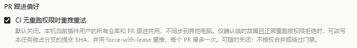
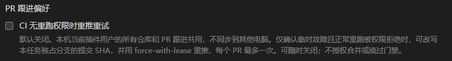
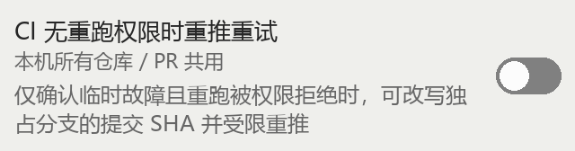
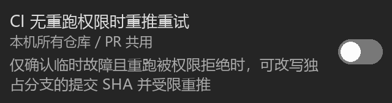

<a href="github-ci-retry-2026-11-13.zh-CN.md">简体中文</a> · <strong>English</strong>

# GitHub CI recovery evidence — 2026-11-13

Environment: Cindy 0.1.136 Beta, Windows 10.0.26100, Node v22.22.3.
Only the isolated `local` GitHub development instance was installed/updated.
The marketplace instance and its preferences were left unchanged.

## Actual desktop observation: 1.5.14 / 209ef92

The PR card enabled the preference; the live tool returned `true`. The settings
page displayed it checked, then disabled it; the live tool returned `false`.
Clicking Disable on a stale card that still displayed On kept the value false;
the card redrew Off, and refreshing `pr_card` also returned false.
Light/Dark were observed in Cindy. The original light theme and the disabled
development preference were restored. A later foreground activation was refused
by Windows; no input was sent. No further desktop input was attempted after lock.

These are cropped actual screenshots from **1.5.14**, including its older,
longer wording and former per-PR limit. They are not current-version screenshots.
Only the control and its explanation remain; account, task list and chat are
excluded. Image metadata is not retained.

| Actual settings page | Actual PR card |
| --- | --- |
|  |  |
|  |  |

In 1.5.17 the account-settings preference control, KV reads and dedicated
readiness/write messaging were removed. These old settings-page observations
are historical, not a current entry point or an outstanding cold-start test.
The card's persistence and explicit target action paths are unchanged; their
evidence remains applicable. Changed recovery rules need their own evidence.

## Current wording: generated 1.5.16 preview

These images are generated copy/layout previews, **not live Cindy or phone
screenshots**. The explanation stays one sentence; an adjacent scope label says
all repositories/PRs on this computer share the preference. The scope is also
included in the card's accessible name. The four-language card layout is
unchanged in 1.5.17; the plugin account-settings page no longer has this control.

| Generated narrow light | Generated narrow dark |
| --- | --- |
|  |  |

## Verified GitHub normal rerun

Isolated [test PR #1](https://github.com/yan-xdt/cindy-official-plugins/pull/1)
added only a controlled workflow. The first attempt deliberately failed.
The plugin's normal rerun produced
[run 43421933262, attempt 2: success](https://github.com/yan-xdt/cindy-official-plugins/actions/runs/43421933262),
without changing head `1296be40`. The test PR was closed, never merged; its
branch and run are retained. This was a deliberate fixture failure, not a
diagnosis of an infrastructure fault. The owner account has rerun rights, so no
real permission denial or CI-only rewrite occurred.

## Review invariants and signature checks

The scope-disclosure invariant is that every CI-retry choice names its shared
scope before selection, on every PR card. Preference writes still have
one owner: the existing main-page PR queue. The signature invariant is that an
originally signed head never authorizes an unsigned replacement push. The Agent
reads the existing Git configuration; it does not change signing identities,
keys or verification policy to make recovery eligible.

| Observed state/event | Required action |
| --- | --- |
| Signed original, signature invalid/unknown or automatic signing disabled | Stop before budget consumption or amend |
| Signed original, signing readiness unknown/key unavailable/interaction required | Stop; never fall back to unsigned |
| Signed original, existing noninteractive signing succeeds | Verify new signature before push |
| Replacement signature missing/invalid/unknown | Leave it unpushed; report outcome |
| Unsigned original | Apply every existing recovery condition |
| Preference disabled or unreadable before amend/push | No CI-only rewrite/push |

The isolated real Git fixture uses a generated, test-only SSH signing key. It
checks one-off `-S` with automatic signing off, successful verification after a
configured signed amend, unchanged tree, and failure without head movement when
the signing key is unavailable. It does not establish GitHub Verified status or
prove an Agent followed these instructions on a live recovery.

In 1.5.17, quota receipts move to durable user data; observation/trace cache
stays disposable. The gate is the sole receipt writer and exclusively adopts
matching older cache evidence, without overwriting durable receipts. The CLI
fixture verifies that removing or changing the cache cannot reopen the same
failure's budget, and that an older cache receipt cannot replace durable evidence.
Migration cannot recover evidence that had already been deleted before upgrade.

## Remaining prerequisites

- Actual phone display. The deleted settings-page preference handshake no
  longer requires cold-start acceptance; it is absent, not claimed tested.
- Disabled preference observed in an actual scheduled follow-up round.
- A real eligible permission-denied rerun through signed/unsigned recovery,
  exact leased push, original PR head read-back and actual CI triggering.
- The maintainers' explicit decision on the branch-rewrite scope, now one
  attempt per diagnosed failure with no PR-wide cap. The
  [maintainer's original comment](https://github.com/makecindy/cindy-official-plugins/pull/332#issuecomment-6850756870)
  promises a later decision; it is not approval.

Local fixtures/generated previews do not replace these prerequisites. Fork CI
approval remains a maintainer action. No merge, publishing, permission changes
or changes to makecindy/cindy#10355 were performed.
