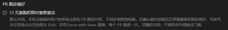
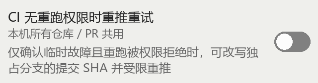
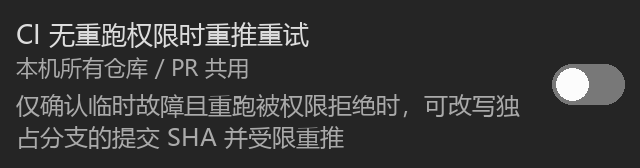

<strong>简体中文</strong> · <a href="github-ci-retry-2026-11-13.md">English</a>

# GitHub CI 恢复运行证据 — 2026-11-13

环境：Cindy 0.1.136 Beta、Windows 10.0.26100、Node v22.22.3。
仅安装/更新隔离的 `local` GitHub 开发实例，市场版及其偏好保持原样。

## 追加真机验收 — 1.5.19 / 97d540e

2026-11-13 18:09 UTC（2026-11-14 02:09 +08:00），经明确授权，Cindy Forge
把已有 `_ns__local__cindy-github` 原位更新到 1.5.19，返回 `action: updated`、
`enabled: true`、`namespace: local`。未覆盖市场版。实测包源码为 97d540e，
后续对本记录的修改不改变该包内容。

- 更新前后实时设置完全一致：`auto_rename:false, auto_follow:true,
  ci_retry_repush:true`。这是更新前已有值，Agent 没有开启开关。账号状态仍为
  ready，市场实例保留。
- iPhone 现场操作者打开 local [隔离 PR #1](https://github.com/yan-xdt/cindy-official-plugins/pull/1)
  的设置，核对重推开关、共用范围和 SHA 说明；浅色、深色均反馈显示完整，
  无横向溢出，开关保持不动。这是手机现场人工观察，不是生成图、浏览器窄屏
  仿真或 Agent 截图。未读取手机客户端版本；本轮没有采集或上传整屏/私人图片，
  也未覆盖故障注入后的未知态界面。
- 通过实际安装的 local 插件正常 rerun
  [run 43421933262](https://github.com/yan-xdt/cindy-official-plugins/actions/runs/43421933262)，
  收到接受回执，随后回读为 **attempt 3、completed/success**；job
  `controlled-check` 132072958905 的所有步骤成功。原测试 PR 保持 closed、未合并，
  head 仍为 `1296be40f2082aa1e8bc01cb7f5d078beba533a1`，未尝试改写分支。

这是实际 Cindy/手机显示及 GitHub 正常重跑证据，**不是真实权限拒绝后的恢复验收**。
仓库元信息确认，当前隔离仓库账号有 `admin`、`maintain`、`push` 权限，不能提供
真实 rerun 拒绝。夹具是受控测试，不是已诊断的基础设施故障。本轮未通过修改凭证、
权限、真实偏好或生产分支来制造资格。真实拒绝 → 受限改写 → 原 PR 新 SHA/CI，
以及该恢复过程中关闭生效，仍未验证；对应验收线程继续保留。

## 真实桌面观察：1.5.14 / 209ef92

在 PR 卡片开启后，实时工具返回 `true`；设置页显示勾选，关闭后工具返回 `false`。
旧卡片仍显示开启时点击“关闭”，全局值保持 false、卡片更新为关闭；刷新
`pr_card` 也返回 false。Light/Dark 均在真实 Cindy 中观察，结束后恢复原 light
主题并关闭开发版开关。后续 Windows 拒绝激活窗口，该次未发送输入；锁屏后没有
再尝试桌面输入。

以下是 **1.5.14 的真实裁图**，其中保留当时较长文案及旧的每 PR 次数限制，
不代表当前版本界面。只保留控件及说明，已去掉账号、任务列表和聊天内容，不保留图片元数据。

| 真实设置页 | 真实 PR 卡片 |
| --- | --- |
|  |  |
|  |  |

1.5.17 已移除账号设置页的 PR 控件、KV 读取及专用就绪/写入通信。上述设置页观察
是历史记录，不代表当前入口，也不再是待验收的冷启动路径。卡片持久化及明确目标的
action 处理未改，可复用卡片证据；改变的恢复规则仍需各自对应证据。

## 当前文案：1.5.16 生成预览

以下图片为生成的文案/布局预览，**不是真实 Cindy 或手机截图**。
说明仍为一句，标题旁单列“本机所有仓库 / PR 共用”，卡片无障碍名称也包含范围。
卡片有四语言文案，1.5.17 卡片布局保持不变；插件账号设置页已无该控件。

| 生成的窄屏浅色预览 | 生成的窄屏深色预览 |
| --- | --- |
|  |  |

## 真实 GitHub 正常重跑

隔离[测试 PR #1](https://github.com/yan-xdt/cindy-official-plugins/pull/1) 只增加受控
workflow，首次故意失败。插件正常 rerun 后，[run 43421933262 的 attempt 2 为
success](https://github.com/yan-xdt/cindy-official-plugins/actions/runs/43421933262)，
head 仍为 `1296be40`。测试 PR 已关闭、未合并；分支和运行保留供核验。
这是假定条件明确的测试夹具，不冒充基础设施故障诊断。当前账号有 rerun 权限，
未出现真实权限拒绝，未执行 CI-only 改写。

## 审查不变量与签名检查

范围披露不变量：每张 PR 卡片在用户选择前都展示共用范围。偏好写入仍由现有主逻辑页
PR 队列单独负责。签名不变量：原 head 已签名时，不能推送未签名的替代提交。
Agent 只读已有 Git 配置，不通过更换签名身份、密钥或放宽验签策略取得资格。

| 观察到的状态或事件 | 要求的行为 |
| --- | --- |
| 原提交已签名，但原签名无效/未知或自动签名关闭 | 占用额度和 amend 前停止 |
| 原提交已签名，但签名准备状态未知、密钥不可用或需交互 | 停止，不降级为无签名 |
| 原提交已签名，已有配置可无交互完成重签 | 推送前验证新签名 |
| 替代提交签名缺失/无效/未知 | 保留本地不推送，如实报告 |
| 原提交未签名 | 仍适用全部既有恢复条件 |
| amend/push 前偏好关闭或不可读 | 不执行 CI-only 改写/推送 |

隔离的真实 Git fixture 使用即时生成的测试 SSH 密钥，检查单次 `-S` 签名与自动
签名关闭、按已有配置 amend 后验签通过及 tree 不变、密钥不可用时失败且 head
不变。不把它当作 GitHub Verified 状态证明，也不证明 Agent 已在真实恢复中执行。

1.5.17 把次数回执迁到用户持久数据目录，观察/trace 缓存仍可清理。gate 是唯一
回执写者，排他迁移匹配的旧缓存证据，不覆盖已有持久记录。真实 CLI fixture 验证
清空或更换缓存不能恢复同一故障的次数，旧缓存也不能替换已有持久记录。升级前
已经删除的证据无法通过迁移恢复。

## 偏好展示不变量 — 1.5.18

未知状态不能显示为确认关闭。仍只有现有主逻辑页队列写偏好，不新增缓存、重试或
协调器；卡片和 Agent 工具都从同一已知/不可读状态投影。所有偏好操作（包括非 CI
偏好）结束时统一回读一次，“刷新 PR 设置”只读。

| 读取/写入事件 | 展示或结果 |
| --- | --- |
| 有效读取，CI 字段缺失或 false | 已知关闭，显示明确的开启动作 |
| 有效读取，CI 字段 true | 已知开启，显示明确的关闭动作 |
| 读取失败或根存储格式无效 | 显示未知说明和只读刷新，不提供开关/模型选项 |
| PUT 响应未确认，回读成功 | 显示当前值及保存结果未确认提示，不重复 PUT |
| PUT 响应未确认，回读失败 | 未知面板，不声称授权已关闭或写入未执行 |
| PUT 成功，后续回读失败 | 显示未知，不乐观确认 |
| 刷新恢复 | 显示新的已知状态，不写入、不启动 Agent 或 Git |

四项仓库规定测试与插件测试合跑：306 通过、19 跳过、0 失败，耗时 132.1 秒，
环境为上文的 Windows/Node。最终三项定向回归也通过，包含 PUT 成功后回读失败；
本轮没有安装新包。
三个生产入口回归测试先在 195cfc4 上复现失败，再验证修复。覆盖读取失败后恢复、
无效根 JSON，以及开启、关闭和修改其他偏好时已落盘却抛出/拒绝响应、回读不可用。
这些是模拟宿主回归，不冒充真实 Cindy 故障注入。桌面/手机的实际未知态 UI 尚未
验收；正常已知状态的文案与布局未改。

## 固定总上限不变量 — 1.5.19

本机同一不可变 PR ID 最多两次成功 CI-only 额度预留，同一稳定诊断最多一次。
gate 持有两个排他持久名额，每个只写一次，不过期、不退款、不清除。它替代新诊断
逐个分配回执的方式，不增加锁、调度器或 Git 重试。新预留与旧证据迁移共用同一
名额分配和验证入口。

| 事件 / 旧记录 | 预期行为 |
| --- | --- |
| 第一 / 第二个不同故障 | Git 前消费一个剩余名额，返回对应 head/诊断 |
| 第三个不同故障 | 不论诊断如何，拒绝、停止并报告 |
| 同一故障换 SHA 或 URL | 拒绝，不再占用名额 |
| 同故障 / 不同故障并发 | 每故障最多一个成功预留，PR 总成功预留最多两个 |
| 旧缓存/持久诊断回执 | 把当前 PR 所有诊断计入两个名额，不覆盖原件 |
| 旧记录超过两次、损坏/半写/身份未知 | 保守失败，不重置或取得新次数 |
| 崩溃、推送失败、清缓存或重启 | 已用名额保留，只读 status 用于核对结果 |

三项新增/扩展 CLI 回归先在 754f1fe 上失败；定向套件修复后 13 项通过，包含旧回执
迁移与真实 Node 跨进程并发。这是隔离本地额度/Git 证据，不替代真实 GitHub 权限
拒绝后的恢复验收。该次 CLI 检查时尚未安装 1.5.19；后续真实安装见前文追加记录。
四项仓库规定测试与插件测试合跑：310 通过、19 跳过、0 失败，106.5 秒，环境为
上文 Windows/Node。状态/帮助文案更新后的最终 CLI 定向套件 13 项通过，5.1 秒；
Git fixture 仍是本地证据，不冒充 GitHub 恢复实测。

## 同步主干 — 源码 1.5.20（2026-11-14）

在现有功能分支合入 main `0410e4862d18b47083aafcb8f381c793a1373b60`。
同时保留主干的基线等待退避、基线移动处理，以及本 PR 的受限恢复额度。
清单/版本断言冲突通过源码升至 1.5.20、认证契约测试不硬编码发布版本解决；
没有新增重试机制或权限。

本机 local 实例仍为 1.5.19；未安装 1.5.20，也未在手机验收这个新版本。
1.5.20 的 main.js 与偏好界面相较 1.5.19 未变，已有正常显示证据可用于这些
未变路径。合并后等待/恢复脚本的本地测试与真实运行证据分开记录；下述真实
权限拒绝恢复的前提仍未满足。

合并后四项规定仓库测试与 GitHub 插件测试合跑：313 通过、19 跳过、0 失败，
耗时 110.0 秒，环境仍为上文 Windows/Node。覆盖继承的基线等待退避、基线移动
场景，以及已有恢复额度和 Git fixture。

## 合入主干复制链接 — 源码 1.5.21（2026-11-14）

在现有分支合入 main `2bc837d71b785b1ceb5ce178520dd2b1db9aa9cf`。
同时保留主干由宿主处理、默认隐藏的 PR 复制链接按钮，以及本 PR 四语言的
偏好未知态/刷新说明。标题行组合调整继承自主干；偏好存储、实时读取及受限恢复
规则未改，源码版本为 1.5.21。

本机 local 仍为 1.5.19。与此前 1.5.20 同步不同，本轮会改变 main.js 的卡片渲染，
因此此前手机验收不能证明新标题行/复制链接行为。本轮没有安装新包，也没有新增
真实剪贴板或手机观察；本地卡片回归不冒充设备证据，真实恢复验收前提继续保留。

合并后四项规定仓库测试与插件测试合跑：314 通过、19 跳过、0 失败，107.4 秒，
环境为上文 Windows/Node。包含继承的复制链接卡片测试，以及既有偏好/回读和
受限恢复回归。

## 剩余验收与决定

- 正常手机显示已通过上文 1.5.19 人工真机验收；故障注入后的未知态界面未验证。
  设置页偏好握手已删除，不再要求验收该冷启动路径。
- 实际调度读取关闭值已在 2026-11-13 13:21:38 UTC 记录于
  [这条回复](https://github.com/makecindy/cindy-official-plugins/pull/332#issuecomment-6854235302)。
  这是历史观察，不是当前改写授权或完整恢复测试。
- 真实合格的 rerun 权限拒绝，经签名/未签名恢复、精确 lease、原 PR head 回读及
  CI 实际触发的完整链路。
- [维护者的明确范围决定](https://github.com/makecindy/cindy-official-plugins/pull/332#issuecomment-6860544540)
  已确认同一故障一次、每 PR 累计两次，对应线程已解决；不等于未验收恢复路径
  获批，也不授权合并。

本地 fixture 和生成预览不能替代这些前提。fork CI 批准仍由维护者处理；未执行
合并、发布、改权限，也未修改 makecindy/cindy#10355。
