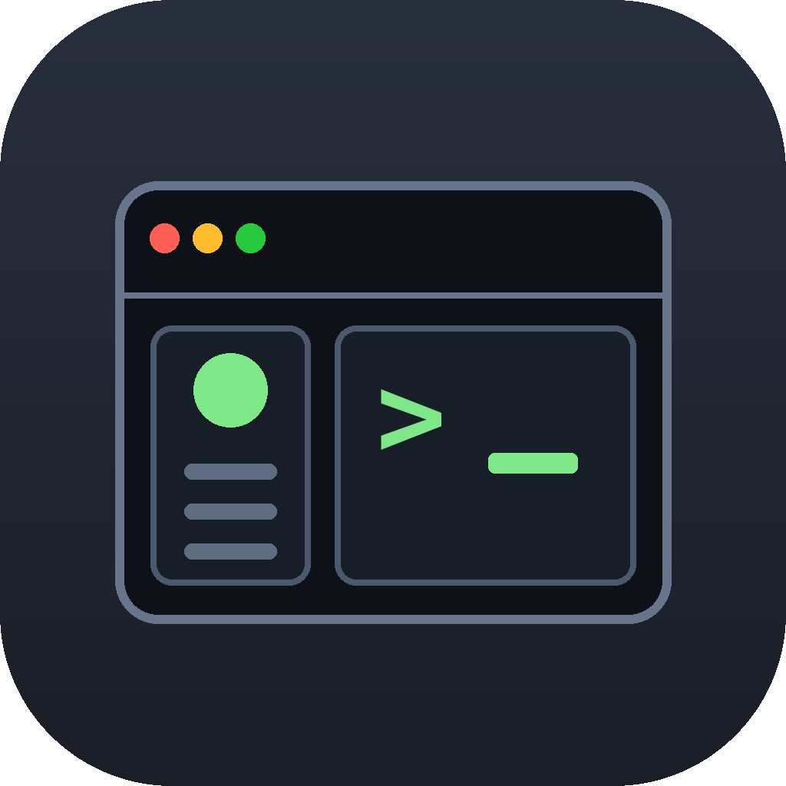

# Herdr Console

Connect Cindy to a local Herdr terminal workspace: inspect workspaces, tabs,
panes and agents, read the terminal output, drive agents, and turn Herdr events
into Cindy notifications and automations. It also covers local tmux sessions as
a second backend, so one plugin is enough for both terminal managers.

## What it does

- **Tools** — the agent can read Herdr state, read pane output, prompt agents,
  send keys, wait for states, manage workspaces/tabs/panes/worktrees, show
  Herdr toasts, and call any raw Herdr socket method. For tmux it can list
  sessions and panes, read a pane's screen (visible or the last N lines of
  scrollback), and send literal text or named keys.
- **Panel** — a live list of workspaces, panes and agent states on the right
  side; click a pane to read its output and type back into it. A Herdr / tmux
  switcher in the toolbar shows tmux sessions and panes the same way.
- **Event bridge** — subscribes to Herdr events; blocked/done transitions raise a
  Cindy toast and an unread badge, and can wake a Cindy automation through a
  webhook so Cindy stops polling. The subscription is rebuilt when panes are
  created or closed and reconnects on its own after Herdr restarts.

## Limits

- Long waits (`herdr_wait`, `herdr_prompt` with `wait_until`) run in bounded
  segments under one `timeout_ms` budget and fail when that budget runs out.
- `tmux_send` with `keys` accepts key names only (`"Enter"`, `"C-c"`); values
  containing separators or starting with `-` are rejected, so a key press can
  never turn into another tmux command.
- The panel follows the Cindy host language and falls back to English.

## Requirements

- Herdr 0.9.5 or newer running on the same machine.
- The Herdr socket under the user config directory (herdr.sock), or the path
  given by HERDR_SOCKET_PATH.
- tmux on the machine's `PATH` for the tmux half. If tmux is missing the tools
  return `available: false` with a hint instead of failing, and the panel says
  so — nothing else breaks.

## Setup

Install the plugin, then ask the agent to look at what Herdr is running now. To
let Cindy react to terminal events without polling, call the
herdr_automation_setup tool once; it creates a webhook-triggered automation and
returns its id and receiving address.

## Privacy

The plugin runs a bundled Node worker with the permissions of your user
account. It talks only to the local Herdr socket, the local tmux executable,
and — when you set up the automation bridge — the webhook address shown in the
setup result.
