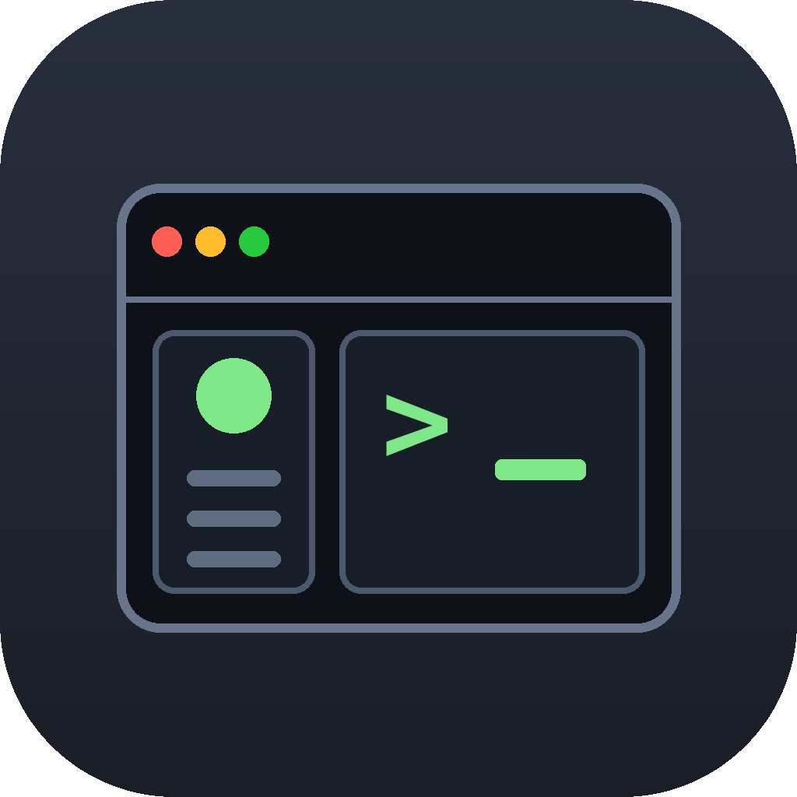

# Herdr 控制台

把本机 Herdr 终端工作区接进 Cindy：查看工作区、标签、分屏与 agent 状态，
读取终端画面，给 agent 派活，并把 Herdr 事件变成 Cindy 通知与自动化。同一套
插件也接管本机 tmux session 作为第二个后端，两种终端管理器用一个插件就够。

## 边界

- 长等待（`herdr_wait`、`herdr_prompt` 带 `wait_until`）会在同一个 `timeout_ms`
  预算内拆成多段执行，预算用完仍未命中就报错。
- `tmux_send` 的 `keys` 只接受键名（`"Enter"`、`"C-c"`）：含分隔符或以 `-` 开头的
  值会被拒绝，按键不会变成另一条 tmux 命令。
- 面板文案跟随 Cindy 宿主语言，宿主语言插件不支持时回退英文。

## 能做什么

- **工具** —— AI 可以读 Herdr 状态、读分屏输出、给 agent 发提示、发送按键、
  等待状态变化、管理工作区/标签/分屏/worktree、在 Herdr 里弹通知，也能直接
  调用任意 Herdr socket 方法。对 tmux 则可以列出 session 与 pane、读取某个
  pane 的画面（当前可见屏，或回滚缓冲区里最近 N 行）、发送字面文本或命名按键。
- **面板** —— 右侧栏实时列出工作区、分屏与 agent 状态，点一下可看画面并直接
  输入。工具栏上的 Herdr / tmux 切换用同样的方式列出 tmux 的 session 与 pane。
- **事件桥** —— 订阅 Herdr 事件，agent 进入 blocked 或 done 时弹 Cindy 轻提示
  并点亮未读角标；同时请宿主调度器跑一次 Cindy 自动化，让 Cindy 不用再定时
  轮询。插件不持有也不外发任何 Webhook 地址，投递由宿主完成。

## 使用前提

- 同机运行 Herdr 0.9.5 或更新版本。
- Herdr socket 位于用户配置目录下（herdr.sock），或用 HERDR_SOCKET_PATH 指定。
- tmux 那半需要本机 `PATH` 里有 tmux。没装时 tmux 工具返回 `available: false`
  并带一句提示，面板也会写明，其余功能不受影响。

## 上手

装好插件后，直接说「看一下 Herdr 现在在跑什么」。如果希望 Cindy 在终端事件
发生时主动醒来而不用轮询，调一次 herdr_automation_setup 工具即可，它会创建
一条只在 Herdr 报告 agent blocked/done 时才运行的自动化（不按时间自己跑），
并返回 id。

## 权限说明

插件带一个随包 Node 工作进程，权限等同当前登录用户；它只访问本机 Herdr
socket 和本机 tmux 可执行文件，不建立任何网络连接——唤醒自动化走宿主调度器。

## 第三方标识

面板用各 agent 的官方图标来标识分屏里运行的是哪个 agent：Claude（`assets/agents/claude.svg`，Anthropic, PBC）、Codex（`assets/agents/codex.svg`，OpenAI, Inc.）、Cursor（`assets/agents/cursor.png`，Anysphere, Inc.）。图标未经修改，仅用于指认对应的 agent（指名使用），权利归各自所有者；同时已在仓库的 `TRADEMARKS.zh-CN.md` 登记。
